<div align="center">

# 🚀 Awesome AI Tools

**English** ｜ [中文](./README.zh-CN.md)

**See what AI can do — a discovery gallery of AI works and tools**

LLMs / Agents / Coding / Image / Audio & Video<br>
**57** playable AI works · **1668** AI tools · **29** open-source projects · **36** categories
[](https://awesome.re) [](https://github.com/Rvelamen/Awesome-AI-Tools)

⭐ If this list helps you, please Star it so more people and agents can discover it

**[Full catalog on the website: search / filters / latest additions](https://rvelamen.github.io/Awesome-AI-Tools/)**

</div>

---

## AI Works

Games, 3D worlds and web pages built entirely by AI — open and play them right in your browser. Full gallery on the [AI Works page](https://rvelamen.github.io/Awesome-AI-Tools/showcase/).

<table>
  <tr>
    <td width="33%" valign="top">
      <a href="https://claude.ai/artifact/BGY1SztrAYcJQHSsnHHGmp"></a><br>
      <b><a href="https://claude.ai/artifact/BGY1SztrAYcJQHSsnHHGmp">Saltline — first-person shooter</a></b><br>
      <sub>An Anthropic engineer one-shot prompted an FPS in 8 hours (~$550); models, sounds and textures all generated in code</sub>
    </td>
    <td width="33%" valign="top">
      <a href="https://claude.ai/artifact/QGWUAjRrzRzZWGcQzSMLfa">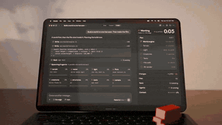</a><br>
      <b><a href="https://claude.ai/artifact/QGWUAjRrzRzZWGcQzSMLfa">Claude App on a Blender laptop</a></b><br>
      <sub>One prompt built the whole room in Blender and rendered it in 4K</sub>
    </td>
    <td width="33%" valign="top">
      <a href="https://what-the-water-keeps.vercel.app/"></a><br>
      <b><a href="https://what-the-water-keeps.vercel.app/">What the Water Keeps</a></b><br>
      <sub>A boat ride through 8 dreamlike worlds, playable in the browser</sub>
    </td>
  </tr>
</table>

---

## Contents

| | | |
| --- | --- | --- |
| 💬 [Chat Assistants](#chat-assistants) | 💻 [Coding Tools](#coding-tools) | 🔌 [MCP Services](#mcp-services) |
| 🤖 [Agents](#agents) | ⚡ [Productivity](#productivity) | 🎬 [Video Tools](#video-tools) |
| 🖼️ [Image Tools](#image-tools) | 🎨 [Image Generation](#image-generation) | 🎵 [Audio Tools](#audio-tools) |
| ✍️ [Writing Tools](#writing-tools) | 🎯 [Design Tools](#design-tools) | 🔍 [Search Engines](#search-engines) |
| 📊 [PPT](#ppt) | 📄 [Document Tools](#document-tools) | 🧠 [Models and Training](#models-and-training) |
| 🌐 [Translation](#translation) | 📈 [Spreadsheets](#spreadsheets) | 🧩 [Mind Maps](#mind-maps) |
| 🛍️ [Product Images](#product-images) | ✂️ [Background Removal](#background-removal) | 🔎 [Image Upscaling](#image-upscaling) |
| 🛠️ [Photo Enhancement](#photo-enhancement) | 🧹 [Object Removal](#object-removal) | 🧊 [3D Model Generation](#3d-model-generation) |
| 🕵️ [Content Detection](#content-detection) | 💡 [Prompt Engineering](#prompt-engineering) | 📚 [Learning Resources](#learning-resources) |
| 🎙️ [Meeting Tools](#meeting-tools) | 💼 [Career Tools](#career-tools) | ⚖️ [Legal Assistants](#legal-assistants) |

[Open-Source Projects](#open-source-projects) ｜ [Contributing](#contributing) ｜ [Disclaimer](#disclaimer) ｜ [License](#license)

---

### Chat Assistants

74 tools · [View all](https://rvelamen.github.io/Awesome-AI-Tools/category/聊天助手/)

<table>
  <tr>
    <td width="16%" valign="top">
      <a href="https://chat.openai.com">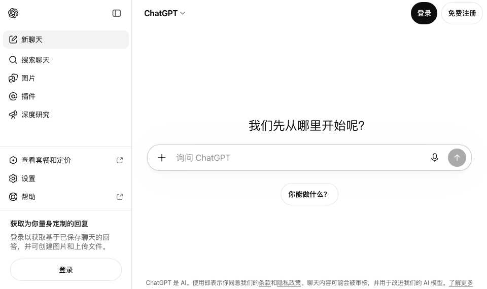</a><br>
      <b><a href="https://chat.openai.com">ChatGPT</a></b><br>
      <sub>OpenAI's AI chat assistant</sub>
    </td>
    <td width="16%" valign="top">
      <a href="https://claude.ai">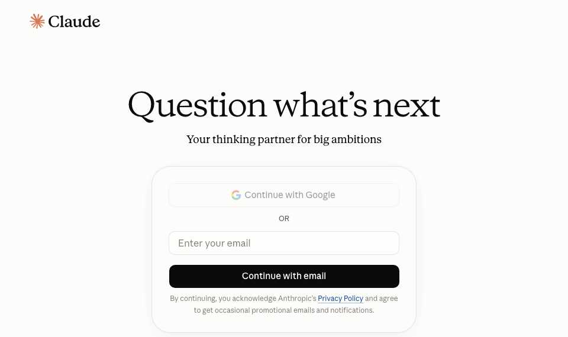</a><br>
      <b><a href="https://claude.ai">Claude</a></b><br>
      <sub>Anthropic's AI assistant</sub>
    </td>
    <td width="16%" valign="top">
      <a href="https://gemini.google.com"></a><br>
      <b><a href="https://gemini.google.com">Gemini</a></b><br>
      <sub>Google's AI chatbot</sub>
    </td>
    <td width="16%" valign="top">
      <a href="https://chat.deepseek.com/"></a><br>
      <b><a href="https://chat.deepseek.com/">DeepSeek</a></b><br>
      <sub>Open-source LLM and chat assistant by DeepSeek</sub>
    </td>
    <td width="16%" valign="top">
      <a href="https://www.doubao.com/chat"></a><br>
      <b><a href="https://www.doubao.com/chat">豆包</a></b><br>
      <sub>ByteDance's AI assistant (Doubao)</sub>
    </td>
    <td width="16%" valign="top">
      <a href="https://kimi.moonshot.cn/">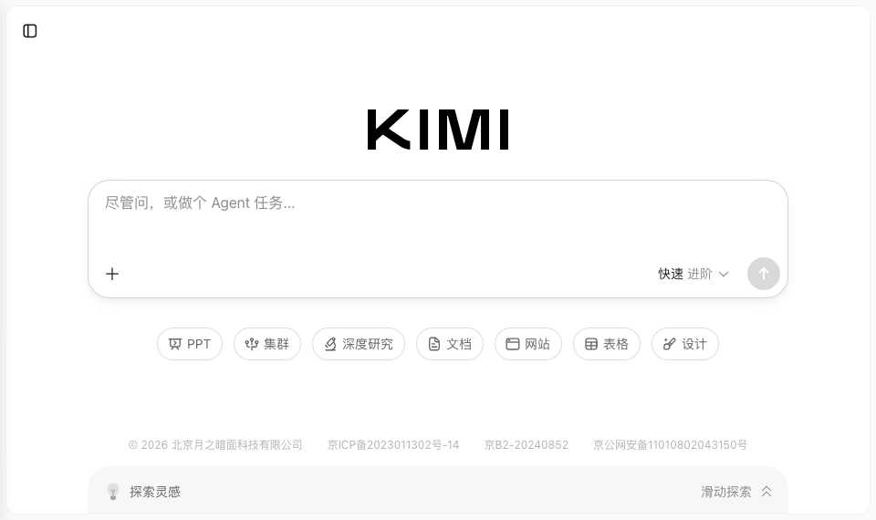</a><br>
      <b><a href="https://kimi.moonshot.cn/">Kimi智能助手</a></b><br>
      <sub>Moonshot AI's assistant with long-document reading and reasoning search</sub>
    </td>
  </tr>
</table>

---

### Coding Tools

202 tools · [View all](https://rvelamen.github.io/Awesome-AI-Tools/category/编程工具/)

<table>
  <tr>
    <td width="20%" valign="top">
      <a href="https://www.cursor.com">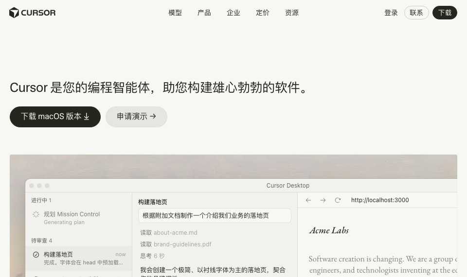</a><br>
      <b><a href="https://www.cursor.com">Cursor</a></b><br>
      <sub>AI code editor for faster programming and development</sub>
    </td>
    <td width="20%" valign="top">
      <a href="https://github.com/features/copilot">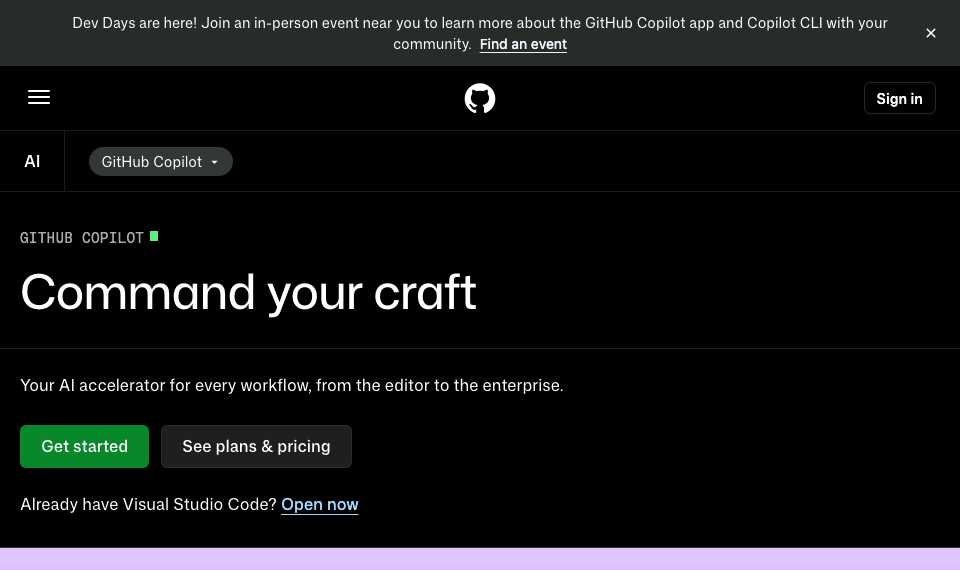</a><br>
      <b><a href="https://github.com/features/copilot">GitHub Copilot</a></b><br>
      <sub>GitHub's AI pair programmer</sub>
    </td>
    <td width="20%" valign="top">
      <a href="https://www.trae.com.cn/">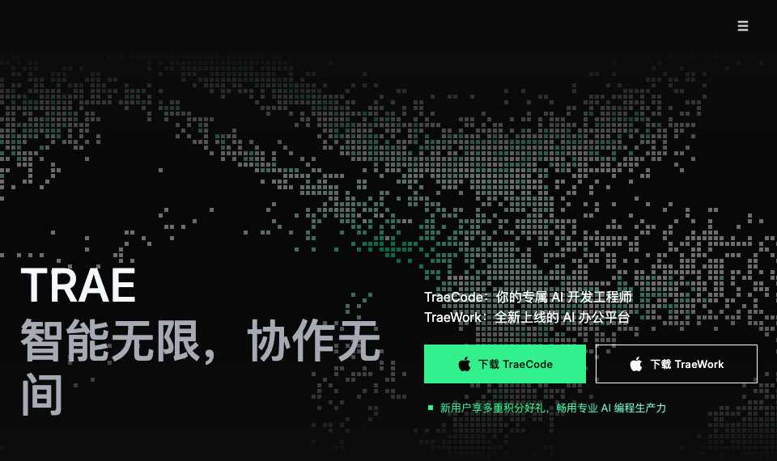</a><br>
      <b><a href="https://www.trae.com.cn/">Trae</a></b><br>
      <sub>ByteDance's AI IDE powered by Claude models</sub>
    </td>
    <td width="20%" valign="top">
      <a href="https://aws.amazon.com/codewhisperer/"></a><br>
      <b><a href="https://aws.amazon.com/codewhisperer/">CodeWhisperer</a></b><br>
      <sub>Amazon's AI coding assistant</sub>
    </td>
    <td width="20%" valign="top">
      <a href="https://comate.baidu.com"></a><br>
      <b><a href="https://comate.baidu.com">文心快码</a></b><br>
      <sub>Baidu's AI coding assistant (Comate), based on ERNIE</sub>
    </td>
  </tr>
</table>

---

### MCP Services

7 tools · [View all](https://rvelamen.github.io/Awesome-AI-Tools/category/MCP 服务/)

<table>
  <tr>
    <td width="33%" valign="top">
      <a href="https://neverapply.co/features/mcp">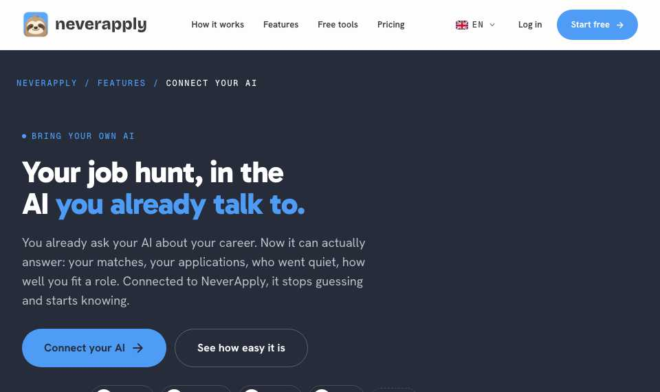</a><br>
      <b><a href="https://neverapply.co/features/mcp">NeverApply</a></b><br>
      <sub>Hosted job-hunting MCP server: job matching, resume tailoring, interview prep and application submission</sub>
    </td>
    <td width="33%" valign="top">
      <a href="https://www.corpusiq.io/">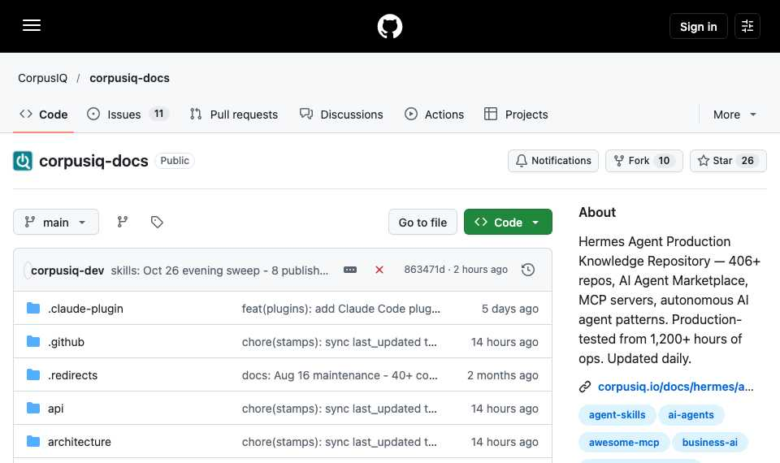</a><br>
      <b><a href="https://www.corpusiq.io/">CorpusIQ</a></b><br>
      <sub>Hosted business-data MCP server: 40+ connectors for Stripe, GA4, Shopify and more</sub>
    </td>
    <td width="33%" valign="top">
      <a href="https://vaneform.com/mcp">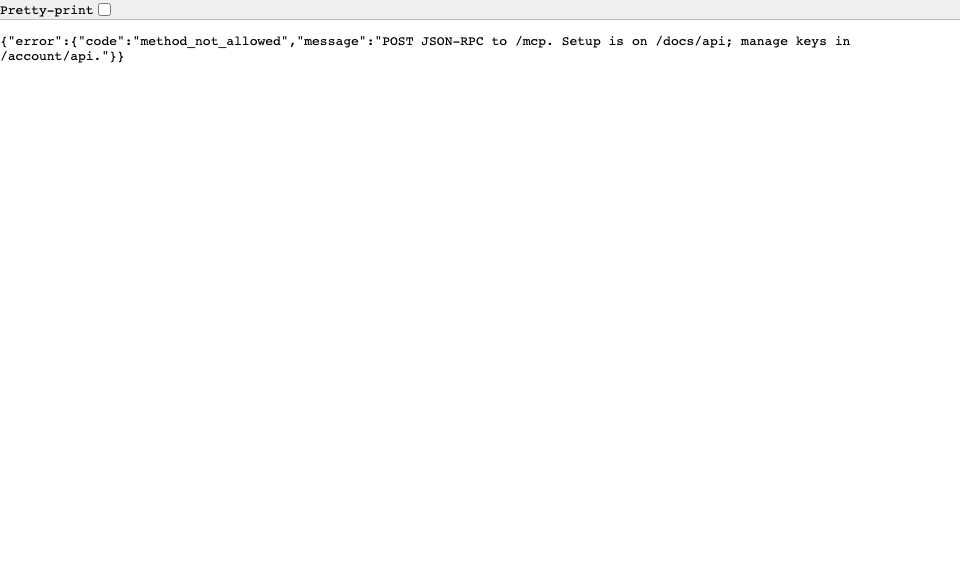</a><br>
      <b><a href="https://vaneform.com/mcp">Vaneform</a></b><br>
      <sub>Hosted website-traffic MCP: estimated visits, trends and sources for public domains</sub>
    </td>
  </tr>
</table>

---

### Agents

100 tools · [View all](https://rvelamen.github.io/Awesome-AI-Tools/category/智能体/)

<table>
  <tr>
    <td width="20%" valign="top">
      <a href="https://www.codebuddy.cn/work/">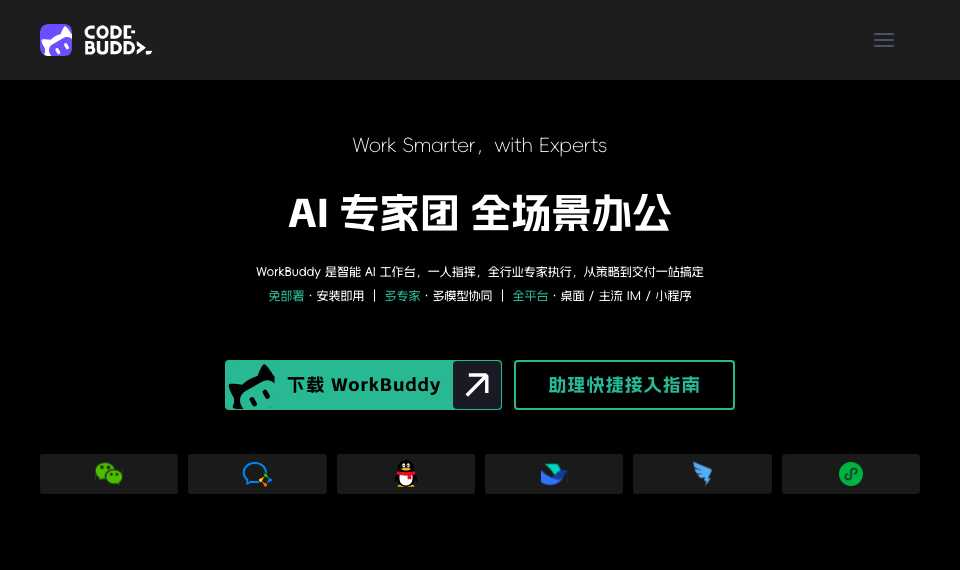</a><br>
      <b><a href="https://www.codebuddy.cn/work/">WorkBuddy</a></b><br>
      <sub>Tencent Cloud's AI-native desktop agent workspace</sub>
    </td>
    <td width="20%" valign="top">
      <a href="https://agent.xfyun.cn/home?ch=xcagent-aitool1">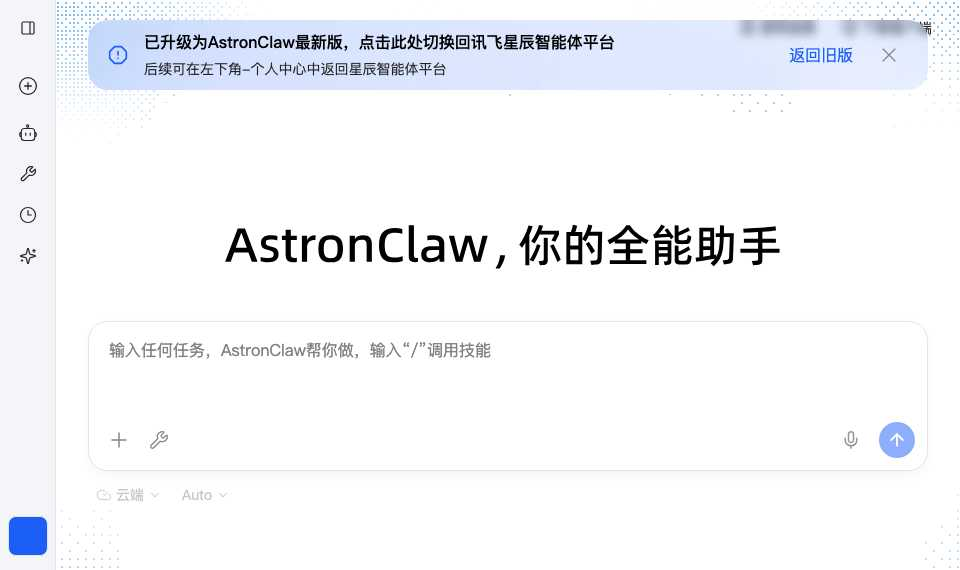</a><br>
      <b><a href="https://agent.xfyun.cn/home?ch=xcagent-aitool1">讯飞星辰Agent</a></b><br>
      <sub>iFlytek's AI agent development platform</sub>
    </td>
    <td width="20%" valign="top">
      <a href="https://promo.aipyaipy.com/">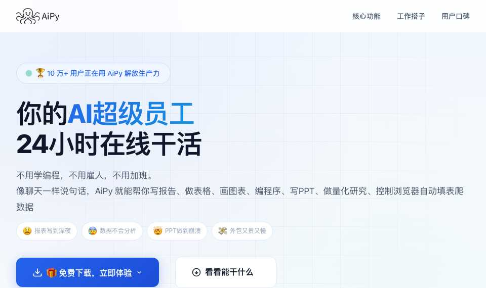</a><br>
      <b><a href="https://promo.aipyaipy.com/">爱派AiPy</a></b><br>
      <sub>Open-source local agent that also works on intranets (AiPy)</sub>
    </td>
    <td width="20%" valign="top">
      <a href="https://seko.sensetime.com/">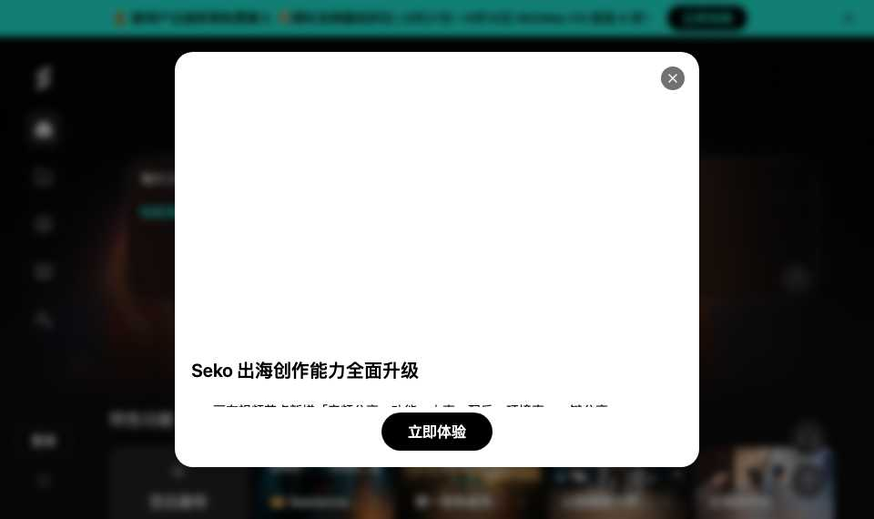</a><br>
      <b><a href="https://seko.sensetime.com/">Seko</a></b><br>
      <sub>SenseTime's AI video creation agent</sub>
    </td>
    <td width="20%" valign="top">
      <a href="https://atoms.dev/">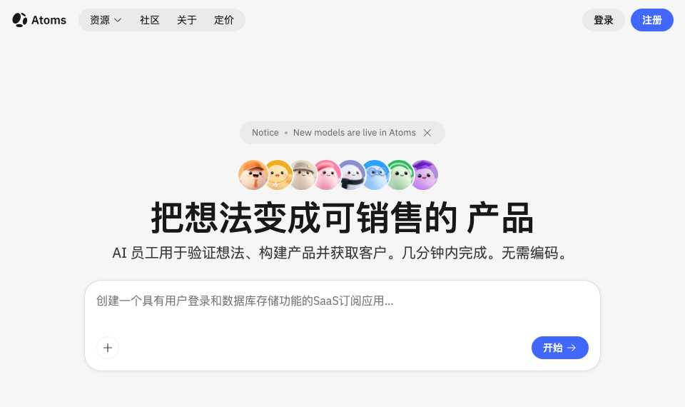</a><br>
      <b><a href="https://atoms.dev/">Atoms</a></b><br>
      <sub>An AI team that builds real businesses autonomously</sub>
    </td>
  </tr>
</table>

---

### Productivity

84 tools · [View all](https://rvelamen.github.io/Awesome-AI-Tools/category/效能工具/)

<table>
  <tr>
    <td width="11%" valign="top">
      <a href="https://manus.im">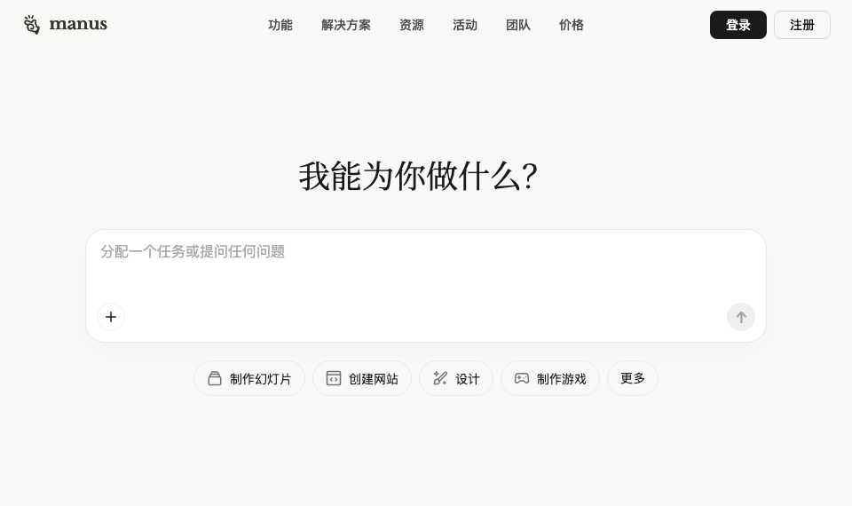</a><br>
      <b><a href="https://manus.im">Manus</a></b><br>
      <sub>General-purpose AI agent by the Monica team</sub>
    </td>
    <td width="11%" valign="top">
      <a href="https://monica.cn"></a><br>
      <b><a href="https://monica.cn">Monica</a></b><br>
      <sub>All-in-one AI assistant for chat, search, writing and translation</sub>
    </td>
    <td width="11%" valign="top">
      <a href="https://ima.qq.com"></a><br>
      <b><a href="https://ima.qq.com">ima.copilot</a></b><br>
      <sub>Tencent's AI workspace powered by Hunyuan</sub>
    </td>
    <td width="11%" valign="top">
      <a href="https://lingxi.wps.cn">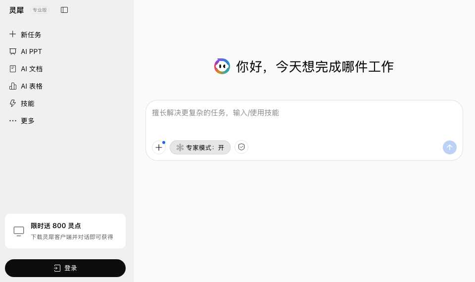</a><br>
      <b><a href="https://lingxi.wps.cn">WPS灵犀</a></b><br>
      <sub>WPS's AI office assistant for PPT generation and writing</sub>
    </td>
    <td width="11%" valign="top">
      <a href="https://tinywow.com/">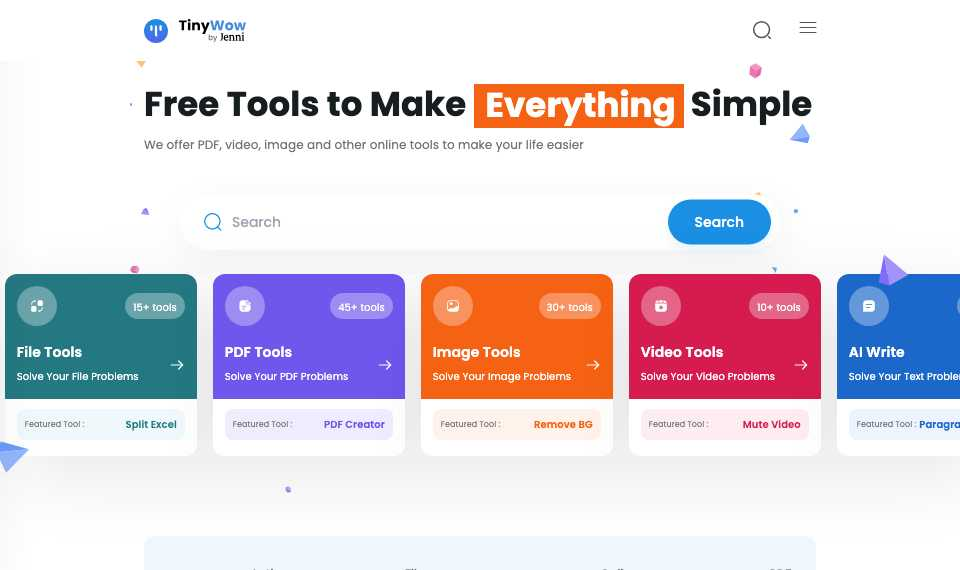</a><br>
      <b><a href="https://tinywow.com/">TinyWow</a></b><br>
      <sub>Free online AI toolbox</sub>
    </td>
    <td width="11%" valign="top">
      <a href="https://meetnewai.com">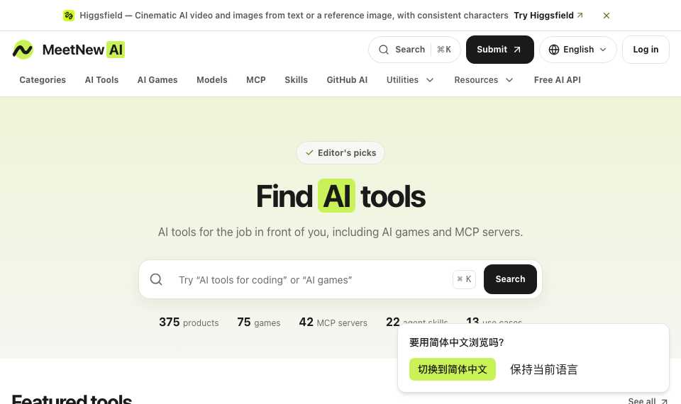</a><br>
      <b><a href="https://meetnewai.com">MeetNewAI</a></b><br>
      <sub>Bilingual directory of AI tools, games, MCP servers and skills, with an AI cost calculator</sub>
    </td>
    <td width="11%" valign="top">
      <a href="https://earlylore.com"></a><br>
      <b><a href="https://earlylore.com">EarlyLore</a></b><br>
      <sub>AI idea validator: competitors, demand, pricing, and entry angles against real products</sub>
    </td>
    <td width="11%" valign="top">
      <a href="https://alternativer.org/">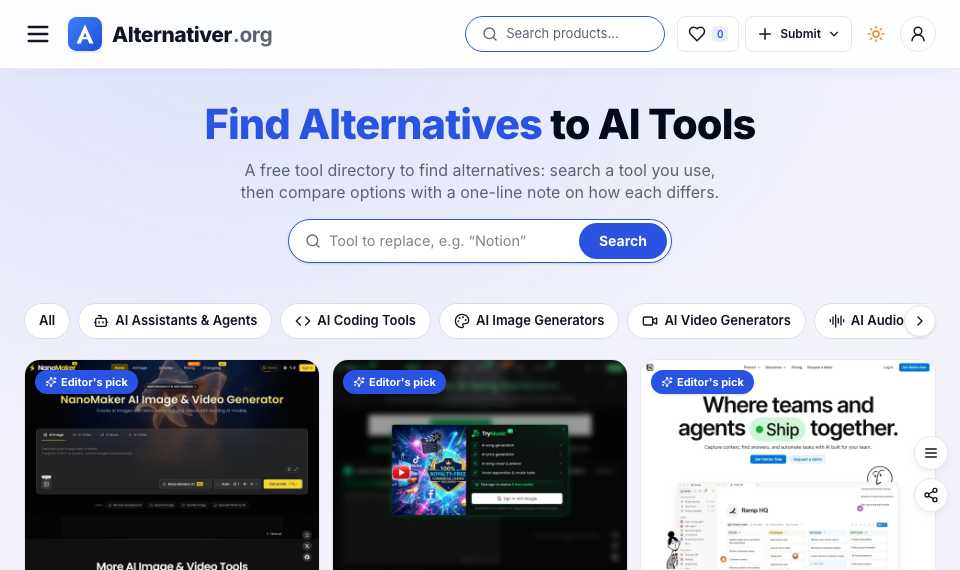</a><br>
      <b><a href="https://alternativer.org/">Alternativer</a></b><br>
      <sub>Editor-curated directory to find alternatives to AI tools, with one-line pricing and feature diffs</sub>
    </td>
    <td width="11%" valign="top">
      <a href="https://disconfirmai.com/en"></a><br>
      <b><a href="https://disconfirmai.com/en">DisconfirmAI</a></b><br>
      <sub>Investment research and reading platform that helps you seek disconfirming evidence before conviction</sub>
    </td>
  </tr>
</table>

---

### Video Tools

256 tools · [View all](https://rvelamen.github.io/Awesome-AI-Tools/category/视频工具/)

<table>
  <tr>
    <td width="20%" valign="top">
      <a href="https://klingai.kuaishou.com"></a><br>
      <b><a href="https://klingai.kuaishou.com">可灵AI</a></b><br>
      <sub>Kuaishou's AI image and video creation platform (Kling)</sub>
    </td>
    <td width="20%" valign="top">
      <a href="https://openai.com/sora">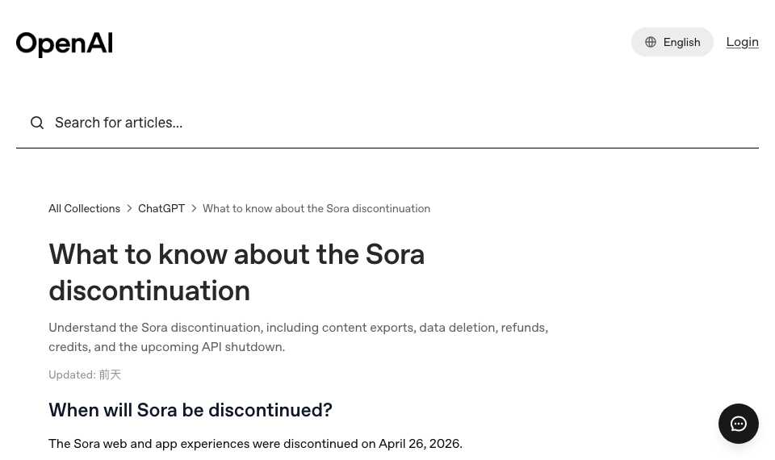</a><br>
      <b><a href="https://openai.com/sora">Sora</a></b><br>
      <sub>OpenAI's video generation model</sub>
    </td>
    <td width="20%" valign="top">
      <a href="https://www.vidu.cn"></a><br>
      <b><a href="https://www.vidu.cn">Vidu</a></b><br>
      <sub>ShengShu's AI video generation model</sub>
    </td>
    <td width="20%" valign="top">
      <a href="https://heygen.com">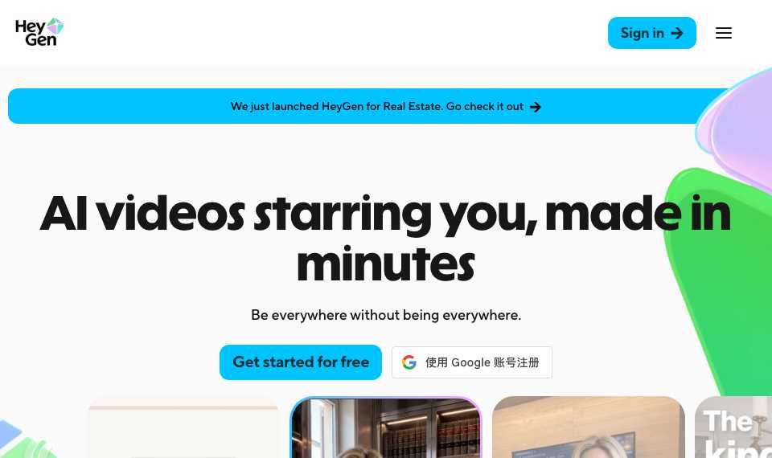</a><br>
      <b><a href="https://heygen.com">HeyGen</a></b><br>
      <sub>AI avatar video creation platform</sub>
    </td>
    <td width="20%" valign="top">
      <a href="https://aibrm.paluai.com/bairimeng"></a><br>
      <b><a href="https://aibrm.paluai.com/bairimeng">白日梦</a></b><br>
      <sub>AI video creation platform supporting videos up to six minutes</sub>
    </td>
  </tr>
</table>

---

### Image Tools

104 tools · [View all](https://rvelamen.github.io/Awesome-AI-Tools/category/图像工具/)

<table>
  <tr>
    <td width="20%" valign="top">
      <a href="https://www.midjourney.com/home">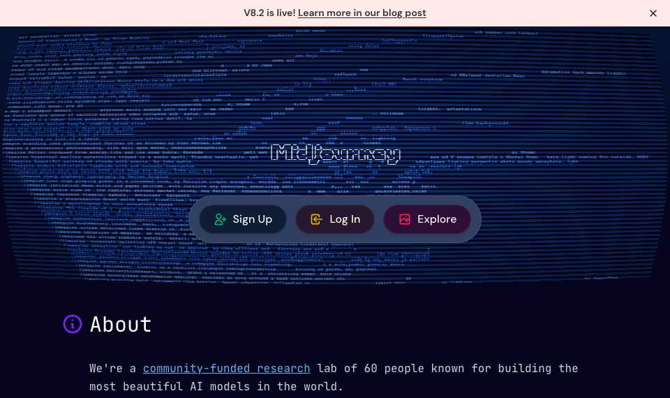</a><br>
      <b><a href="https://www.midjourney.com/home">Midjourney</a></b><br>
      <sub>AI image and art generation</sub>
    </td>
    <td width="20%" valign="top">
      <a href="https://jimeng.jianying.com/ai-tool/home"></a><br>
      <b><a href="https://jimeng.jianying.com/ai-tool/home">即梦</a></b><br>
      <sub>ByteDance's AI image creation tool (Jimeng)</sub>
    </td>
    <td width="20%" valign="top">
      <a href="https://tusiart.com">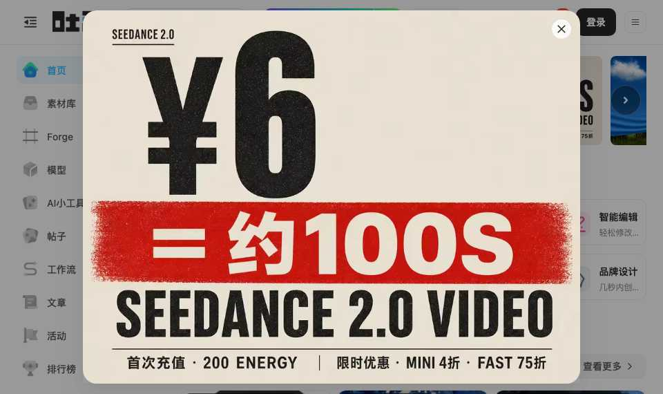</a><br>
      <b><a href="https://tusiart.com">吐司AI</a></b><br>
      <sub>AI art model community and online generation platform (TusiArt)</sub>
    </td>
    <td width="20%" valign="top">
      <a href="https://www.gaoding.com"></a><br>
      <b><a href="https://www.gaoding.com">稿定AI</a></b><br>
      <sub>All-in-one design toolkit: AI drawing, cutout and erasing (Gaoding)</sub>
    </td>
    <td width="20%" valign="top">
      <a href="https://artistrylab.net"></a><br>
      <b><a href="https://artistrylab.net">炉米Lumi</a></b><br>
      <sub>ByteDance's AIGC image creation platform</sub>
    </td>
  </tr>
</table>

---

### Image Generation

85 tools · [View all](https://rvelamen.github.io/Awesome-AI-Tools/category/图片插画生成/)

<table>
  <tr>
    <td width="25%" valign="top">
      <a href="https://civitai.com/">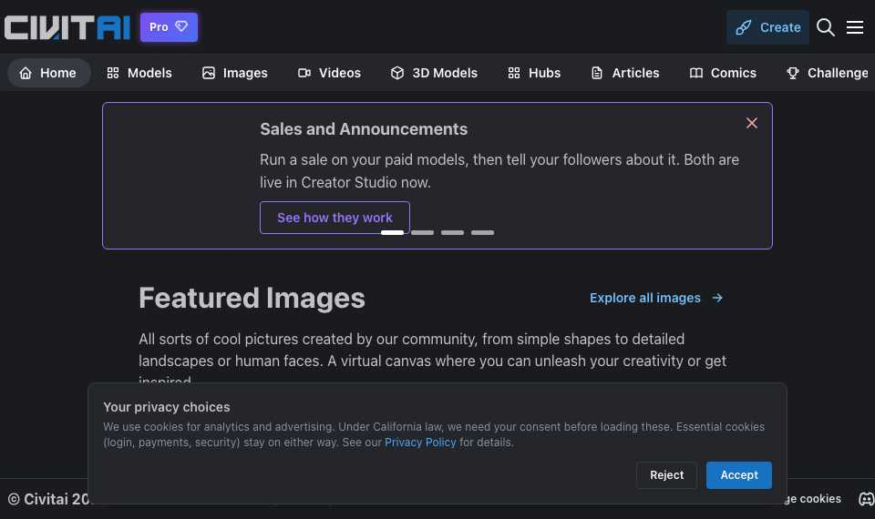</a><br>
      <b><a href="https://civitai.com/">Civitai</a></b><br>
      <sub>Community for sharing AI art and models</sub>
    </td>
    <td width="25%" valign="top">
      <a href="https://tongyi.aliyun.com/wanxiang"></a><br>
      <b><a href="https://tongyi.aliyun.com/wanxiang">通义万相</a></b><br>
      <sub>Alibaba's AI art generation model (Tongyi Wanxiang)</sub>
    </td>
    <td width="25%" valign="top">
      <a href="https://d.design"></a><br>
      <b><a href="https://d.design">堆友AI反应堆</a></b><br>
      <sub>Alibaba D.Design's multi-style AI art generator</sub>
    </td>
    <td width="25%" valign="top">
      <a href="https://miaohua.sensetime.com/inspiration"></a><br>
      <b><a href="https://miaohua.sensetime.com/inspiration">秒画</a></b><br>
      <sub>SenseTime's AI painting and image generation platform (Miaohua)</sub>
    </td>
  </tr>
</table>

---

### Audio Tools

97 tools · [View all](https://rvelamen.github.io/Awesome-AI-Tools/category/音频工具/)

<table>
  <tr>
    <td width="16%" valign="top">
      <a href="https://www.suno.ai"></a><br>
      <b><a href="https://www.suno.ai">Suno</a></b><br>
      <sub>High-quality AI music creation platform</sub>
    </td>
    <td width="16%" valign="top">
      <a href="https://www.haimian.com">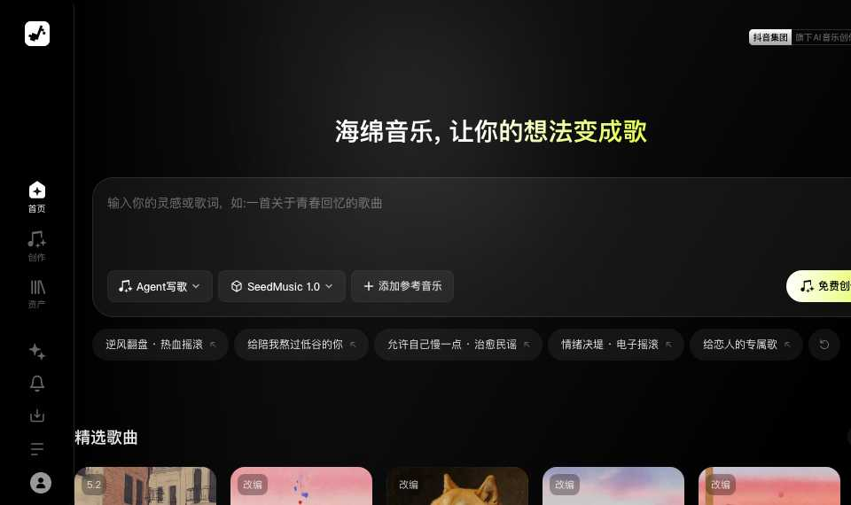</a><br>
      <b><a href="https://www.haimian.com">海绵音乐</a></b><br>
      <sub>ByteDance's AI music creation and discovery platform</sub>
    </td>
    <td width="16%" valign="top">
      <a href="https://www.moyin.com"></a><br>
      <b><a href="https://www.moyin.com">魔音工坊</a></b><br>
      <sub>AI voiceover tool with near-human voices</sub>
    </td>
    <td width="16%" valign="top">
      <a href="https://tingwu.aliyun.com">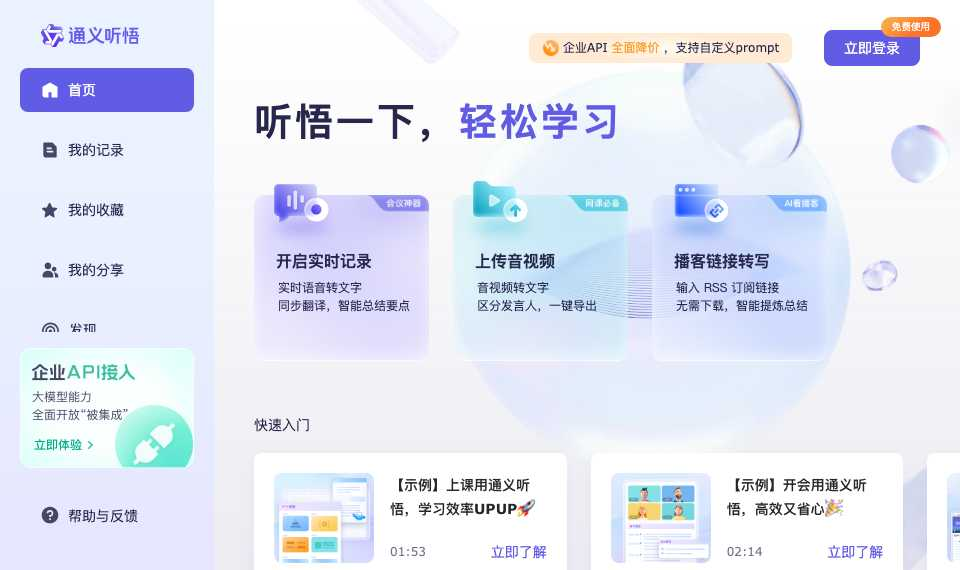</a><br>
      <b><a href="https://tingwu.aliyun.com">通义听悟</a></b><br>
      <sub>Alibaba's AI meeting transcription tool (Tingwu)</sub>
    </td>
    <td width="16%" valign="top">
      <a href="https://noiz.ai/landing"></a><br>
      <b><a href="https://noiz.ai/landing">Noiz AI</a></b><br>
      <sub>AI voiceover with text-to-speech and voice cloning</sub>
    </td>
    <td width="16%" valign="top">
      <a href="https://video2text.ttt.so">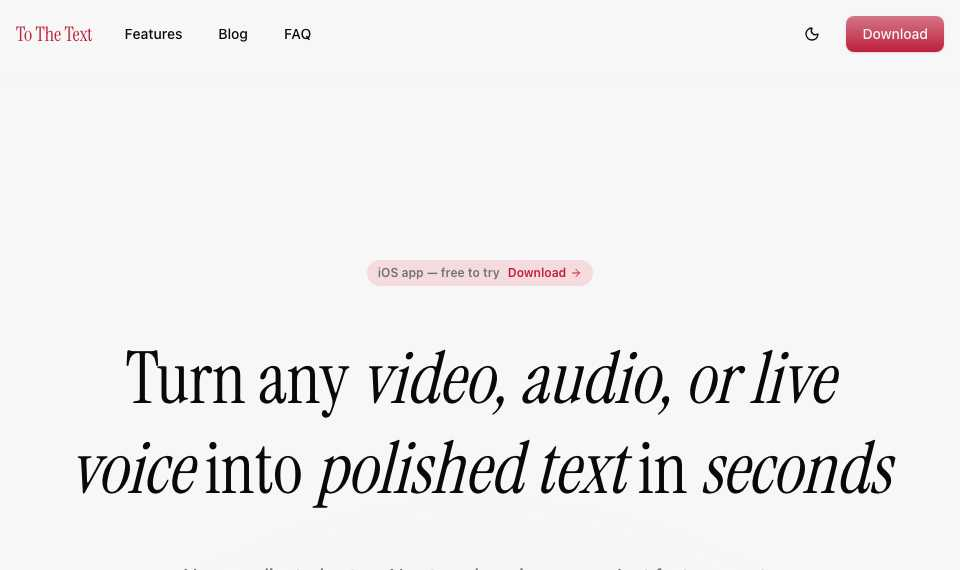</a><br>
      <b><a href="https://video2text.ttt.so">Transcribe Video: To The Text</a></b><br>
      <sub>iPhone app that turns video files, YouTube/Vimeo links, and live voice into text with speaker view, summaries, and TXT/DOCX export</sub>
    </td>
  </tr>
</table>

---

### Writing Tools

84 tools · [View all](https://rvelamen.github.io/Awesome-AI-Tools/category/写作工具/)

<table>
  <tr>
    <td width="20%" valign="top">
      <a href="https://laper.ai/">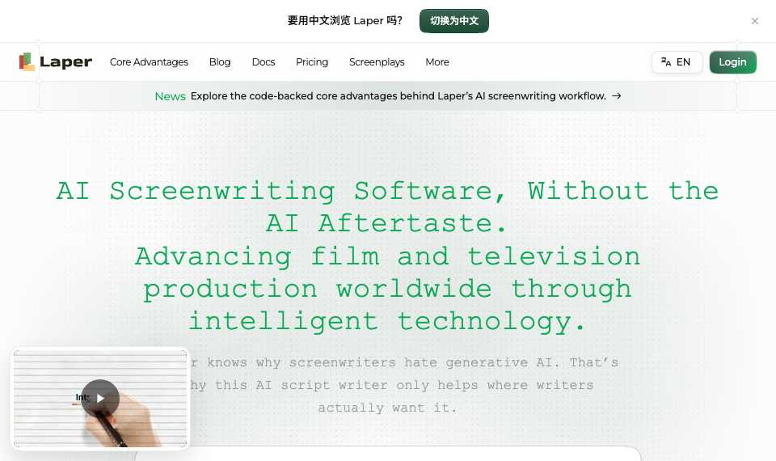</a><br>
      <b><a href="https://laper.ai/">Laper</a></b><br>
      <sub>AI-native screenwriting tool</sub>
    </td>
    <td width="20%" valign="top">
      <a href="https://www.jucloud.com/"></a><br>
      <b><a href="https://www.jucloud.com/">剧云</a></b><br>
      <sub>AI screenwriting platform for Chinese scripts</sub>
    </td>
    <td width="20%" valign="top">
      <a href="https://app.qinyanai.com/">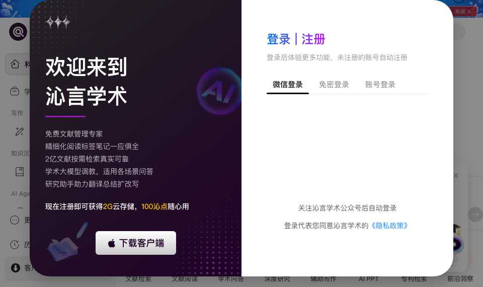</a><br>
      <b><a href="https://app.qinyanai.com/">沁言学术</a></b><br>
      <sub>AI academic writing platform with literature management</sub>
    </td>
    <td width="20%" valign="top">
      <a href="https://ibiling.cn/novel-workbench/"></a><br>
      <b><a href="https://ibiling.cn/novel-workbench/">笔灵AI小说</a></b><br>
      <sub>AI novel writing with outlines and material generation</sub>
    </td>
    <td width="20%" valign="top">
      <a href="https://mymmc.cn/?fromId=954f8p78">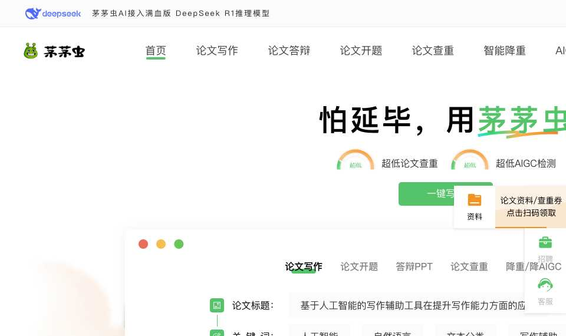</a><br>
      <b><a href="https://mymmc.cn/?fromId=954f8p78">茅茅虫</a></b><br>
      <sub>All-in-one AI academic paper writing assistant</sub>
    </td>
  </tr>
</table>

---

### Design Tools

98 tools · [View all](https://rvelamen.github.io/Awesome-AI-Tools/category/设计工具/)

<table>
  <tr>
    <td width="20%" valign="top">
      <a href="https://www.figma.com/ai">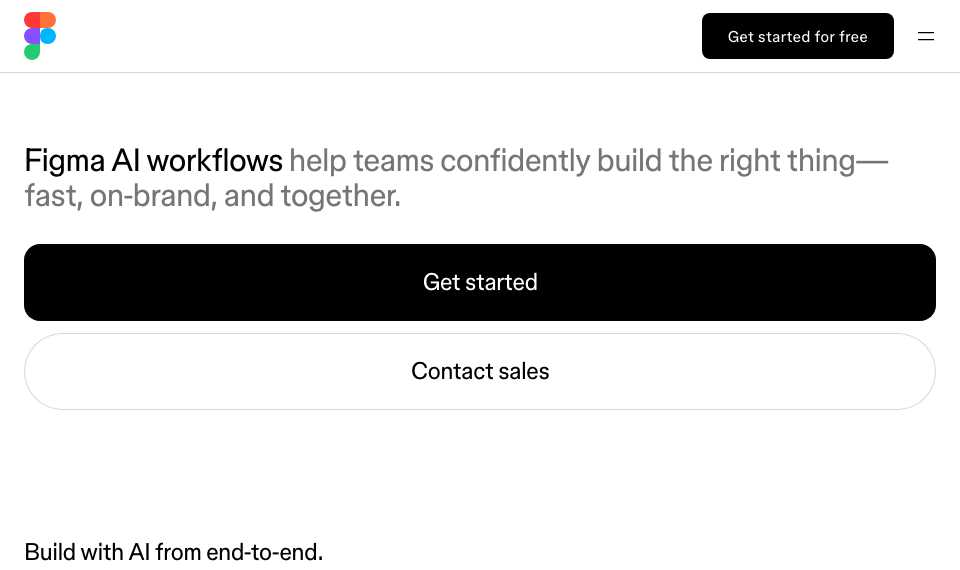</a><br>
      <b><a href="https://www.figma.com/ai">Figma AI</a></b><br>
      <sub>Figma's native AI design capabilities</sub>
    </td>
    <td width="20%" valign="top">
      <a href="https://www.recraft.ai">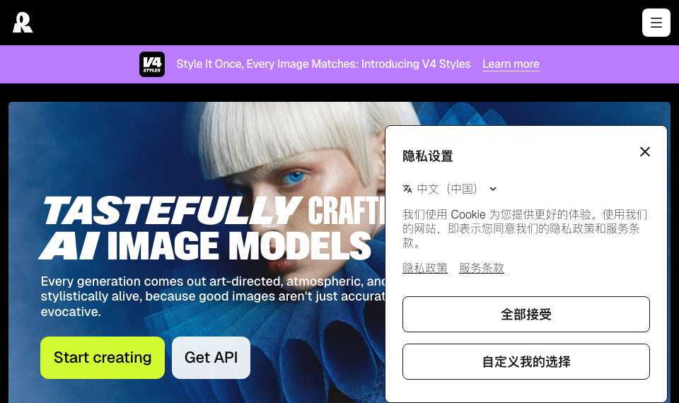</a><br>
      <b><a href="https://www.recraft.ai">Recraft AI</a></b><br>
      <sub>AI canvas for vector art, icons, 3D images and illustrations</sub>
    </td>
    <td width="20%" valign="top">
      <a href="https://designer.microsoft.com/"></a><br>
      <b><a href="https://designer.microsoft.com/">Microsoft Designer</a></b><br>
      <sub>Microsoft's online poster and graphic design tool</sub>
    </td>
    <td width="20%" valign="top">
      <a href="https://www.canva.cn/magic">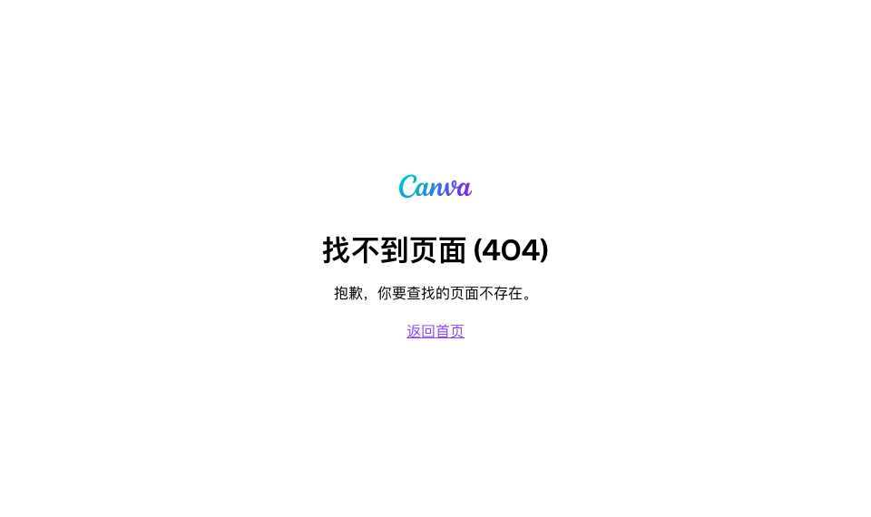</a><br>
      <b><a href="https://www.canva.cn/magic">魔力工作室</a></b><br>
      <sub>Canva China's all-in-one AI creation suite</sub>
    </td>
    <td width="20%" valign="top">
      <a href="https://www.piccopilot.com/create"></a><br>
      <b><a href="https://www.piccopilot.com/create">Pic Copilot</a></b><br>
      <sub>Alibaba International's AI e-commerce design tool</sub>
    </td>
  </tr>
</table>

---

### Search Engines

49 tools · [View all](https://rvelamen.github.io/Awesome-AI-Tools/category/搜索引擎/)

<table>
  <tr>
    <td width="20%" valign="top">
      <a href="https://www.perplexity.ai">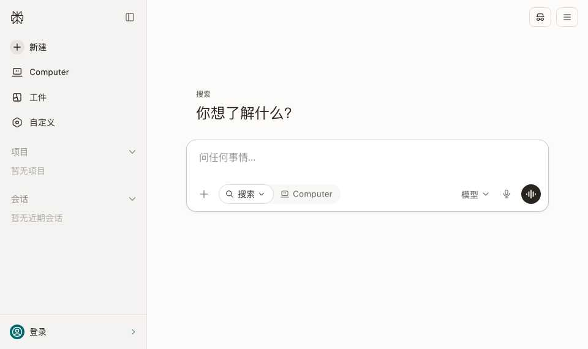</a><br>
      <b><a href="https://www.perplexity.ai">Perplexity</a></b><br>
      <sub>Conversational AI search engine</sub>
    </td>
    <td width="20%" valign="top">
      <a href="https://metaso.cn"></a><br>
      <b><a href="https://metaso.cn">秘塔AI搜索</a></b><br>
      <sub>Ad-free AI search with direct answers (Metaso)</sub>
    </td>
    <td width="20%" valign="top">
      <a href="https://www.genspark.ai">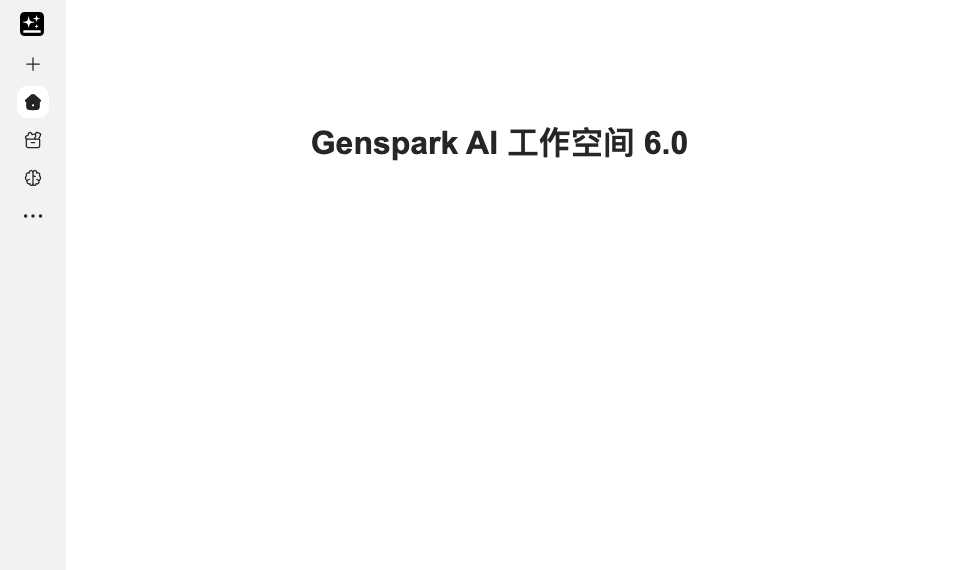</a><br>
      <b><a href="https://www.genspark.ai">Genspark</a></b><br>
      <sub>Agent-based search engine</sub>
    </td>
    <td width="20%" valign="top">
      <a href="https://devv.ai/zh">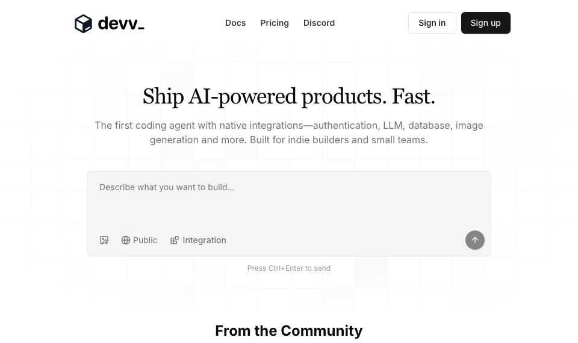</a><br>
      <b><a href="https://devv.ai/zh">Devv</a></b><br>
      <sub>AI search engine for programmers</sub>
    </td>
    <td width="20%" valign="top">
      <a href="https://b.quark.cn/apps/qkhomepage_twofoufeb/routes/model">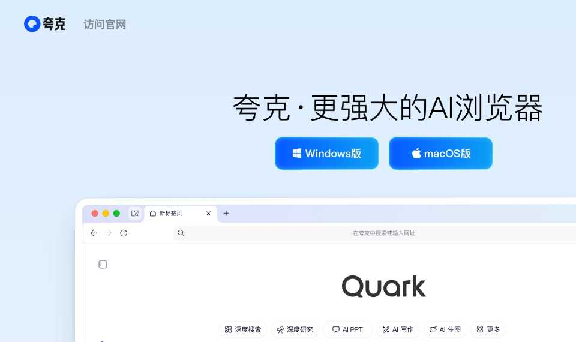</a><br>
      <b><a href="https://b.quark.cn/apps/qkhomepage_twofoufeb/routes/model">夸克AI</a></b><br>
      <sub>Quark's app combining AI search, cloud drive, docs and creation</sub>
    </td>
  </tr>
</table>

---

### PPT

48 tools · [View all](https://rvelamen.github.io/Awesome-AI-Tools/category/PPT/)

<table>
  <tr>
    <td width="20%" valign="top">
      <a href="https://gamma.app/"></a><br>
      <b><a href="https://gamma.app/">Gamma App</a></b><br>
      <sub>AI slide and presentation generator</sub>
    </td>
    <td width="20%" valign="top">
      <a href="https://www.aippt.cn">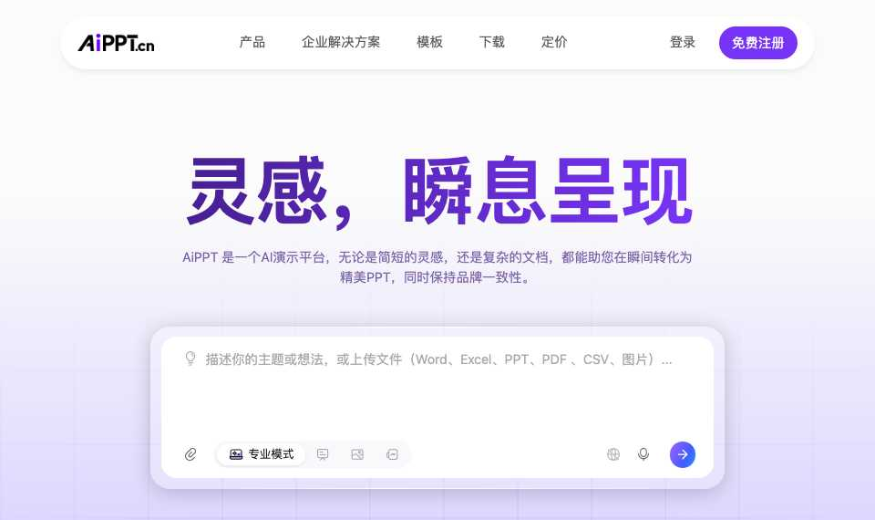</a><br>
      <b><a href="https://www.aippt.cn">AiPPT</a></b><br>
      <sub>Generate high-quality PPTs with AI</sub>
    </td>
    <td width="20%" valign="top">
      <a href="https://www.islide.cc">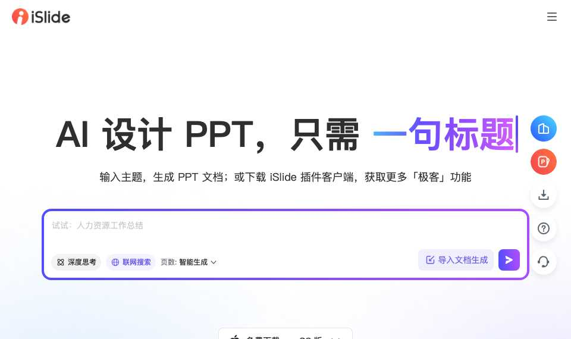</a><br>
      <b><a href="https://www.islide.cc">iSlide AIPPT</a></b><br>
      <sub>Generate a full PPT from a single title</sub>
    </td>
    <td width="20%" valign="top">
      <a href="https://zhiwen.xfyun.cn"></a><br>
      <b><a href="https://zhiwen.xfyun.cn">讯飞智文</a></b><br>
      <sub>iFlytek's AI PPT generator</sub>
    </td>
    <td width="20%" valign="top">
      <a href="https://www.cappt.cc"></a><br>
      <b><a href="https://www.cappt.cc">咔片PPT</a></b><br>
      <sub>AI PPT tool automating design and beautification</sub>
    </td>
  </tr>
</table>

---

### Document Tools

37 tools · [View all](https://rvelamen.github.io/Awesome-AI-Tools/category/文档工具/)

<table>
  <tr>
    <td width="20%" valign="top">
      <a href="https://ai.wps.cn">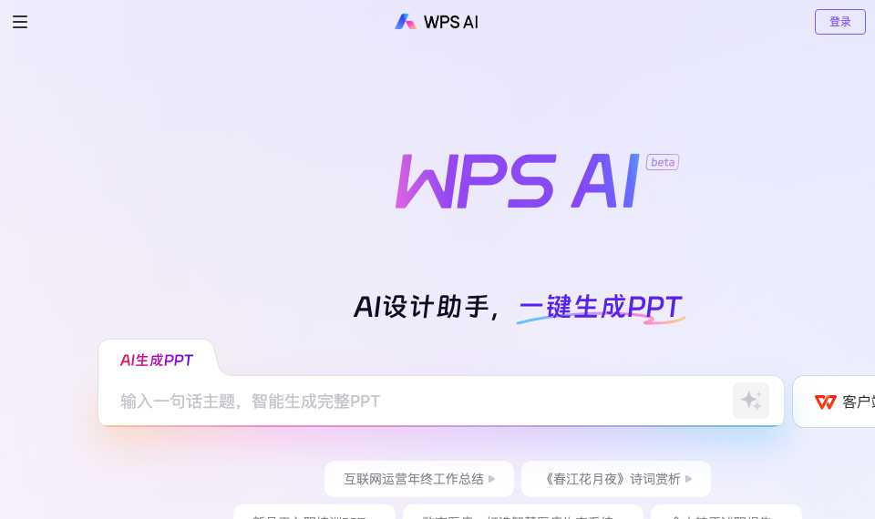</a><br>
      <b><a href="https://ai.wps.cn">WPS AI</a></b><br>
      <sub>WPS's AI office assistant</sub>
    </td>
    <td width="20%" valign="top">
      <a href="https://www.wanzhi01.com">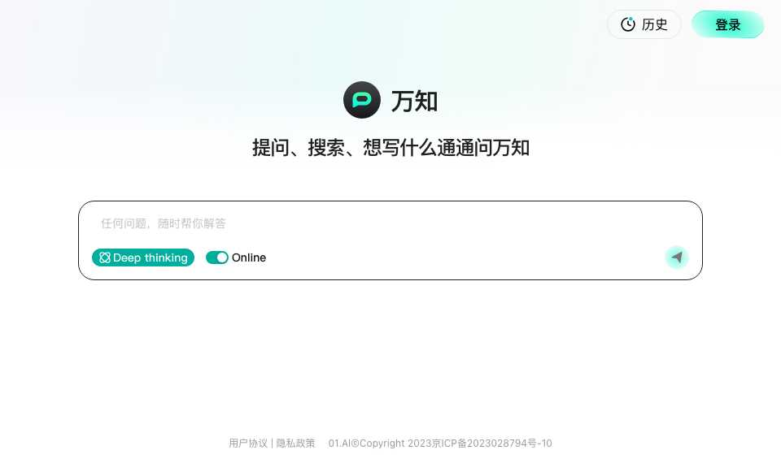</a><br>
      <b><a href="https://www.wanzhi01.com">万知</a></b><br>
      <sub>01.AI's workspace for AI document reading and PPT creation</sub>
    </td>
    <td width="20%" valign="top">
      <a href="https://noedgeai.com">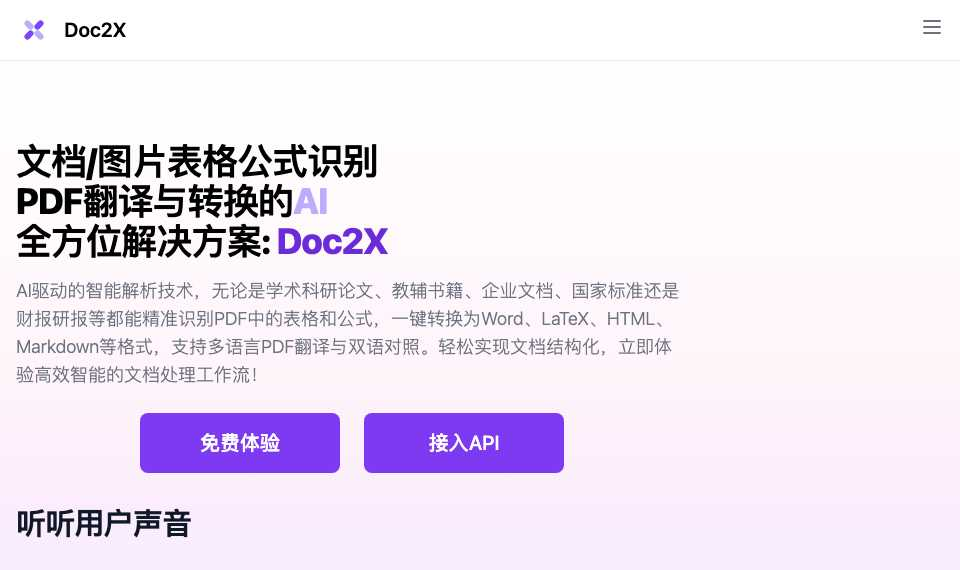</a><br>
      <b><a href="https://noedgeai.com">Doc2X</a></b><br>
      <sub>AI document recognition, conversion and translation</sub>
    </td>
    <td width="20%" valign="top">
      <a href="https://www.txyz.ai">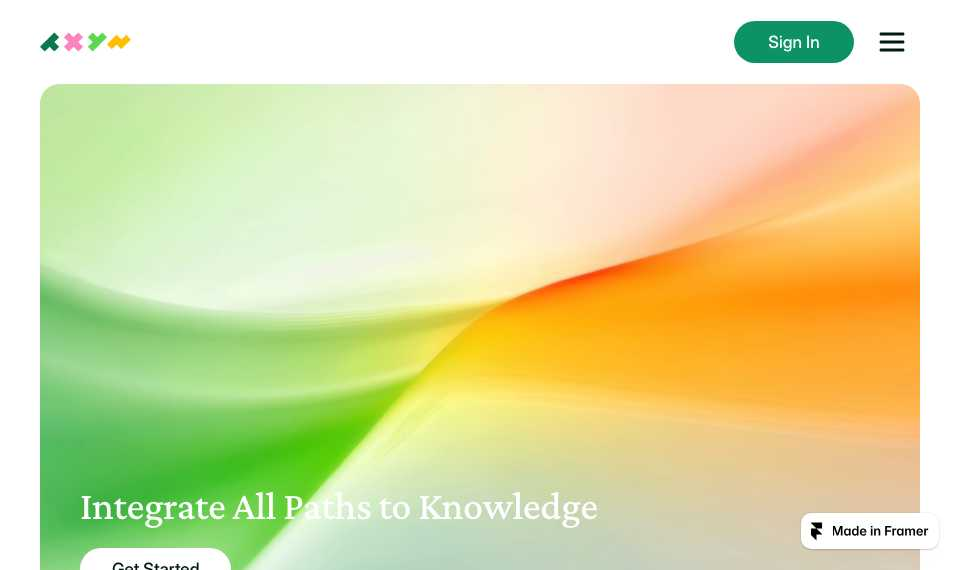</a><br>
      <b><a href="https://www.txyz.ai">txyz</a></b><br>
      <sub>AI literature reading and research assistant</sub>
    </td>
    <td width="20%" valign="top">
      <a href="https://www.quivr.app"></a><br>
      <b><a href="https://www.quivr.app">Quivr</a></b><br>
      <sub>Open-source knowledge base builder — your second brain</sub>
    </td>
  </tr>
</table>

---

### Models and Training

42 tools · [View all](https://rvelamen.github.io/Awesome-AI-Tools/category/训练模型/)

<table>
  <tr>
    <td width="20%" valign="top">
      <a href="https://ollama.ai/">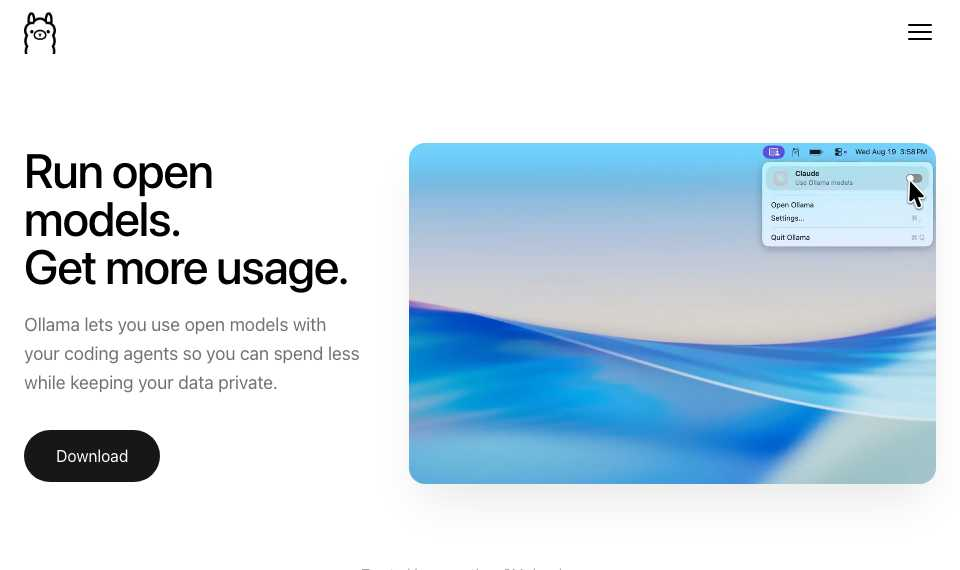</a><br>
      <b><a href="https://ollama.ai/">Ollama</a></b><br>
      <sub>Run Llama and other LLMs locally</sub>
    </td>
    <td width="20%" valign="top">
      <a href="https://www.modelscope.cn/">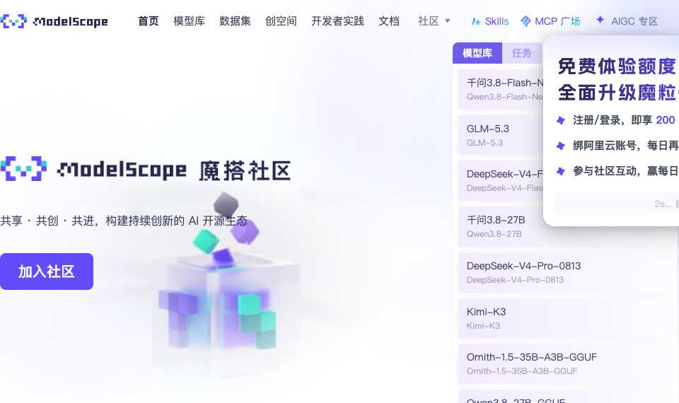</a><br>
      <b><a href="https://www.modelscope.cn/">魔搭社区</a></b><br>
      <sub>Alibaba DAMO's model community with 300+ open models (ModelScope)</sub>
    </td>
    <td width="20%" valign="top">
      <a href="https://www.cherry-ai.com/"></a><br>
      <b><a href="https://www.cherry-ai.com/">Cherry Studio</a></b><br>
      <sub>Open-source all-in-one AI client</sub>
    </td>
    <td width="20%" valign="top">
      <a href="https://agpt.co/">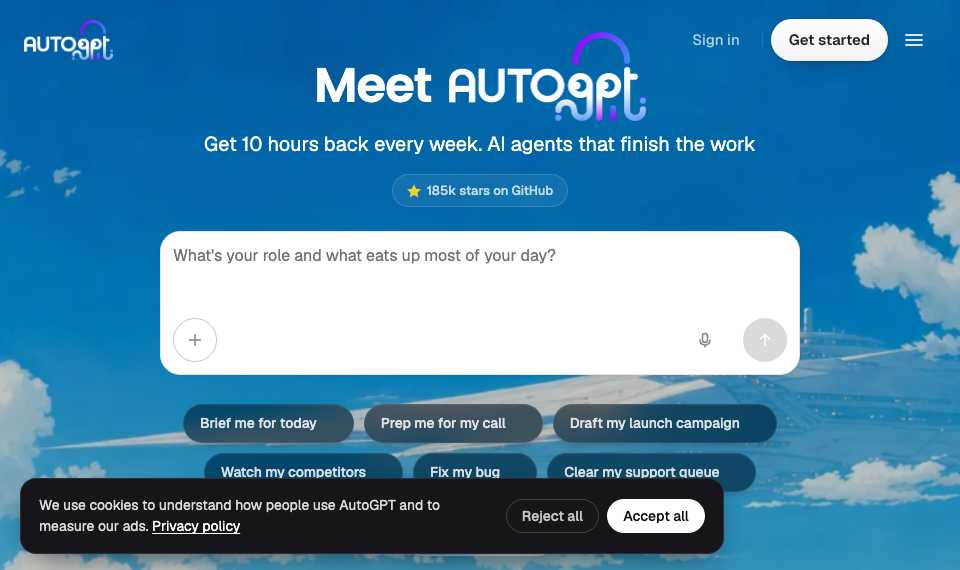</a><br>
      <b><a href="https://agpt.co/">AutoGPT</a></b><br>
      <sub>Experimental open-source autonomous agent project</sub>
    </td>
    <td width="20%" valign="top">
      <a href="https://jan.ai/">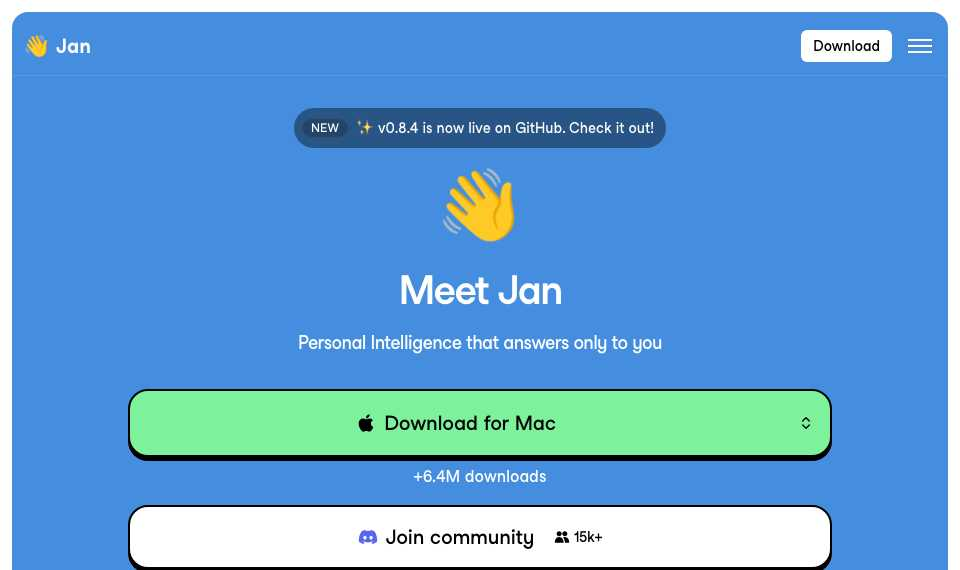</a><br>
      <b><a href="https://jan.ai/">Jan</a></b><br>
      <sub>Open-source tool for local LLM chats</sub>
    </td>
  </tr>
</table>

---

### Translation

27 tools · [View all](https://rvelamen.github.io/Awesome-AI-Tools/category/翻译/)

<table>
  <tr>
    <td width="20%" valign="top">
      <a href="https://immersivetranslate.com/zh-Hans">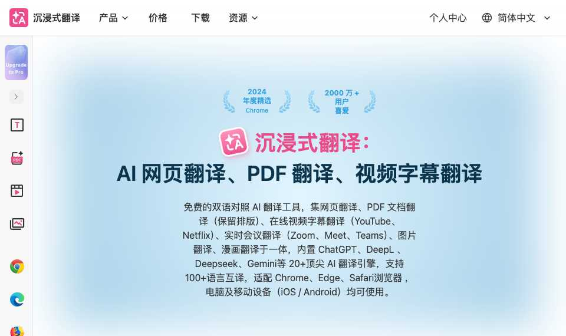</a><br>
      <b><a href="https://immersivetranslate.com/zh-Hans">沉浸式翻译</a></b><br>
      <sub>Bilingual side-by-side web translation extension (Immersive Translate)</sub>
    </td>
    <td width="20%" valign="top">
      <a href="https://www.deepl.com/translator">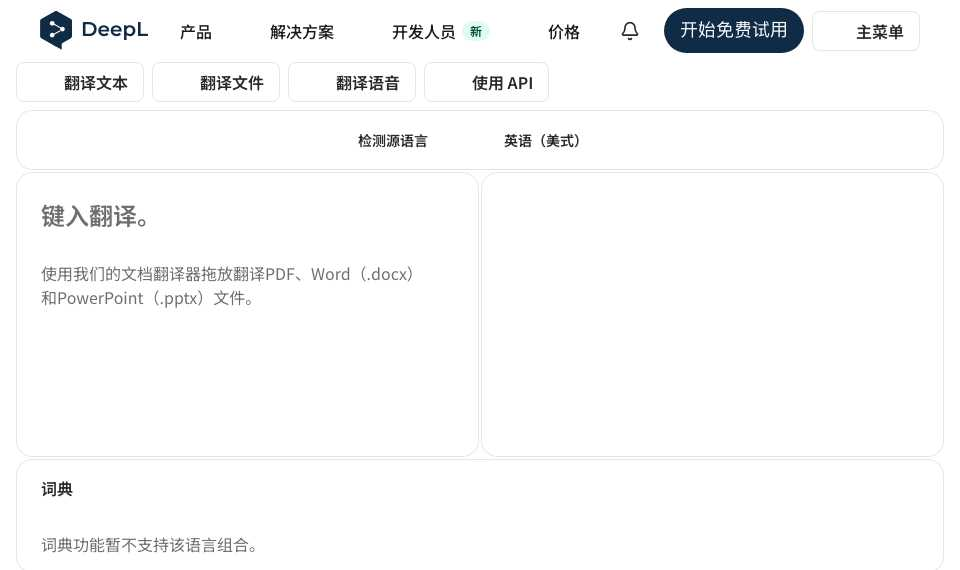</a><br>
      <b><a href="https://www.deepl.com/translator">DeepL翻译</a></b><br>
      <sub>DeepL — AI translation known for accuracy</sub>
    </td>
    <td width="20%" valign="top">
      <a href="https://translate.google.com/"></a><br>
      <b><a href="https://translate.google.com/">Google翻译</a></b><br>
      <sub>Google Translate — 100+ languages</sub>
    </td>
    <td width="20%" valign="top">
      <a href="https://transmart.qq.com"></a><br>
      <b><a href="https://transmart.qq.com">腾讯交互翻译</a></b><br>
      <sub>Tencent's interactive translation tool (TranSmart)</sub>
    </td>
    <td width="20%" valign="top">
      <a href="https://huiyiai.net/"></a><br>
      <b><a href="https://huiyiai.net/">会译</a></b><br>
      <sub>Immersive bilingual translation supporting 100+ languages</sub>
    </td>
  </tr>
</table>

---

### Spreadsheets

25 tools · [View all](https://rvelamen.github.io/Awesome-AI-Tools/category/表格/)

<table>
  <tr>
    <td width="20%" valign="top">
      <a href="https://www.chatexcel.com/#/home"></a><br>
      <b><a href="https://www.chatexcel.com/#/home">酷表ChatExcel</a></b><br>
      <sub>AI assistant for Excel data analysis (ChatExcel)</sub>
    </td>
    <td width="20%" valign="top">
      <a href="https://www.xiaohuanxiong.com"></a><br>
      <b><a href="https://www.xiaohuanxiong.com">办公小浣熊</a></b><br>
      <sub>SenseTime's AI office assistant</sub>
    </td>
    <td width="20%" valign="top">
      <a href="https://vika.cn"></a><br>
      <b><a href="https://vika.cn">vika维格云</a></b><br>
      <sub>Smart multidimensional spreadsheet and data platform</sub>
    </td>
    <td width="20%" valign="top">
      <a href="https://ajelix.com/"></a><br>
      <b><a href="https://ajelix.com/">Ajelix</a></b><br>
      <sub>AI tools for Excel and Google Sheets</sub>
    </td>
    <td width="20%" valign="top">
      <a href="https://excelformulabot.com"></a><br>
      <b><a href="https://excelformulabot.com">Formula bot</a></b><br>
      <sub>Turn natural-language instructions into Excel formulas</sub>
    </td>
  </tr>
</table>

---

### Mind Maps

21 tools · [View all](https://rvelamen.github.io/Awesome-AI-Tools/category/思维导图/)

<table>
  <tr>
    <td width="20%" valign="top">
      <a href="https://shutu.cn"></a><br>
      <b><a href="https://shutu.cn">TreeMind树图</a></b><br>
      <sub>Generate mind maps from a single sentence</sub>
    </td>
    <td width="20%" valign="top">
      <a href="https://www.processon.com"></a><br>
      <b><a href="https://www.processon.com">ProcessOn</a></b><br>
      <sub>Online AI flowchart and mind-map maker</sub>
    </td>
    <td width="20%" valign="top">
      <a href="https://boardmix.cn/ai-whiteboard"></a><br>
      <b><a href="https://boardmix.cn/ai-whiteboard">博思白板</a></b><br>
      <sub>AI-powered online whiteboard (Boardmix)</sub>
    </td>
    <td width="20%" valign="top">
      <a href="https://mapify.so/cn"></a><br>
      <b><a href="https://mapify.so/cn">Mapify</a></b><br>
      <sub>Xmind's AI mind-map generator</sub>
    </td>
    <td width="20%" valign="top">
      <a href="https://www.edrawsoft.cn/mindmaster"></a><br>
      <b><a href="https://www.edrawsoft.cn/mindmaster">亿图脑图</a></b><br>
      <sub>Edraw's mind-mapping assistant (MindMaster)</sub>
    </td>
  </tr>
</table>

---

### Product Images

35 tools · [View all](https://rvelamen.github.io/Awesome-AI-Tools/category/商品图生成/)

<table>
  <tr>
    <td width="20%" valign="top">
      <a href="https://ihuiwa.paluai.com"></a><br>
      <b><a href="https://ihuiwa.paluai.com">绘蛙</a></b><br>
      <sub>AI e-commerce marketing: product images and copy (Huiwa)</sub>
    </td>
    <td width="20%" valign="top">
      <a href="https://www.meijian.com/e-commerce"></a><br>
      <b><a href="https://www.meijian.com/e-commerce">美间AI商拍</a></b><br>
      <sub>Generate high-quality product photos with AI (Meijian)</sub>
    </td>
    <td width="20%" valign="top">
      <a href="https://psai.cn"></a><br>
      <b><a href="https://psai.cn">PhotoStudio AI</a></b><br>
      <sub>ArcSoft's AI product photography tool</sub>
    </td>
    <td width="20%" valign="top">
      <a href="https://ling.jd.com/"></a><br>
      <b><a href="https://ling.jd.com/">羚珑</a></b><br>
      <sub>JD.com's smart product image design tool</sub>
    </td>
    <td width="20%" valign="top">
      <a href="https://ai.linkfox.com"></a><br>
      <b><a href="https://ai.linkfox.com">LinkFox AI</a></b><br>
      <sub>AI e-commerce design for professional product graphics</sub>
    </td>
  </tr>
</table>

---

### Background Removal

33 tools · [View all](https://rvelamen.github.io/Awesome-AI-Tools/category/背景消除/)

<table>
  <tr>
    <td width="20%" valign="top">
      <a href="https://pixian.ai"></a><br>
      <b><a href="https://pixian.ai">Pixian.AI</a></b><br>
      <sub>AI background removal for images</sub>
    </td>
    <td width="20%" valign="top">
      <a href="https://bgsub.cn/"></a><br>
      <b><a href="https://bgsub.cn/">BgSub</a></b><br>
      <sub>Privacy-friendly AI background remover</sub>
    </td>
    <td width="20%" valign="top">
      <a href="https://kt.94xy.com"></a><br>
      <b><a href="https://kt.94xy.com">鲜艺AI抠图</a></b><br>
      <sub>AI cutout tool with offline installation</sub>
    </td>
    <td width="20%" valign="top">
      <a href="https://icons8.com/bgremover"></a><br>
      <b><a href="https://icons8.com/bgremover">Icons8 Background Remover</a></b><br>
      <sub>Icons8's image background remover</sub>
    </td>
    <td width="20%" valign="top">
      <a href="https://clipdrop.co/remove-background"></a><br>
      <b><a href="https://clipdrop.co/remove-background">ClipDrop Remove Background</a></b><br>
      <sub>ClipDrop's AI background removal</sub>
    </td>
  </tr>
</table>

---

### Image Upscaling

25 tools · [View all](https://rvelamen.github.io/Awesome-AI-Tools/category/图片无损放大/)

<table>
  <tr>
    <td width="20%" valign="top">
      <a href="https://www.upscayl.org/"></a><br>
      <b><a href="https://www.upscayl.org/">Upscayl</a></b><br>
      <sub>Free open-source AI image upscaler</sub>
    </td>
    <td width="20%" valign="top">
      <a href="https://bigjpg.com/"></a><br>
      <b><a href="https://bigjpg.com/">BigJPG</a></b><br>
      <sub>Online lossless image upscaling</sub>
    </td>
    <td width="20%" valign="top">
      <a href="https://magnific.ai"></a><br>
      <b><a href="https://magnific.ai">Magnific AI</a></b><br>
      <sub>AI image upscaler supporting up to 10K</sub>
    </td>
    <td width="20%" valign="top">
      <a href="https://letsenhance.io"></a><br>
      <b><a href="https://letsenhance.io">Let’s Enhance</a></b><br>
      <sub>Online AI upscaling with preserved quality</sub>
    </td>
    <td width="20%" valign="top">
      <a href="https://icons8.com/upscaler"></a><br>
      <b><a href="https://icons8.com/upscaler">Icons8 Smart Upscaler</a></b><br>
      <sub>Icons8's AI image upscaler</sub>
    </td>
  </tr>
</table>

---

### Photo Enhancement

21 tools · [View all](https://rvelamen.github.io/Awesome-AI-Tools/category/图片优化修复/)

<table>
  <tr>
    <td width="20%" valign="top">
      <a href="https://remini.ai"></a><br>
      <b><a href="https://remini.ai">Remini</a></b><br>
      <sub>AI photo enhancer that turns blurry photos sharp</sub>
    </td>
    <td width="20%" valign="top">
      <a href="https://yunxiu.meitu.com/"></a><br>
      <b><a href="https://yunxiu.meitu.com/">美图云修</a></b><br>
      <sub>Meitu's all-in-one AI retouching software</sub>
    </td>
    <td width="20%" valign="top">
      <a href="https://jpghd.com/zh"></a><br>
      <b><a href="https://jpghd.com/zh">jpgHD</a></b><br>
      <sub>AI colorization and restoration for old photos</sub>
    </td>
    <td width="20%" valign="top">
      <a href="https://www.restorephotos.io/"></a><br>
      <b><a href="https://www.restorephotos.io/">restorePhotos.io</a></b><br>
      <sub>AI old-photo restoration</sub>
    </td>
    <td width="20%" valign="top">
      <a href="https://clipdrop.co/relight"></a><br>
      <b><a href="https://clipdrop.co/relight">Relight</a></b><br>
      <sub>ClipDrop's AI relighting tool</sub>
    </td>
  </tr>
</table>

---

### Object Removal

18 tools · [View all](https://rvelamen.github.io/Awesome-AI-Tools/category/图片物体擦除/)

<table>
  <tr>
    <td width="20%" valign="top">
      <a href="https://www.iopaint.com"></a><br>
      <b><a href="https://www.iopaint.com">IOPaint</a></b><br>
      <sub>Free open-source AI image inpainting and object removal</sub>
    </td>
    <td width="20%" valign="top">
      <a href="https://cleanup.pictures/"></a><br>
      <b><a href="https://cleanup.pictures/">Cleanup.pictures</a></b><br>
      <sub>Remove objects, text and blemishes intelligently</sub>
    </td>
    <td width="20%" valign="top">
      <a href="https://www.hama.app/zh"></a><br>
      <b><a href="https://www.hama.app/zh">Hama</a></b><br>
      <sub>Erase unwanted objects from photos online</sub>
    </td>
    <td width="20%" valign="top">
      <a href="https://snapedit.app/"></a><br>
      <b><a href="https://snapedit.app/">SnapEdit</a></b><br>
      <sub>AI removal of any object in a photo</sub>
    </td>
    <td width="20%" valign="top">
      <a href="https://www.ihuiwa.com/workspace/ai-image/partial-redraw?editType=eraser-pen"></a><br>
      <b><a href="https://www.ihuiwa.com/workspace/ai-image/partial-redraw?editType=eraser-pen">绘蛙AI消除</a></b><br>
      <sub>One-click removal of unwanted elements (Huiwa)</sub>
    </td>
  </tr>
</table>

---

### 3D Model Generation

16 tools · [View all](https://rvelamen.github.io/Awesome-AI-Tools/category/3D模型生成/)

<table>
  <tr>
    <td width="20%" valign="top">
      <a href="https://www.tripo3d.ai"></a><br>
      <b><a href="https://www.tripo3d.ai">Tripo AI</a></b><br>
      <sub>Generate 3D models from text or images</sub>
    </td>
    <td width="20%" valign="top">
      <a href="https://www.meshy.ai"></a><br>
      <b><a href="https://www.meshy.ai">Meshy</a></b><br>
      <sub>Fast AI text/image-to-3D generation</sub>
    </td>
    <td width="20%" valign="top">
      <a href="https://3d.hunyuan.tencent.com"></a><br>
      <b><a href="https://3d.hunyuan.tencent.com">腾讯混元3D</a></b><br>
      <sub>Tencent's all-in-one 3D content creation platform (Hunyuan3D)</sub>
    </td>
    <td width="20%" valign="top">
      <a href="https://marble.worldlabs.ai/"></a><br>
      <b><a href="https://marble.worldlabs.ai/">Marble</a></b><br>
      <sub>3D world generation by Fei-Fei Li's World Labs</sub>
    </td>
    <td width="20%" valign="top">
      <a href="https://voxcraft.ai"></a><br>
      <b><a href="https://voxcraft.ai">VoxCraft</a></b><br>
      <sub>AI 3D model generator</sub>
    </td>
  </tr>
</table>

---

### Content Detection

28 tools · [View all](https://rvelamen.github.io/Awesome-AI-Tools/category/内容检测/)

<table>
  <tr>
    <td width="20%" valign="top">
      <a href="https://speedai.com/"></a><br>
      <b><a href="https://speedai.com/">SpeedAI</a></b><br>
      <sub>AI research assistant with AIGC detection and rewriting</sub>
    </td>
    <td width="20%" valign="top">
      <a href="https://xiangpiai.cn/workspace"></a><br>
      <b><a href="https://xiangpiai.cn/workspace">小橡皮</a></b><br>
      <sub>AI content risk detection and humanizing</sub>
    </td>
    <td width="20%" valign="top">
      <a href="https://gaoyiai.com/paper_aigc"></a><br>
      <b><a href="https://gaoyiai.com/paper_aigc">稿易降AI率</a></b><br>
      <sub>Reduce AI-detection rates for academic writing</sub>
    </td>
    <td width="20%" valign="top">
      <a href="https://ibiling.cn/paper-pass"></a><br>
      <b><a href="https://ibiling.cn/paper-pass">笔灵降AI率</a></b><br>
      <sub>Reduce AIGC traces, adapted to latest detectors</sub>
    </td>
    <td width="20%" valign="top">
      <a href="https://paperfake.cn/aigc?q=aibot"></a><br>
      <b><a href="https://paperfake.cn/aigc?q=aibot">PaperFake降重降AI率</a></b><br>
      <sub>Paraphrasing for CNKI, VIP and Wanfang checks</sub>
    </td>
  </tr>
</table>

---

### Prompt Engineering

30 tools · [View all](https://rvelamen.github.io/Awesome-AI-Tools/category/提示词工程/)

<table>
  <tr>
    <td width="20%" valign="top">
      <a href="https://www.promptingguide.ai/zh"></a><br>
      <b><a href="https://www.promptingguide.ai/zh">提示工程指南</a></b><br>
      <sub>Systematic prompt engineering guide (Prompting Guide)</sub>
    </td>
    <td width="20%" valign="top">
      <a href="https://promptperfect.jinaai.cn"></a><br>
      <b><a href="https://promptperfect.jinaai.cn">PromptPerfect</a></b><br>
      <sub>Professional prompt optimization tool</sub>
    </td>
    <td width="20%" valign="top">
      <a href="https://flowgpt.com/"></a><br>
      <b><a href="https://flowgpt.com/">FlowGPT</a></b><br>
      <sub>Community for sharing and discovering prompts</sub>
    </td>
    <td width="20%" valign="top">
      <a href="https://prompthero.com/"></a><br>
      <b><a href="https://prompthero.com/">PromptHero</a></b><br>
      <sub>Prompt search platform</sub>
    </td>
    <td width="20%" valign="top">
      <a href="https://github.com/langgptai/LangGPT"></a><br>
      <b><a href="https://github.com/langgptai/LangGPT">LangGPT</a></b><br>
      <sub>Open-source structured prompt framework</sub>
    </td>
  </tr>
</table>

---

### Learning Resources

27 tools · [View all](https://rvelamen.github.io/Awesome-AI-Tools/category/学习网站/)

<table>
  <tr>
    <td width="20%" valign="top">
      <a href="https://www.fast.ai"></a><br>
      <b><a href="https://www.fast.ai">fast.ai</a></b><br>
      <sub>Free open-source deep learning and AI courses</sub>
    </td>
    <td width="20%" valign="top">
      <a href="https://dayofai.org/"></a><br>
      <b><a href="https://dayofai.org/">Day of AI</a></b><br>
      <sub>MIT's free AI learning platform</sub>
    </td>
    <td width="20%" valign="top">
      <a href="https://www.elementsofai.com/"></a><br>
      <b><a href="https://www.elementsofai.com/">Elements of AI</a></b><br>
      <sub>Free online AI literacy course</sub>
    </td>
    <td width="20%" valign="top">
      <a href="https://www.coursera.org/collections/best-machine-learning-ai"></a><br>
      <b><a href="https://www.coursera.org/collections/best-machine-learning-ai">Coursera</a></b><br>
      <sub>AI and machine learning course collections</sub>
    </td>
    <td width="20%" valign="top">
      <a href="https://www.aidaxue.com/?ch=daxue_collection_1"></a><br>
      <b><a href="https://www.aidaxue.com/?ch=daxue_collection_1">AI大学堂</a></b><br>
      <sub>iFlytek's online AI learning platform</sub>
    </td>
  </tr>
</table>

---

### Meeting Tools

15 tools · [View all](https://rvelamen.github.io/Awesome-AI-Tools/category/会议工具/)

<table>
  <tr>
    <td width="20%" valign="top">
      <a href="https://otter.ai"></a><br>
      <b><a href="https://otter.ai">Otter.ai</a></b><br>
      <sub>AI meeting transcription and notes</sub>
    </td>
    <td width="20%" valign="top">
      <a href="https://www.feishu.cn/product/minutes"></a><br>
      <b><a href="https://www.feishu.cn/product/minutes">飞书妙记</a></b><br>
      <sub>Feishu's smart meeting minutes and speech-to-text</sub>
    </td>
    <td width="20%" valign="top">
      <a href="https://meeting.iflyrec.com"></a><br>
      <b><a href="https://meeting.iflyrec.com">讯飞会议</a></b><br>
      <sub>iFlytek meetings: live captions, translation and auto minutes</sub>
    </td>
    <td width="20%" valign="top">
      <a href="https://meeting.tencent.com/ai"></a><br>
      <b><a href="https://meeting.tencent.com/ai">腾讯会议AI小助手</a></b><br>
      <sub>Tencent Meeting's AI assistant</sub>
    </td>
    <td width="20%" valign="top">
      <a href="https://fireflies.ai/"></a><br>
      <b><a href="https://fireflies.ai/">Fireflies.ai</a></b><br>
      <sub>AI meeting transcription and summaries</sub>
    </td>
  </tr>
</table>

---

### Career Tools

34 tools · [View all](https://rvelamen.github.io/Awesome-AI-Tools/category/招聘求职求职/)

<table>
  <tr>
    <td width="20%" valign="top">
      <a href="https://offergoose.cn"></a><br>
      <b><a href="https://offergoose.cn">多面鹅</a></b><br>
      <sub>Big-tech interview simulator with live answer prompts (OfferGoose)</sub>
    </td>
    <td width="20%" valign="top">
      <a href="https://mercor.com"></a><br>
      <b><a href="https://mercor.com">Mercor</a></b><br>
      <sub>AI-powered hiring platform</sub>
    </td>
    <td width="20%" valign="top">
      <a href="https://www.offerin.cn"></a><br>
      <b><a href="https://www.offerin.cn">Offerin</a></b><br>
      <sub>AI interview and written-test assistant with instant answers</sub>
    </td>
    <td width="20%" valign="top">
      <a href="https://www.52cv.com"></a><br>
      <b><a href="https://www.52cv.com">职徒简历</a></b><br>
      <sub>Smart resume building and optimization (52CV)</sub>
    </td>
    <td width="20%" valign="top">
      <a href="https://www.yoojober.com"></a><br>
      <b><a href="https://www.yoojober.com">YOO简历</a></b><br>
      <sub>AI resume generator by Yoojober</sub>
    </td>
  </tr>
</table>

---

### Legal Assistants

13 tools · [View all](https://rvelamen.github.io/Awesome-AI-Tools/category/法律助手/)

<table>
  <tr>
    <td width="20%" valign="top">
      <a href="https://www.chineselaw.com/tyjs/index"></a><br>
      <b><a href="https://www.chineselaw.com/tyjs/index">元典智库</a></b><br>
      <sub>Legal knowledge platform and search engine</sub>
    </td>
    <td width="20%" valign="top">
      <a href="https://tongyi.aliyun.com/farui"></a><br>
      <b><a href="https://tongyi.aliyun.com/farui">通义法睿</a></b><br>
      <sub>Alibaba's AI legal advisor (Tongyi Farui)</sub>
    </td>
    <td width="20%" valign="top">
      <a href="https://ailegal.baidu.com/"></a><br>
      <b><a href="https://ailegal.baidu.com/">法行宝</a></b><br>
      <sub>Baidu's AI legal assistant</sub>
    </td>
    <td width="20%" valign="top">
      <a href="https://chatlaw.cloud/lawchat/"></a><br>
      <b><a href="https://chatlaw.cloud/lawchat/">ChatLaw</a></b><br>
      <sub>PKU's open-source legal LLM and assistant</sub>
    </td>
    <td width="20%" valign="top">
      <a href="https://www.delilegal.com/search"></a><br>
      <b><a href="https://www.delilegal.com/search">得理法搜</a></b><br>
      <sub>AI legal research and search (DLS)</sub>
    </td>
  </tr>
</table>

---

## Open-Source Projects

Besides tools, the catalog includes **29** open-source projects, with cards showing stars, language and license automatically: [Browse all](https://rvelamen.github.io/Awesome-AI-Tools/projects/)

| Category | Count |
| --- | ---: |
| [Agent Skills](https://rvelamen.github.io/Awesome-AI-Tools/projects/category/Agent%20技能/) | 9 |
| [MCP Services](https://rvelamen.github.io/Awesome-AI-Tools/projects/category/MCP%20服务/) | 8 |
| [CLI Tools](https://rvelamen.github.io/Awesome-AI-Tools/projects/category/CLI%20工具/) | 6 |
| [Plugins & Extensions](https://rvelamen.github.io/Awesome-AI-Tools/projects/category/插件与扩展/) | 3 |
| [Agent Applications](https://rvelamen.github.io/Awesome-AI-Tools/projects/category/代理应用/) | 2 |
| [Dev Libraries](https://rvelamen.github.io/Awesome-AI-Tools/projects/category/开发库/) | 1 |

The website also has an [AI Works](https://rvelamen.github.io/Awesome-AI-Tools/showcase/) section: games, 3D worlds and web pages generated directly by AI models, each with a GIF preview and creator credit.

## Contributing

All entries live in [`data.json`](./data.json); the READMEs show a curated subset per category, and the website rebuilds automatically after PRs are merged. Contributions are welcome:

1. Open a Pull Request adding new tools to `data.json`
2. Improve descriptions and links of existing entries
3. Suggest new categories

**Entry format**:
```json
{
    "url": "",
    "title": "",
    "type": "",
    "description": "",
    "image": "",
    "category": [
    ],
    "kind": "",	// optional: "project" for open-source projects; omit for tools
    "id": ""	// uuid
}
```

**Notes**:
- `url` must be a clean official link without `utm` or other tracking parameters; verify it is reachable before submitting
- Keep descriptions objective; avoid unverifiable promotional claims
- `id` must be a UUID not already used in the catalog
- `category` should reuse existing category names where possible (Chinese names as listed in the links above)
- For open-source projects set `"kind": "project"` and use project-side categories (Agent 技能 / CLI 工具 / 插件与扩展 / 代理应用 / MCP 服务 / 开发库); stars, language and license are fetched from the GitHub API at build time, no need to include them
- Hosted or closed-source MCP services belong on the tool side under the tool-side `MCP 服务` category (no `kind` field), not in the open-source project section
- Run `jq empty data.json` before submitting to confirm valid JSON

## Disclaimer

The sites listed are collected from the web. For any infringement, please open an [Issue](https://github.com/Rvelamen/Awesome-AI-Tools/issues).

## License

MIT License | © 2025–2026
