<div align="center">

# 🚀 Awesome AI Tools

**中文** ｜ [English](./README.md)

**AI 现在能做什么，一看便知：作品与工具的发现画廊**

大语言模型 / Agent / 编程 / 图像 / 音视频<br>
**57** 个可直接打开的 AI 作品 · **1668** 个 AI 工具 · **29** 个开源项目 · **36** 个分类
[](https://awesome.re) [](https://github.com/Rvelamen/Awesome-AI-Tools)

⭐ 如果这份清单对你有帮助，欢迎 Star，让更多人和 Agent 发现它

**[进入网站：完整清单 / 全文搜索 / 类型筛选 / 最新收录](https://rvelamen.github.io/Awesome-AI-Tools/)**

</div>

---

## AI 作品

这些游戏、3D 世界和网页完全由 AI 生成，点开就能玩；完整画廊见 [AI 作品栏目](https://rvelamen.github.io/Awesome-AI-Tools/showcase/)。

<table>
  <tr>
    <td width="33%" valign="top">
      <a href="https://claude.ai/artifact/BGY1SztrAYcJQHSsnHHGmp"></a><br>
      <b><a href="https://claude.ai/artifact/BGY1SztrAYcJQHSsnHHGmp">Saltline 第一人称射击</a></b><br>
      <sub>Anthropic 工程师一次性提示、无人工反馈跑 8 小时，约 $550；模型、音效、贴图全部代码生成</sub>
    </td>
    <td width="33%" valign="top">
      <a href="https://claude.ai/artifact/QGWUAjRrzRzZWGcQzSMLfa"></a><br>
      <b><a href="https://claude.ai/artifact/QGWUAjRrzRzZWGcQzSMLfa">Blender 房间里的「Claude App」网页</a></b><br>
      <sub>一条提示词建整个房间并渲 4K</sub>
    </td>
    <td width="33%" valign="top">
      <a href="https://what-the-water-keeps.vercel.app/"></a><br>
      <b><a href="https://what-the-water-keeps.vercel.app/">What the Water Keeps 梦境划船</a></b><br>
      <sub>穿过 8 个梦境世界的划船游戏，浏览器里直接玩</sub>
    </td>
  </tr>
</table>

---

## 目录

| | | |
| --- | --- | --- |
| 💬 [聊天助手](#聊天助手) | 💻 [编程工具](#编程工具) | 🔌 [MCP 服务](#mcp-服务) |
| 🤖 [智能体](#智能体) | ⚡ [效能工具](#效能工具) | 🎬 [视频工具](#视频工具) |
| 🖼️ [图像工具](#图像工具) | 🎨 [图片插画生成](#图片插画生成) | 🎵 [音频工具](#音频工具) |
| ✍️ [写作工具](#写作工具) | 🎯 [设计工具](#设计工具) | 🔍 [搜索引擎](#搜索引擎) |
| 📊 [PPT](#ppt) | 📄 [文档工具](#文档工具) | 🧠 [训练模型](#训练模型) |
| 🌐 [翻译](#翻译) | 📈 [表格](#表格) | 🧩 [思维导图](#思维导图) |
| 🛍️ [商品图生成](#商品图生成) | ✂️ [背景消除](#背景消除) | 🔎 [图片无损放大](#图片无损放大) |
| 🛠️ [图片优化修复](#图片优化修复) | 🧹 [图片物体擦除](#图片物体擦除) | 🧊 [3D模型生成](#3d模型生成) |
| 🕵️ [内容检测](#内容检测) | 💡 [提示词工程](#提示词工程) | 📚 [学习网站](#学习网站) |
| 🎙️ [会议工具](#会议工具) | 💼 [招聘求职求职](#招聘求职求职) | ⚖️ [法律助手](#法律助手) |

[开源项目](#开源项目) ｜ [贡献指南](#贡献指南) ｜ [声明](#声明) ｜ [License](#license)

---

### 聊天助手

共 74 个 · [查看全部](https://rvelamen.github.io/Awesome-AI-Tools/category/聊天助手/)

<table>
  <tr>
    <td width="16%" valign="top">
      <a href="https://chat.openai.com">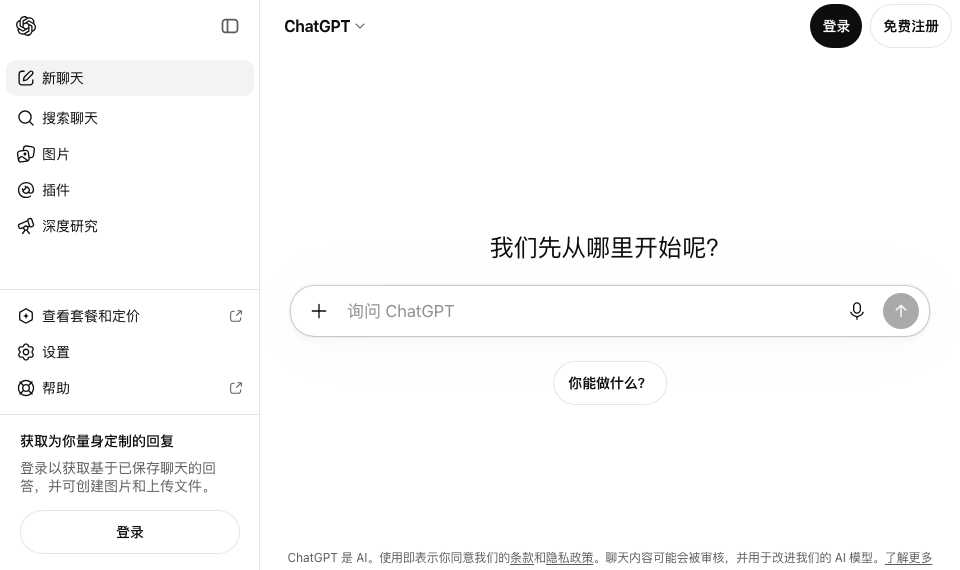</a><br>
      <b><a href="https://chat.openai.com">ChatGPT</a></b><br>
      <sub>OpenAI 旗下 AI 对话工具</sub>
    </td>
    <td width="16%" valign="top">
      <a href="https://claude.ai">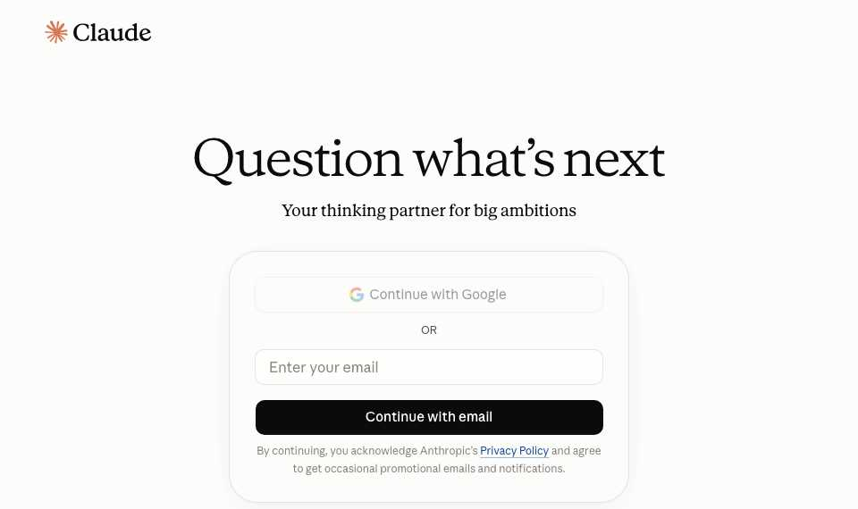</a><br>
      <b><a href="https://claude.ai">Claude</a></b><br>
      <sub>Anthropic 推出的 AI 助手</sub>
    </td>
    <td width="16%" valign="top">
      <a href="https://gemini.google.com"></a><br>
      <b><a href="https://gemini.google.com">Gemini</a></b><br>
      <sub>Google 推出的 AI 聊天对话机器人</sub>
    </td>
    <td width="16%" valign="top">
      <a href="https://chat.deepseek.com/">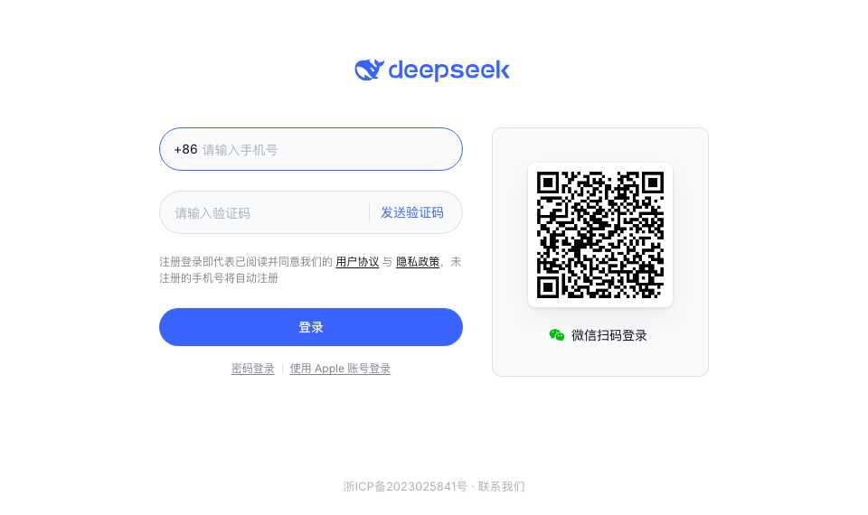</a><br>
      <b><a href="https://chat.deepseek.com/">DeepSeek</a></b><br>
      <sub>幻方量化旗下深度求索推出的开源大模型和聊天助手</sub>
    </td>
    <td width="16%" valign="top">
      <a href="https://www.doubao.com/chat">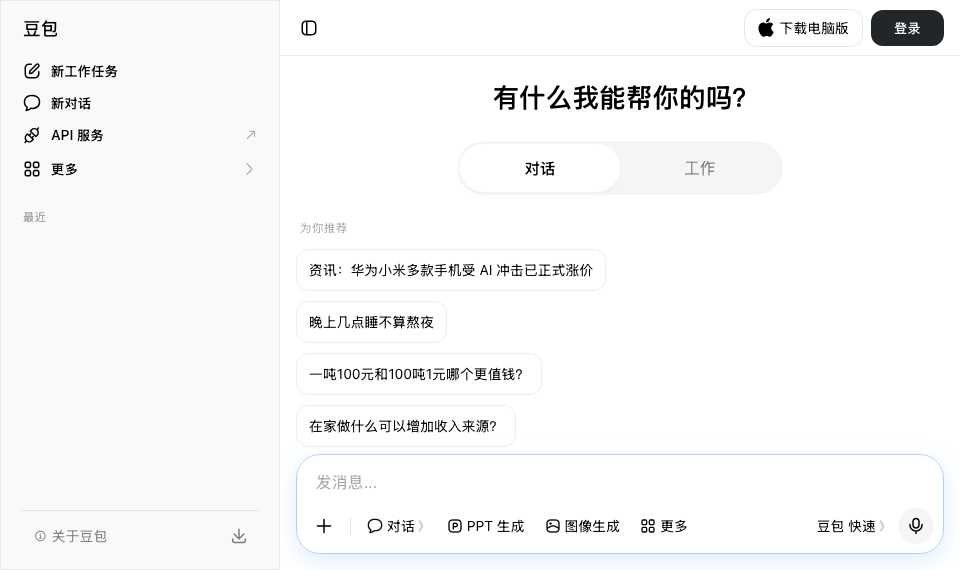</a><br>
      <b><a href="https://www.doubao.com/chat">豆包</a></b><br>
      <sub>字节跳动推出的 AI 智能助手</sub>
    </td>
    <td width="16%" valign="top">
      <a href="https://kimi.moonshot.cn/">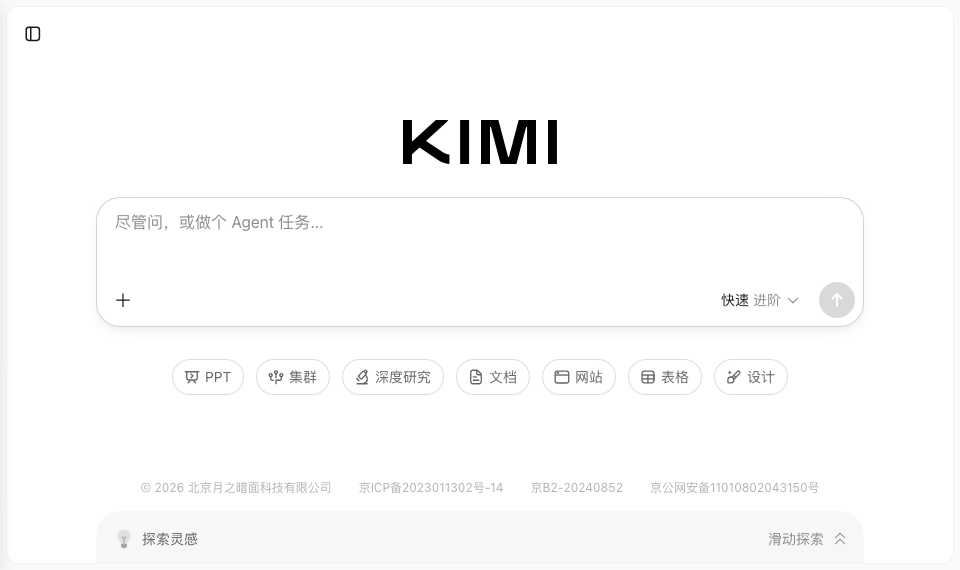</a><br>
      <b><a href="https://kimi.moonshot.cn/">Kimi智能助手</a></b><br>
      <sub>支持长文精读、推理搜索的 AI 助手</sub>
    </td>
  </tr>
</table>

---

### 编程工具

共 202 个 · [查看全部](https://rvelamen.github.io/Awesome-AI-Tools/category/编程工具/)

<table>
  <tr>
    <td width="20%" valign="top">
      <a href="https://www.cursor.com">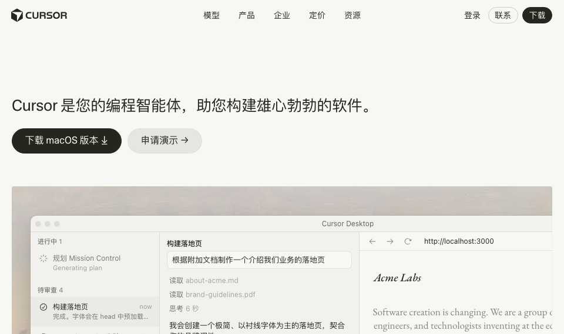</a><br>
      <b><a href="https://www.cursor.com">Cursor</a></b><br>
      <sub>AI 代码编辑器，快速进行编程和软件开发</sub>
    </td>
    <td width="20%" valign="top">
      <a href="https://github.com/features/copilot">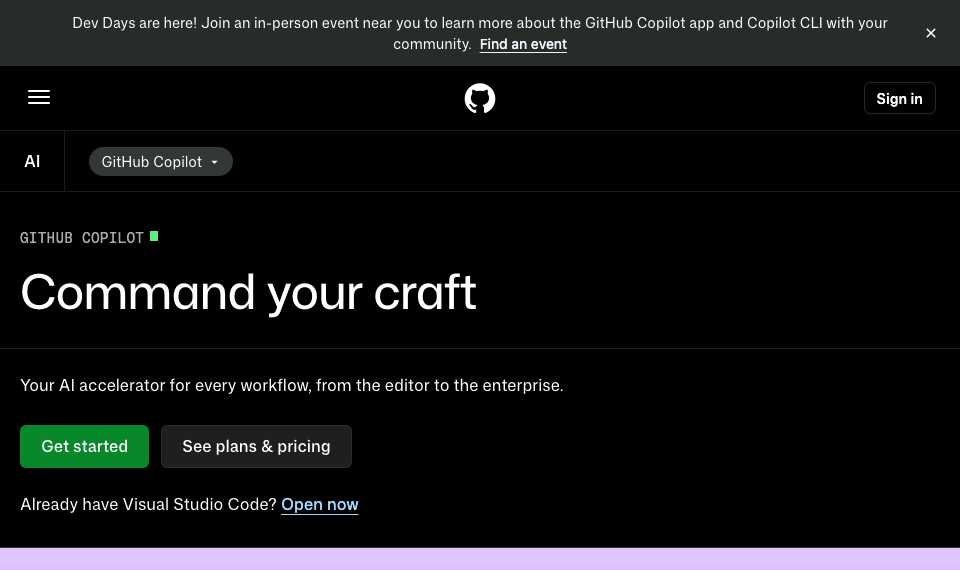</a><br>
      <b><a href="https://github.com/features/copilot">GitHub Copilot</a></b><br>
      <sub>GitHub 推出的 AI 编程助手</sub>
    </td>
    <td width="20%" valign="top">
      <a href="https://www.trae.com.cn/">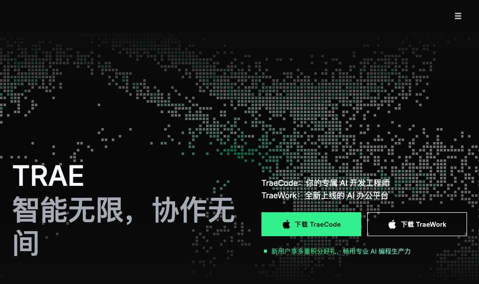</a><br>
      <b><a href="https://www.trae.com.cn/">Trae</a></b><br>
      <sub>字节跳动推出的编程工具，基于 Claude 模型</sub>
    </td>
    <td width="20%" valign="top">
      <a href="https://aws.amazon.com/codewhisperer/"></a><br>
      <b><a href="https://aws.amazon.com/codewhisperer/">CodeWhisperer</a></b><br>
      <sub>亚马逊推出的 AI 编程助手</sub>
    </td>
    <td width="20%" valign="top">
      <a href="https://comate.baidu.com"></a><br>
      <b><a href="https://comate.baidu.com">文心快码</a></b><br>
      <sub>百度推出的 AI 编程助手，基于文心大模型</sub>
    </td>
  </tr>
</table>

---

### MCP 服务

共 7 个 · [查看全部](https://rvelamen.github.io/Awesome-AI-Tools/category/MCP 服务/)

<table>
  <tr>
    <td width="33%" valign="top">
      <a href="https://neverapply.co/features/mcp">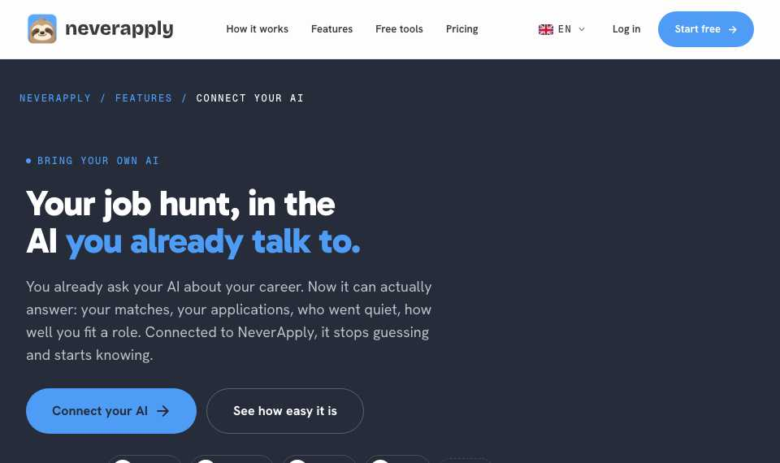</a><br>
      <b><a href="https://neverapply.co/features/mcp">NeverApply</a></b><br>
      <sub>托管求职 MCP 服务器：职位搜索匹配、简历定制、面试准备，确认后投递申请</sub>
    </td>
    <td width="33%" valign="top">
      <a href="https://www.corpusiq.io/">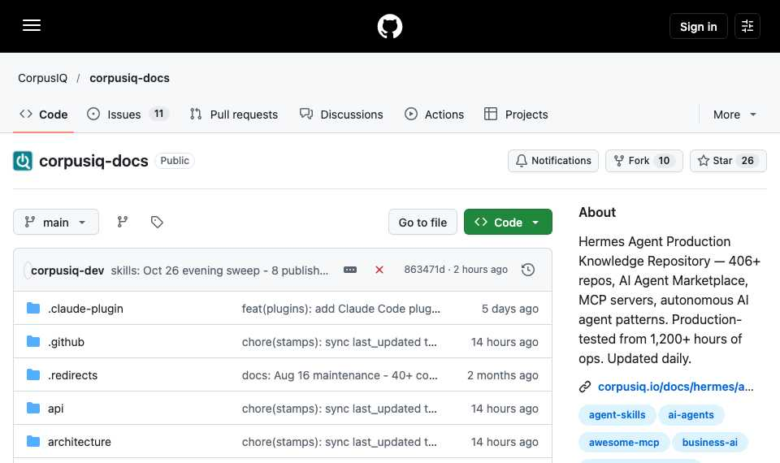</a><br>
      <b><a href="https://www.corpusiq.io/">CorpusIQ</a></b><br>
      <sub>托管商业数据 MCP 服务器：40+ 连接器查询 Stripe、GA4、Shopify 等业务数据</sub>
    </td>
    <td width="33%" valign="top">
      <a href="https://vaneform.com/mcp">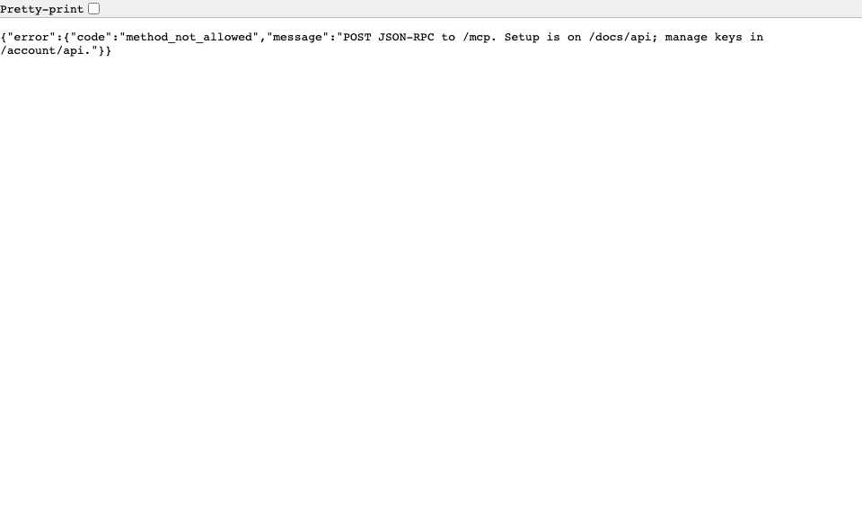</a><br>
      <b><a href="https://vaneform.com/mcp">Vaneform</a></b><br>
      <sub>托管网站流量 MCP：查询公开域名的估算访问量、趋势与来源等信号</sub>
    </td>
  </tr>
</table>

---

### 智能体

共 100 个 · [查看全部](https://rvelamen.github.io/Awesome-AI-Tools/category/智能体/)

<table>
  <tr>
    <td width="20%" valign="top">
      <a href="https://www.codebuddy.cn/work/">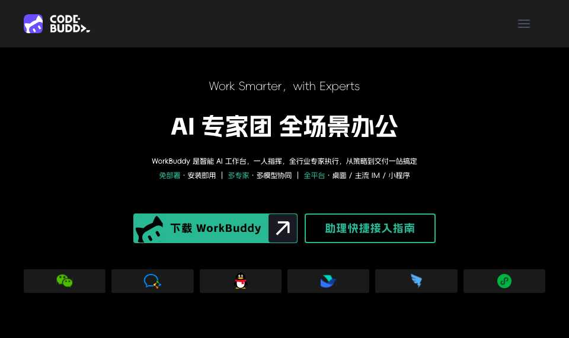</a><br>
      <b><a href="https://www.codebuddy.cn/work/">WorkBuddy</a></b><br>
      <sub>腾讯云推出的 AI 原生桌面智能体工作台</sub>
    </td>
    <td width="20%" valign="top">
      <a href="https://agent.xfyun.cn/home?ch=xcagent-aitool1">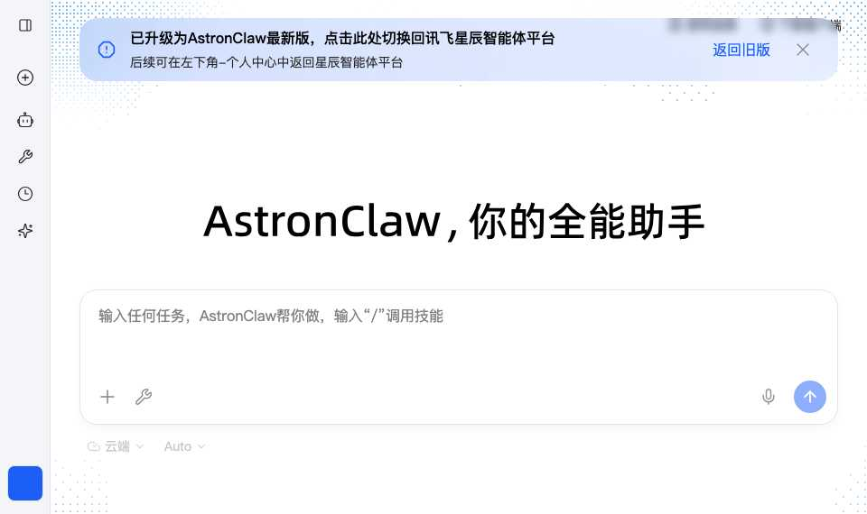</a><br>
      <b><a href="https://agent.xfyun.cn/home?ch=xcagent-aitool1">讯飞星辰Agent</a></b><br>
      <sub>科大讯飞推出的 AI 智能体开发平台</sub>
    </td>
    <td width="20%" valign="top">
      <a href="https://promo.aipyaipy.com/">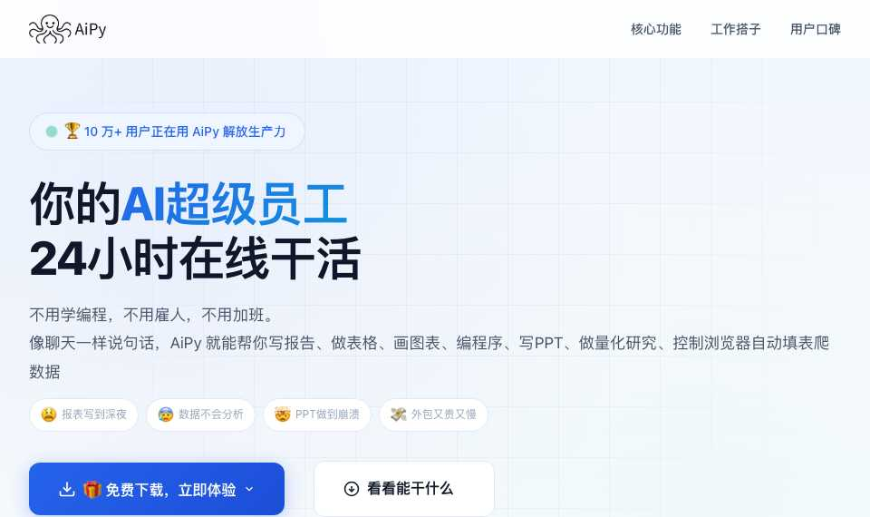</a><br>
      <b><a href="https://promo.aipyaipy.com/">爱派AiPy</a></b><br>
      <sub>本地运行的开源智能体，支持内网环境</sub>
    </td>
    <td width="20%" valign="top">
      <a href="https://seko.sensetime.com/">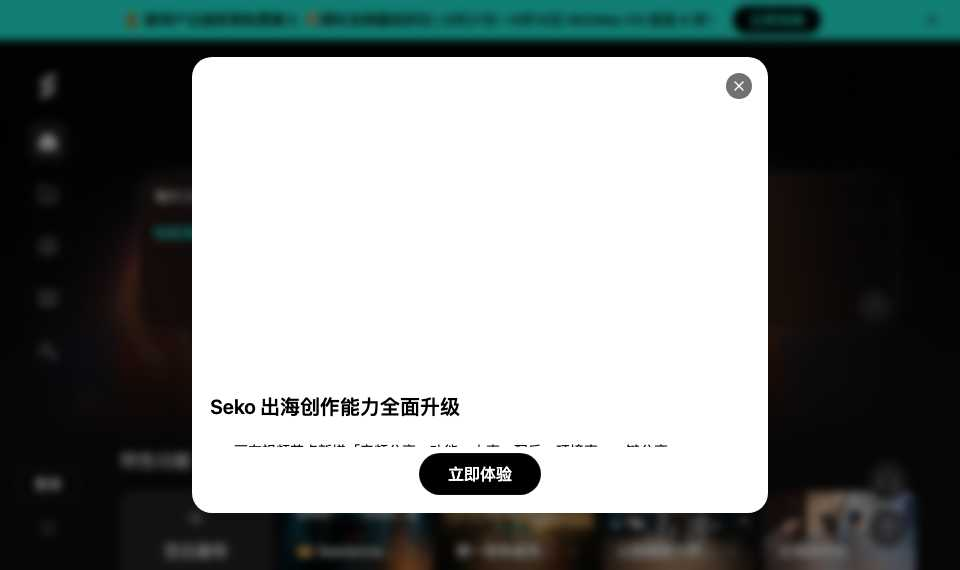</a><br>
      <b><a href="https://seko.sensetime.com/">Seko</a></b><br>
      <sub>商汤推出的创编一体 AI 视频创作 Agent</sub>
    </td>
    <td width="20%" valign="top">
      <a href="https://atoms.dev/">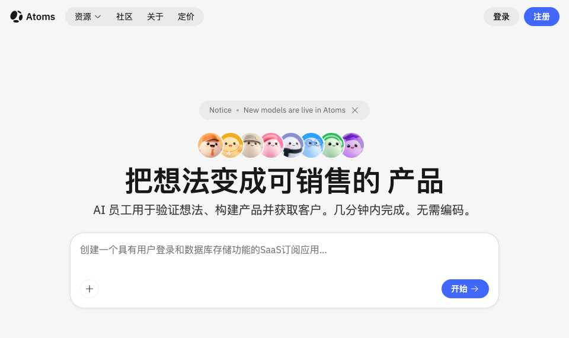</a><br>
      <b><a href="https://atoms.dev/">Atoms</a></b><br>
      <sub>自动构建真实业务的 AI 团队</sub>
    </td>
  </tr>
</table>

---

### 效能工具

共 84 个 · [查看全部](https://rvelamen.github.io/Awesome-AI-Tools/category/效能工具/)

<table>
  <tr>
    <td width="14%" valign="top">
      <a href="https://manus.im">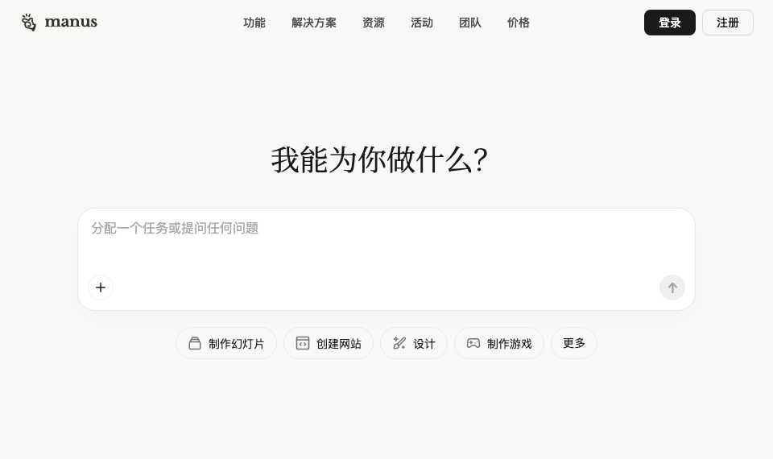</a><br>
      <b><a href="https://manus.im">Manus</a></b><br>
      <sub>Monica 团队推出的通用型 AI Agent</sub>
    </td>
    <td width="14%" valign="top">
      <a href="https://meetnewai.com">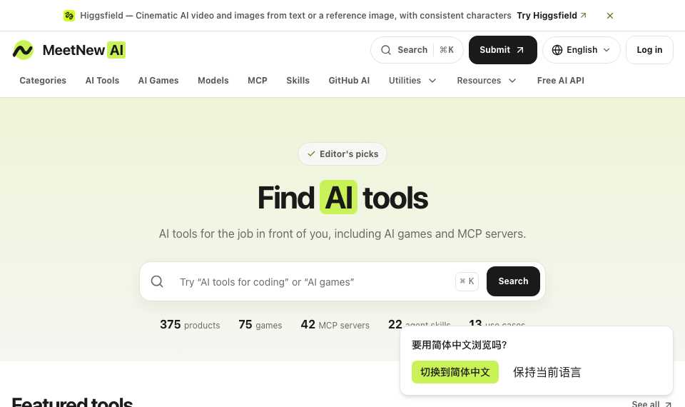</a><br>
      <b><a href="https://meetnewai.com">MeetNewAI</a></b><br>
      <sub>免费双语 AI 工具/游戏/MCP/技能目录，附带 AI 成本计算器</sub>
    </td>
    <td width="14%" valign="top">
      <a href="https://alternativer.org/">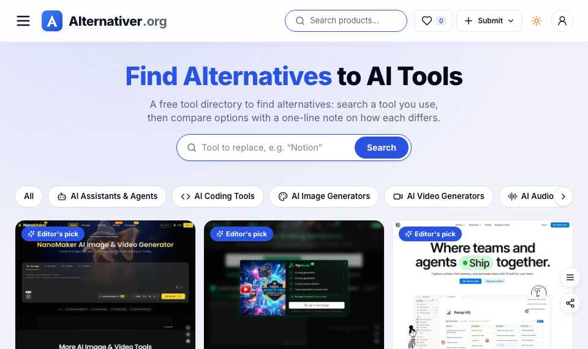</a><br>
      <b><a href="https://alternativer.org/">Alternativer</a></b><br>
      <sub>编辑策展的 AI 工具替代目录，可一句话对比定价与功能差异</sub>
    </td>
    <td width="14%" valign="top">
      <a href="https://monica.cn"></a><br>
      <b><a href="https://monica.cn">Monica</a></b><br>
      <sub>全能 AI 助手，提供聊天、搜索、写作、翻译等功能</sub>
    </td>
    <td width="14%" valign="top">
      <a href="https://ima.qq.com"></a><br>
      <b><a href="https://ima.qq.com">ima.copilot</a></b><br>
      <sub>腾讯推出的 AI 智能工作台，基于混元大模型</sub>
    </td>
    <td width="14%" valign="top">
      <a href="https://lingxi.wps.cn">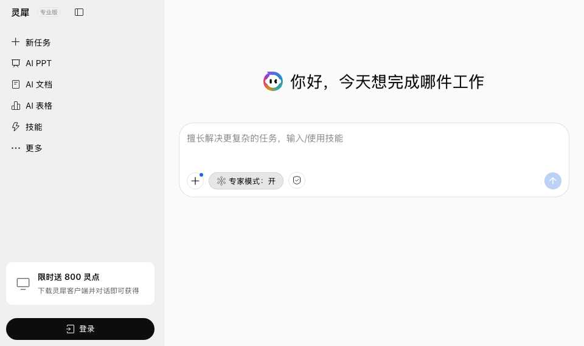</a><br>
      <b><a href="https://lingxi.wps.cn">WPS灵犀</a></b><br>
      <sub>WPS 推出的 AI 办公助手，支持 PPT 生成、AI 写作</sub>
    </td>
    <td width="14%" valign="top">
      <a href="https://tinywow.com/">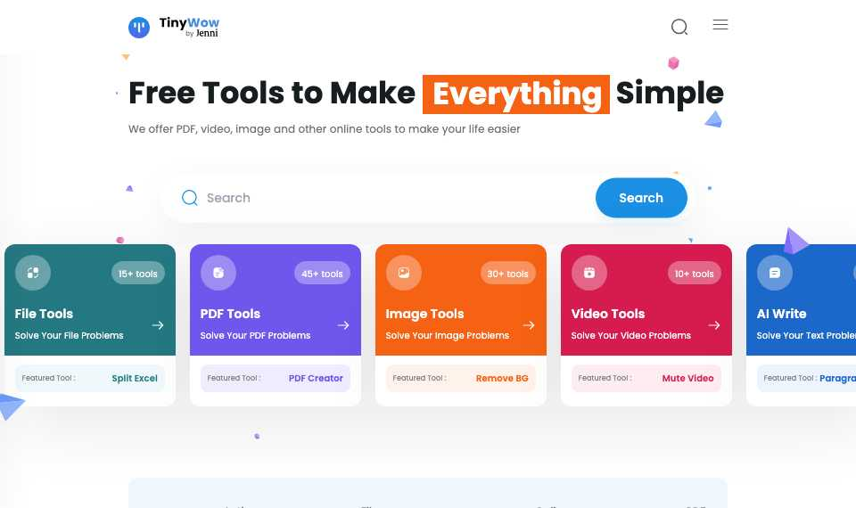</a><br>
      <b><a href="https://tinywow.com/">TinyWow</a></b><br>
      <sub>免费在线 AI 工具箱</sub>
    </td>
  </tr>
</table>

---

### 视频工具

共 256 个 · [查看全部](https://rvelamen.github.io/Awesome-AI-Tools/category/视频工具/)

<table>
  <tr>
    <td width="20%" valign="top">
      <a href="https://klingai.kuaishou.com"></a><br>
      <b><a href="https://klingai.kuaishou.com">可灵AI</a></b><br>
      <sub>快手推出的 AI 图像和视频创作平台</sub>
    </td>
    <td width="20%" valign="top">
      <a href="https://openai.com/sora">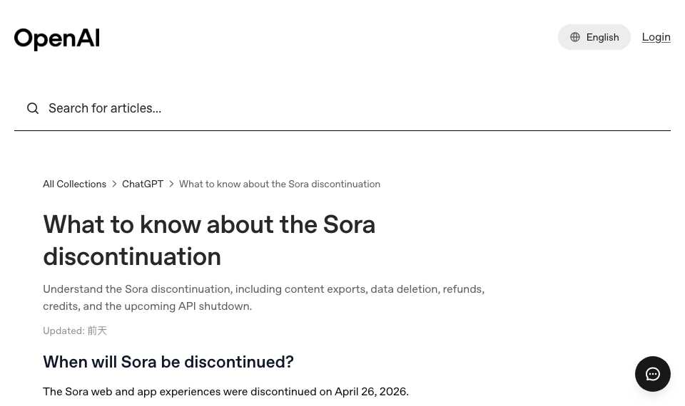</a><br>
      <b><a href="https://openai.com/sora">Sora</a></b><br>
      <sub>OpenAI 推出的 AI 视频生成模型</sub>
    </td>
    <td width="20%" valign="top">
      <a href="https://www.vidu.cn"></a><br>
      <b><a href="https://www.vidu.cn">Vidu</a></b><br>
      <sub>生数科技推出的 AI 视频生成大模型</sub>
    </td>
    <td width="20%" valign="top">
      <a href="https://heygen.com">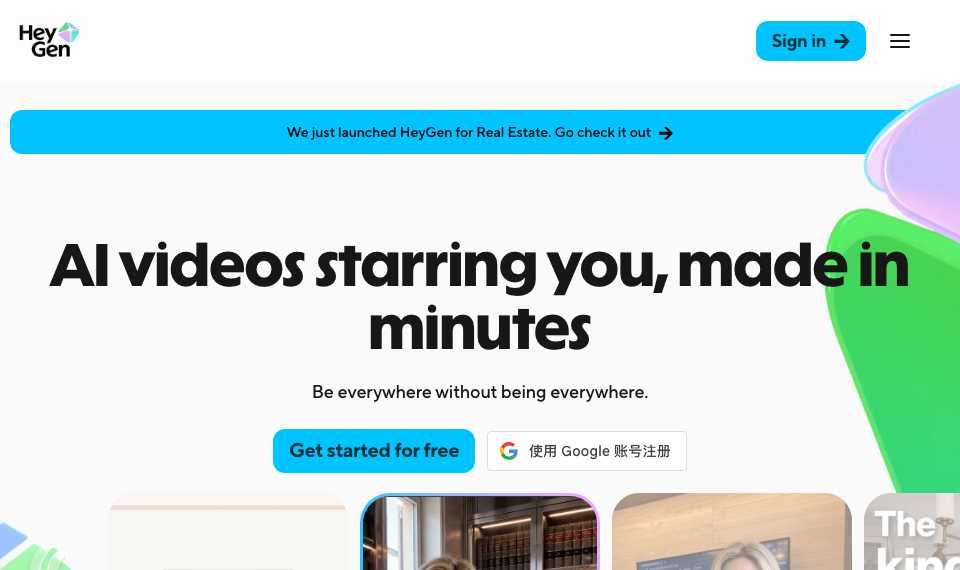</a><br>
      <b><a href="https://heygen.com">HeyGen</a></b><br>
      <sub>AI 数字人视频创作平台</sub>
    </td>
    <td width="20%" valign="top">
      <a href="https://aibrm.paluai.com/bairimeng"></a><br>
      <b><a href="https://aibrm.paluai.com/bairimeng">白日梦</a></b><br>
      <sub>AI 视频创作平台，最长可生成六分钟视频</sub>
    </td>
  </tr>
</table>

---

### 图像工具

共 104 个 · [查看全部](https://rvelamen.github.io/Awesome-AI-Tools/category/图像工具/)

<table>
  <tr>
    <td width="20%" valign="top">
      <a href="https://www.midjourney.com/home">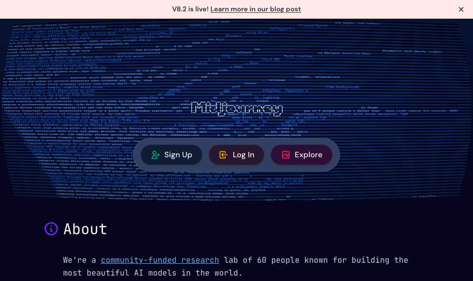</a><br>
      <b><a href="https://www.midjourney.com/home">Midjourney</a></b><br>
      <sub>AI 图像和插画生成工具</sub>
    </td>
    <td width="20%" valign="top">
      <a href="https://jimeng.jianying.com/ai-tool/home">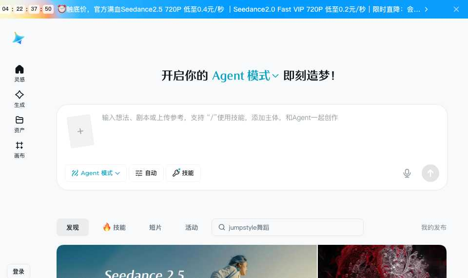</a><br>
      <b><a href="https://jimeng.jianying.com/ai-tool/home">即梦</a></b><br>
      <sub>抖音旗下 AI 图片创作工具</sub>
    </td>
    <td width="20%" valign="top">
      <a href="https://tusiart.com">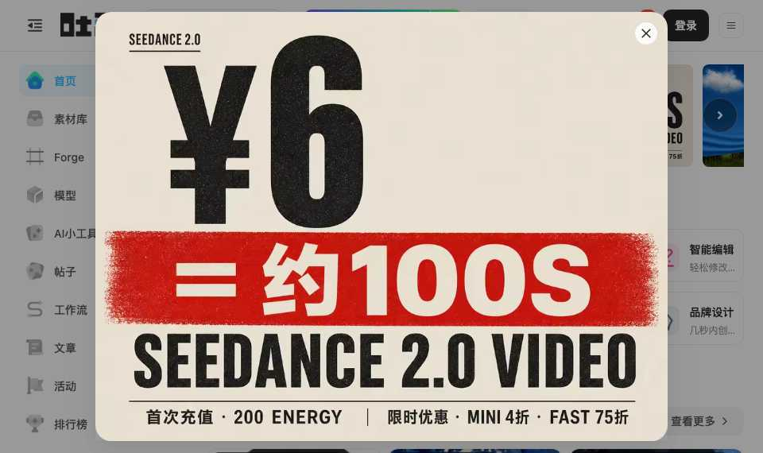</a><br>
      <b><a href="https://tusiart.com">吐司AI</a></b><br>
      <sub>AI 绘画模型社区和在线生图平台</sub>
    </td>
    <td width="20%" valign="top">
      <a href="https://www.gaoding.com"></a><br>
      <b><a href="https://www.gaoding.com">稿定AI</a></b><br>
      <sub>一站式设计工具集，AI 绘图、抠图消除</sub>
    </td>
    <td width="20%" valign="top">
      <a href="https://artistrylab.net"></a><br>
      <b><a href="https://artistrylab.net">炉米Lumi</a></b><br>
      <sub>字节跳动推出的 AIGC 图像创作平台</sub>
    </td>
  </tr>
</table>

---

### 图片插画生成

共 85 个 · [查看全部](https://rvelamen.github.io/Awesome-AI-Tools/category/图片插画生成/)

<table>
  <tr>
    <td width="25%" valign="top">
      <a href="https://civitai.com/">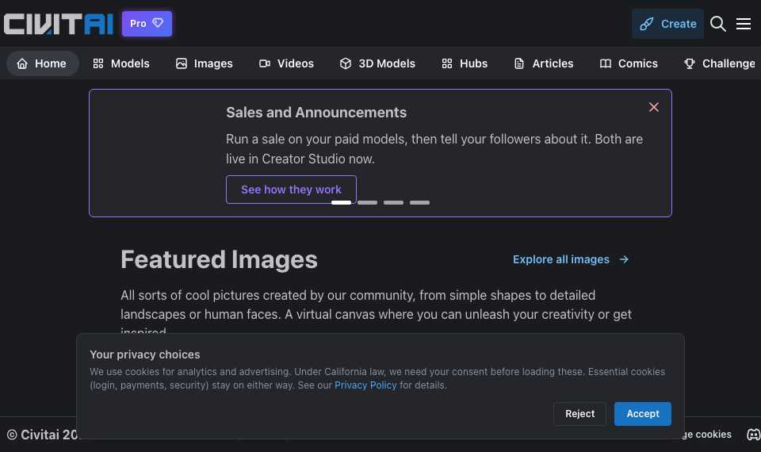</a><br>
      <b><a href="https://civitai.com/">Civitai</a></b><br>
      <sub>AI 绘画作品和模型分享社区</sub>
    </td>
    <td width="25%" valign="top">
      <a href="https://tongyi.aliyun.com/wanxiang"></a><br>
      <b><a href="https://tongyi.aliyun.com/wanxiang">通义万相</a></b><br>
      <sub>阿里推出的 AI 绘画创作模型</sub>
    </td>
    <td width="25%" valign="top">
      <a href="https://d.design"></a><br>
      <b><a href="https://d.design">堆友AI反应堆</a></b><br>
      <sub>阿里旗下堆友推出的多风格 AI 绘画生成器</sub>
    </td>
    <td width="25%" valign="top">
      <a href="https://miaohua.sensetime.com/inspiration">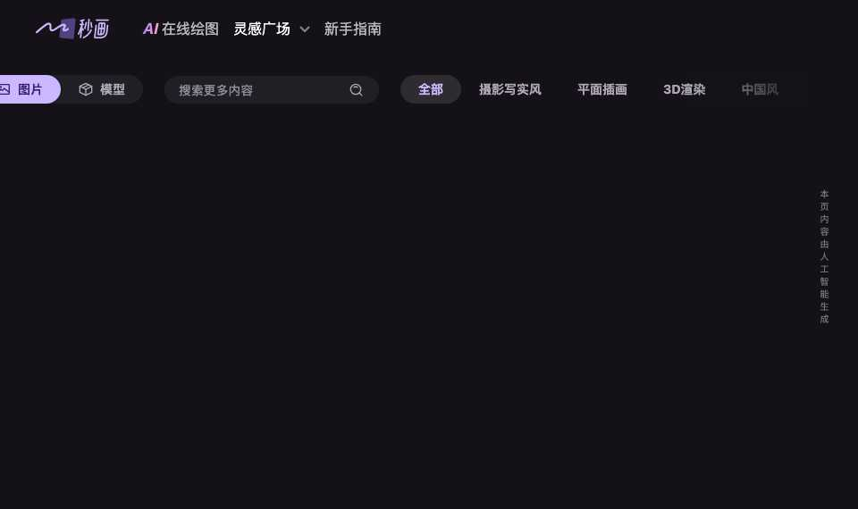</a><br>
      <b><a href="https://miaohua.sensetime.com/inspiration">秒画</a></b><br>
      <sub>商汤科技推出的 AI 作画和图片生成平台</sub>
    </td>
  </tr>
</table>

---

### 音频工具

共 97 个 · [查看全部](https://rvelamen.github.io/Awesome-AI-Tools/category/音频工具/)

<table>
  <tr>
    <td width="16%" valign="top">
      <a href="https://www.suno.ai"></a><br>
      <b><a href="https://www.suno.ai">Suno</a></b><br>
      <sub>高质量的 AI 音乐创作平台</sub>
    </td>
    <td width="16%" valign="top">
      <a href="https://www.haimian.com">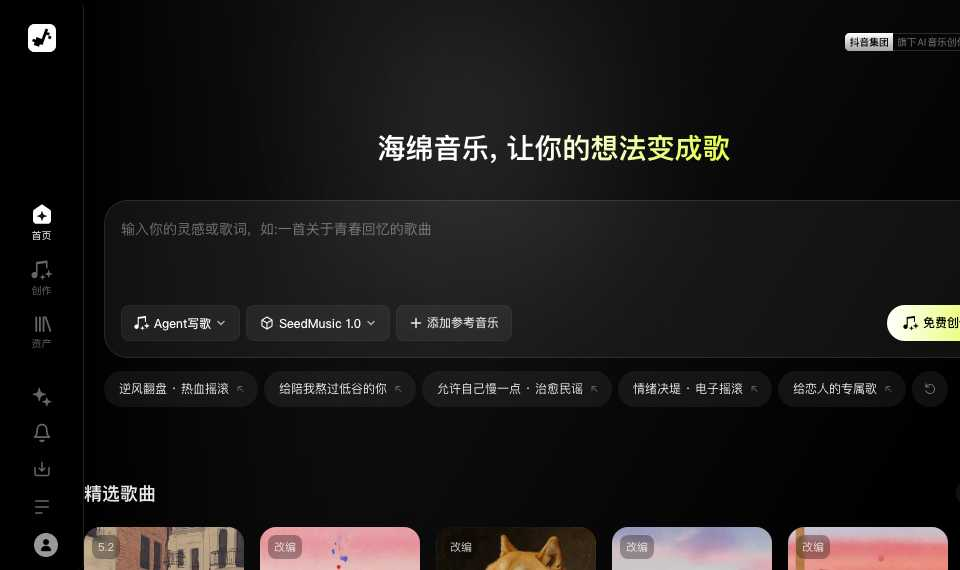</a><br>
      <b><a href="https://www.haimian.com">海绵音乐</a></b><br>
      <sub>字节跳动推出的 AI 音乐创作和发现平台</sub>
    </td>
    <td width="16%" valign="top">
      <a href="https://www.moyin.com"></a><br>
      <b><a href="https://www.moyin.com">魔音工坊</a></b><br>
      <sub>AI 配音工具，可配出媲美真人的声音</sub>
    </td>
    <td width="16%" valign="top">
      <a href="https://tingwu.aliyun.com">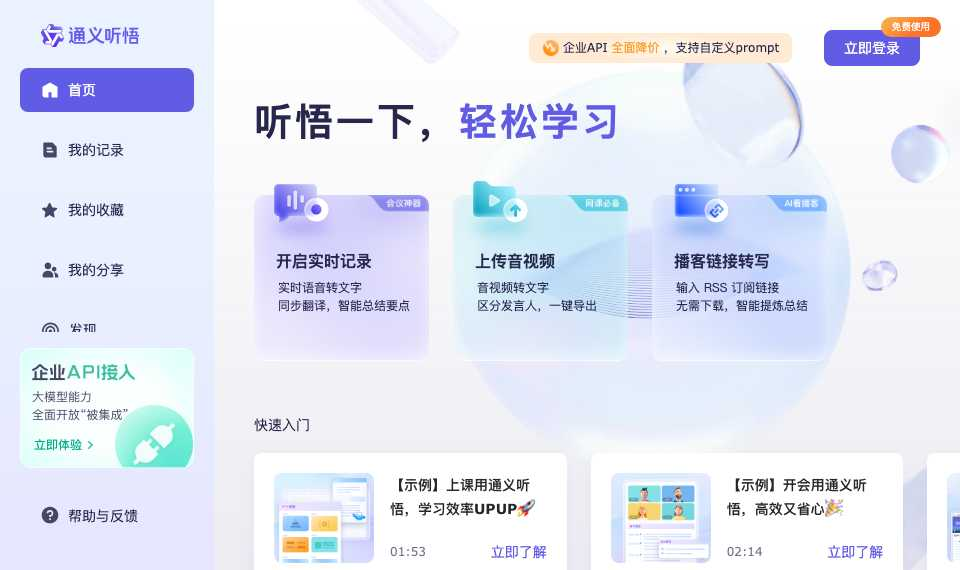</a><br>
      <b><a href="https://tingwu.aliyun.com">通义听悟</a></b><br>
      <sub>阿里推出的 AI 会议转录工具</sub>
    </td>
    <td width="16%" valign="top">
      <a href="https://noiz.ai/landing"></a><br>
      <b><a href="https://noiz.ai/landing">Noiz AI</a></b><br>
      <sub>AI 配音工具，支持文本转语音和声音克隆</sub>
    </td>
    <td width="16%" valign="top">
      <a href="https://video2text.ttt.so">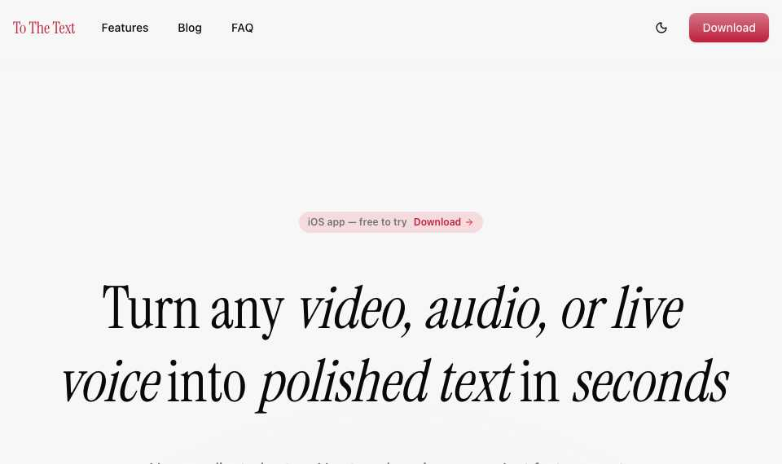</a><br>
      <b><a href="https://video2text.ttt.so">Transcribe Video: To The Text</a></b><br>
      <sub>iPhone 应用：视频文件、YouTube/Vimeo 链接与实时语音转文字，支持说话人视图、摘要与 TXT/DOCX 导出</sub>
    </td>
  </tr>
</table>

---

### 写作工具

共 84 个 · [查看全部](https://rvelamen.github.io/Awesome-AI-Tools/category/写作工具/)

<table>
  <tr>
    <td width="20%" valign="top">
      <a href="https://laper.ai/">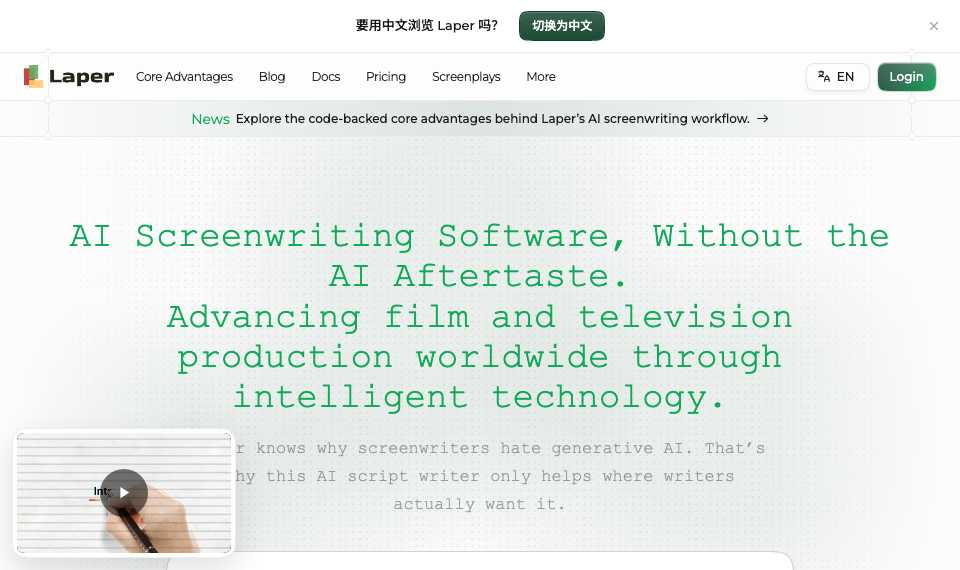</a><br>
      <b><a href="https://laper.ai/">Laper</a></b><br>
      <sub>AI 原生剧本创作工具</sub>
    </td>
    <td width="20%" valign="top">
      <a href="https://www.jucloud.com/">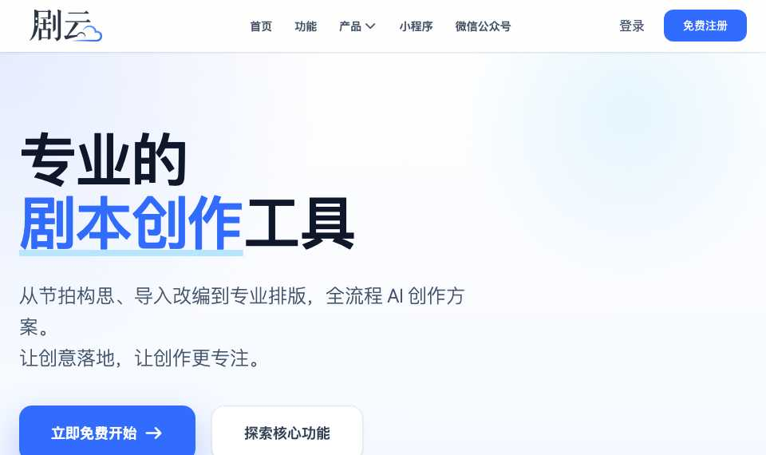</a><br>
      <b><a href="https://www.jucloud.com/">剧云</a></b><br>
      <sub>AI 智能中文剧本创作平台</sub>
    </td>
    <td width="20%" valign="top">
      <a href="https://app.qinyanai.com/">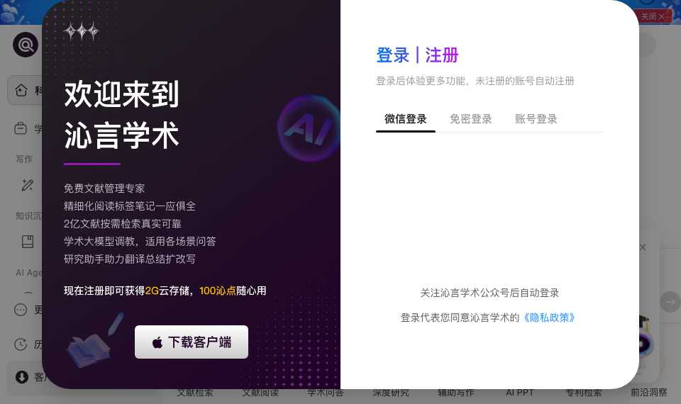</a><br>
      <b><a href="https://app.qinyanai.com/">沁言学术</a></b><br>
      <sub>AI 科研写作平台，一站式文献管理</sub>
    </td>
    <td width="20%" valign="top">
      <a href="https://ibiling.cn/novel-workbench/"></a><br>
      <b><a href="https://ibiling.cn/novel-workbench/">笔灵AI小说</a></b><br>
      <sub>AI 小说写作工具，支持大纲与素材生成</sub>
    </td>
    <td width="20%" valign="top">
      <a href="https://mymmc.cn/?fromId=954f8p78">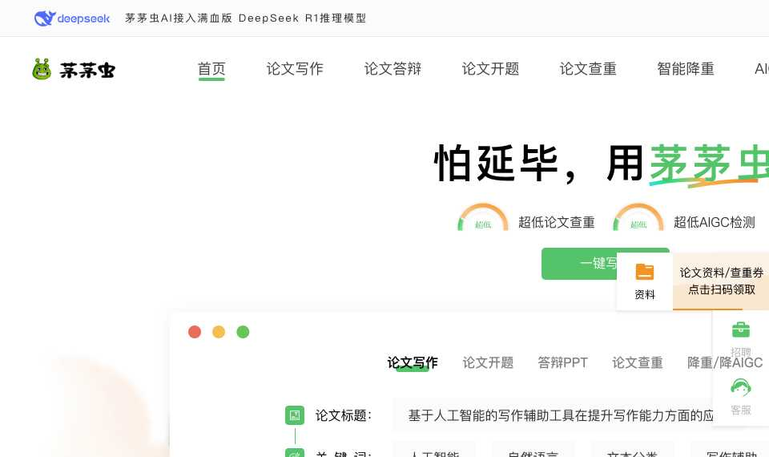</a><br>
      <b><a href="https://mymmc.cn/?fromId=954f8p78">茅茅虫</a></b><br>
      <sub>一站式 AI 论文写作助手</sub>
    </td>
  </tr>
</table>

---

### 设计工具

共 98 个 · [查看全部](https://rvelamen.github.io/Awesome-AI-Tools/category/设计工具/)

<table>
  <tr>
    <td width="20%" valign="top">
      <a href="https://www.figma.com/ai">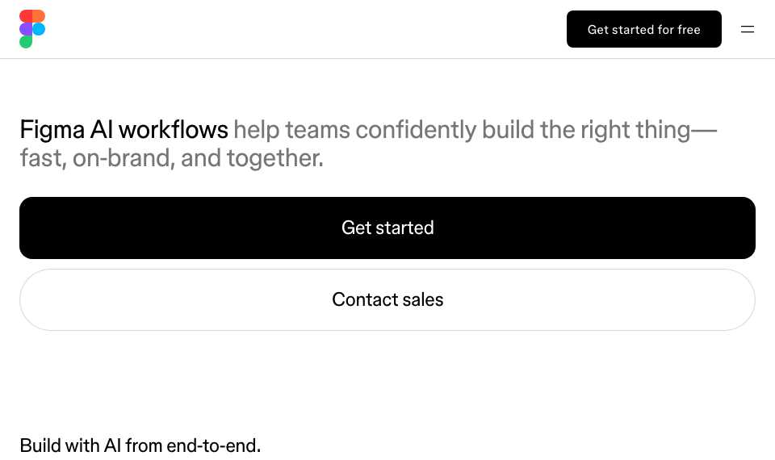</a><br>
      <b><a href="https://www.figma.com/ai">Figma AI</a></b><br>
      <sub>Figma 推出的原生 AI 设计能力</sub>
    </td>
    <td width="20%" valign="top">
      <a href="https://www.recraft.ai">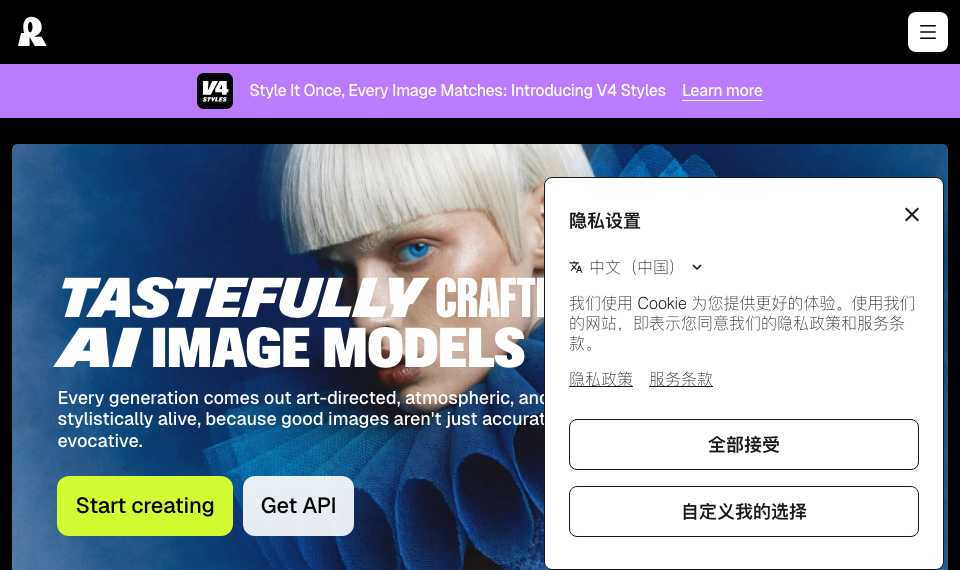</a><br>
      <b><a href="https://www.recraft.ai">Recraft AI</a></b><br>
      <sub>AI 画板，生成矢量艺术画、图标、3D 图片和插画</sub>
    </td>
    <td width="20%" valign="top">
      <a href="https://designer.microsoft.com/"></a><br>
      <b><a href="https://designer.microsoft.com/">Microsoft Designer</a></b><br>
      <sub>微软推出的在线海报和宣传图设计工具</sub>
    </td>
    <td width="20%" valign="top">
      <a href="https://www.canva.cn/magic">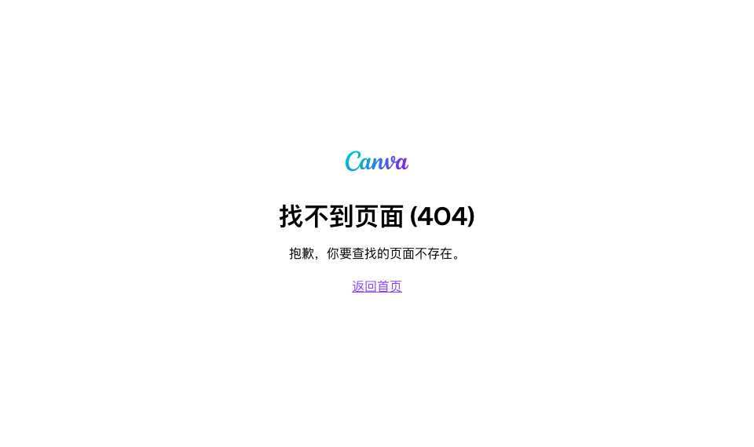</a><br>
      <b><a href="https://www.canva.cn/magic">魔力工作室</a></b><br>
      <sub>Canva 可画推出的一站式 AI 创作套件</sub>
    </td>
    <td width="20%" valign="top">
      <a href="https://www.piccopilot.com/create"></a><br>
      <b><a href="https://www.piccopilot.com/create">Pic Copilot</a></b><br>
      <sub>阿里国际推出的 AI 电商设计工具</sub>
    </td>
  </tr>
</table>

---

### 搜索引擎

共 49 个 · [查看全部](https://rvelamen.github.io/Awesome-AI-Tools/category/搜索引擎/)

<table>
  <tr>
    <td width="20%" valign="top">
      <a href="https://www.perplexity.ai">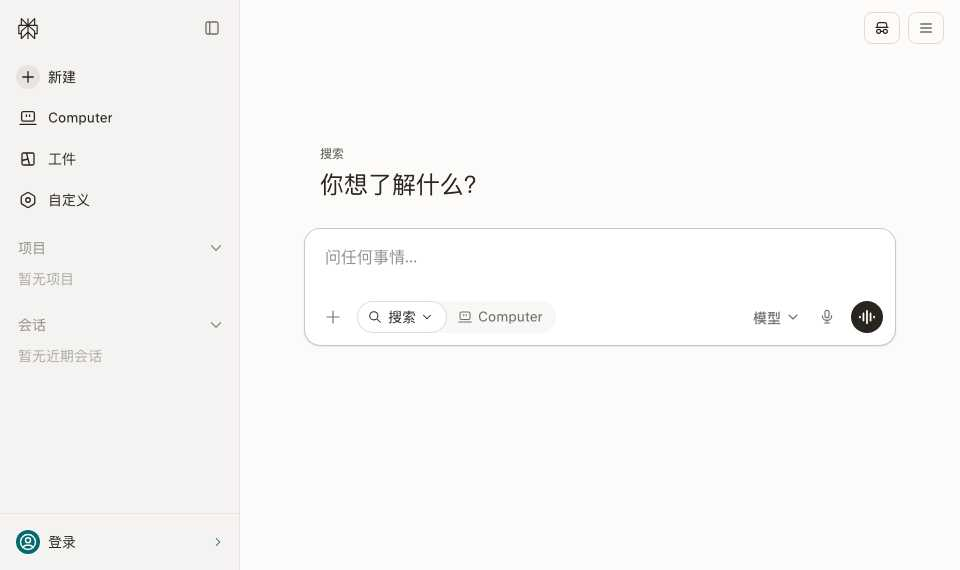</a><br>
      <b><a href="https://www.perplexity.ai">Perplexity</a></b><br>
      <sub>对话式 AI 搜索引擎</sub>
    </td>
    <td width="20%" valign="top">
      <a href="https://metaso.cn">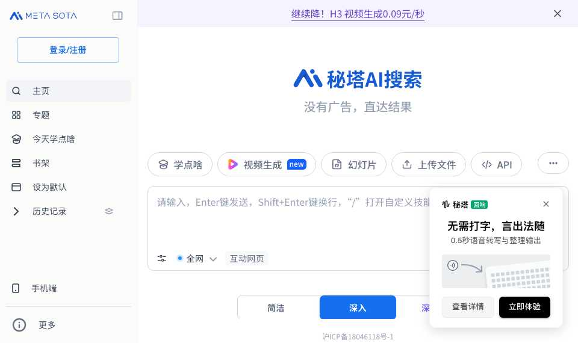</a><br>
      <b><a href="https://metaso.cn">秘塔AI搜索</a></b><br>
      <sub>无广告、直达结果的 AI 搜索工具</sub>
    </td>
    <td width="20%" valign="top">
      <a href="https://www.genspark.ai">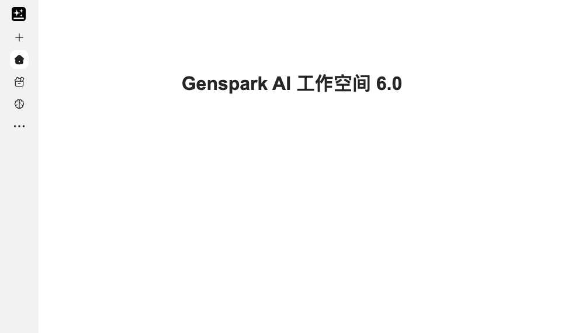</a><br>
      <b><a href="https://www.genspark.ai">Genspark</a></b><br>
      <sub>基于智能体的搜索引擎</sub>
    </td>
    <td width="20%" valign="top">
      <a href="https://devv.ai/zh">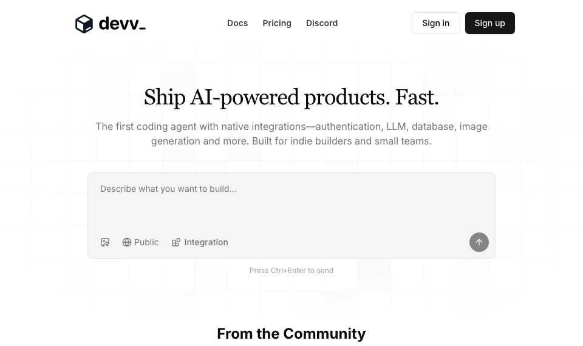</a><br>
      <b><a href="https://devv.ai/zh">Devv</a></b><br>
      <sub>面向程序员的 AI 搜索引擎</sub>
    </td>
    <td width="20%" valign="top">
      <a href="https://b.quark.cn/apps/qkhomepage_twofoufeb/routes/model">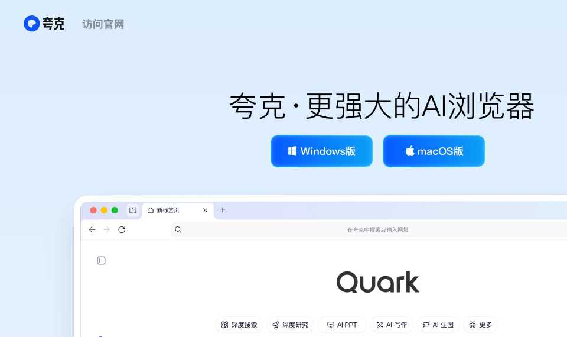</a><br>
      <b><a href="https://b.quark.cn/apps/qkhomepage_twofoufeb/routes/model">夸克AI</a></b><br>
      <sub>集 AI 搜索、网盘、文档、创作于一体的应用</sub>
    </td>
  </tr>
</table>

---

### PPT

共 48 个 · [查看全部](https://rvelamen.github.io/Awesome-AI-Tools/category/PPT/)

<table>
  <tr>
    <td width="20%" valign="top">
      <a href="https://gamma.app/"></a><br>
      <b><a href="https://gamma.app/">Gamma App</a></b><br>
      <sub>AI 幻灯片演示生成工具</sub>
    </td>
    <td width="20%" valign="top">
      <a href="https://www.aippt.cn">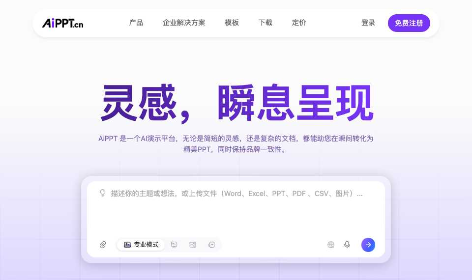</a><br>
      <b><a href="https://www.aippt.cn">AiPPT</a></b><br>
      <sub>AI 快速生成高质量 PPT</sub>
    </td>
    <td width="20%" valign="top">
      <a href="https://www.islide.cc">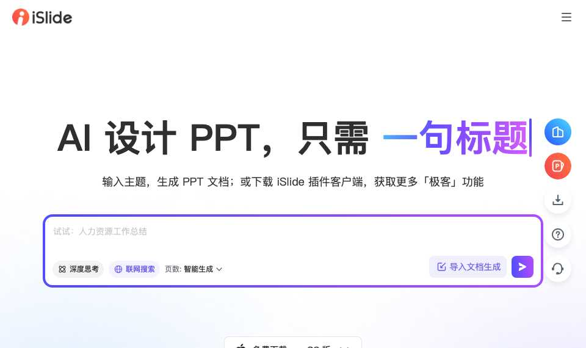</a><br>
      <b><a href="https://www.islide.cc">iSlide AIPPT</a></b><br>
      <sub>输入一句标题即可生成 PPT</sub>
    </td>
    <td width="20%" valign="top">
      <a href="https://zhiwen.xfyun.cn"></a><br>
      <b><a href="https://zhiwen.xfyun.cn">讯飞智文</a></b><br>
      <sub>科大讯飞推出的 AI PPT 生成工具</sub>
    </td>
    <td width="20%" valign="top">
      <a href="https://www.cappt.cc"></a><br>
      <b><a href="https://www.cappt.cc">咔片PPT</a></b><br>
      <sub>AI PPT 制作工具，设计美化全流程自动化</sub>
    </td>
  </tr>
</table>

---

### 文档工具

共 37 个 · [查看全部](https://rvelamen.github.io/Awesome-AI-Tools/category/文档工具/)

<table>
  <tr>
    <td width="20%" valign="top">
      <a href="https://ai.wps.cn">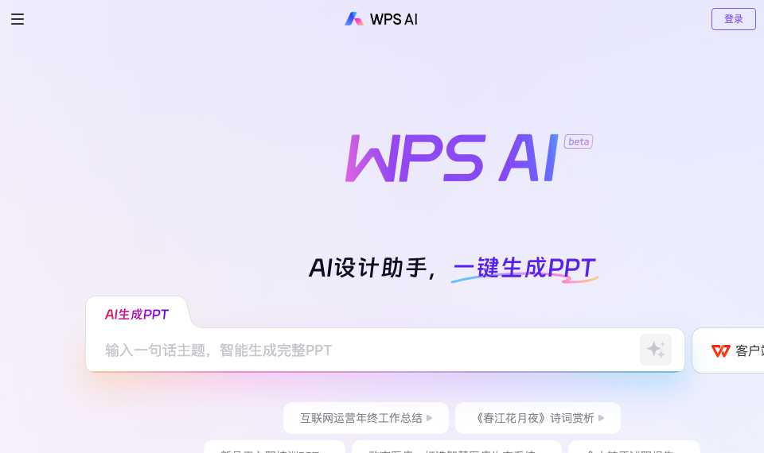</a><br>
      <b><a href="https://ai.wps.cn">WPS AI</a></b><br>
      <sub>WPS 推出的 AI 办公助手</sub>
    </td>
    <td width="20%" valign="top">
      <a href="https://www.wanzhi01.com">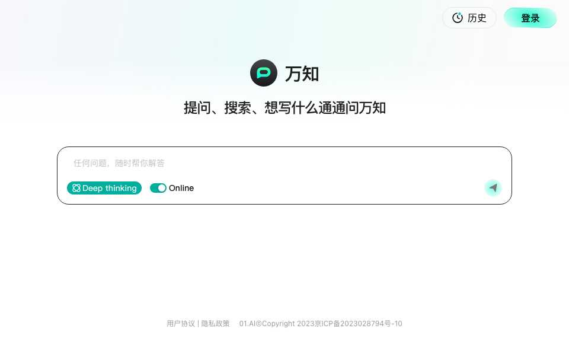</a><br>
      <b><a href="https://www.wanzhi01.com">万知</a></b><br>
      <sub>零一万物推出的一站式 AI 文档阅读和 PPT 创作工作台</sub>
    </td>
    <td width="20%" valign="top">
      <a href="https://noedgeai.com">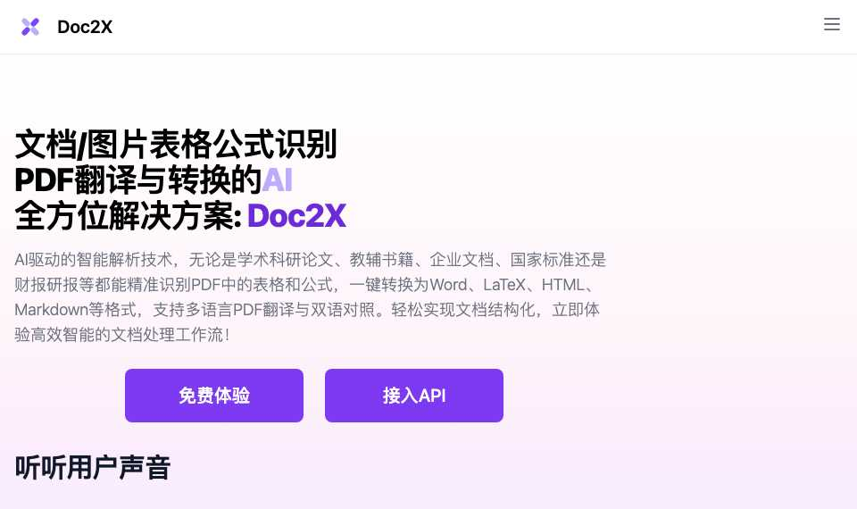</a><br>
      <b><a href="https://noedgeai.com">Doc2X</a></b><br>
      <sub>AI 文档识别、转换与翻译工具</sub>
    </td>
    <td width="20%" valign="top">
      <a href="https://www.txyz.ai">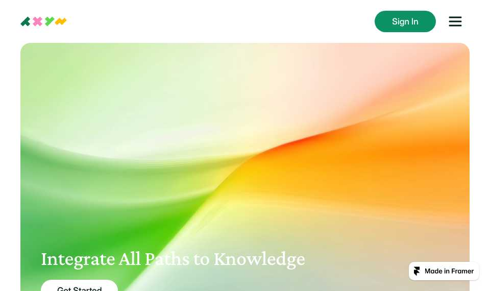</a><br>
      <b><a href="https://www.txyz.ai">txyz</a></b><br>
      <sub>AI 文献阅读和学术研究辅助平台</sub>
    </td>
    <td width="20%" valign="top">
      <a href="https://www.quivr.app"></a><br>
      <b><a href="https://www.quivr.app">Quivr</a></b><br>
      <sub>开源知识库搭建工具，构建第二大脑</sub>
    </td>
  </tr>
</table>

---

### 训练模型

共 42 个 · [查看全部](https://rvelamen.github.io/Awesome-AI-Tools/category/训练模型/)

<table>
  <tr>
    <td width="20%" valign="top">
      <a href="https://ollama.ai/">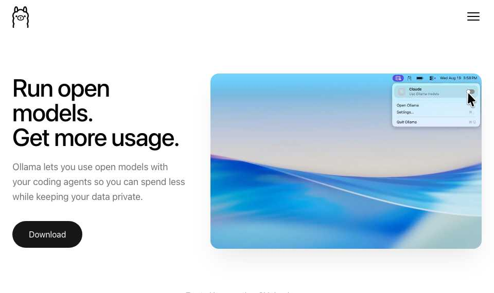</a><br>
      <b><a href="https://ollama.ai/">Ollama</a></b><br>
      <sub>本地运行 Llama 和其他大语言模型</sub>
    </td>
    <td width="20%" valign="top">
      <a href="https://www.modelscope.cn/"></a><br>
      <b><a href="https://www.modelscope.cn/">魔搭社区</a></b><br>
      <sub>阿里达摩院推出的 AI 模型社区，300+ 开源模型</sub>
    </td>
    <td width="20%" valign="top">
      <a href="https://www.cherry-ai.com/"></a><br>
      <b><a href="https://www.cherry-ai.com/">Cherry Studio</a></b><br>
      <sub>开源全能 AI 客户端助手</sub>
    </td>
    <td width="20%" valign="top">
      <a href="https://agpt.co/"></a><br>
      <b><a href="https://agpt.co/">AutoGPT</a></b><br>
      <sub>自主执行任务的实验性开源 Agent 项目</sub>
    </td>
    <td width="20%" valign="top">
      <a href="https://jan.ai/"></a><br>
      <b><a href="https://jan.ai/">Jan</a></b><br>
      <sub>本地运行大模型并进行 AI 对话的开源工具</sub>
    </td>
  </tr>
</table>

---

### 翻译

共 27 个 · [查看全部](https://rvelamen.github.io/Awesome-AI-Tools/category/翻译/)

<table>
  <tr>
    <td width="20%" valign="top">
      <a href="https://immersivetranslate.com/zh-Hans"></a><br>
      <b><a href="https://immersivetranslate.com/zh-Hans">沉浸式翻译</a></b><br>
      <sub>双语对照的网页翻译插件</sub>
    </td>
    <td width="20%" valign="top">
      <a href="https://www.deepl.com/translator"></a><br>
      <b><a href="https://www.deepl.com/translator">DeepL翻译</a></b><br>
      <sub>以准确度著称的 AI 翻译工具</sub>
    </td>
    <td width="20%" valign="top">
      <a href="https://translate.google.com/"></a><br>
      <b><a href="https://translate.google.com/">Google翻译</a></b><br>
      <sub>上百种语言智能翻译</sub>
    </td>
    <td width="20%" valign="top">
      <a href="https://transmart.qq.com"></a><br>
      <b><a href="https://transmart.qq.com">腾讯交互翻译</a></b><br>
      <sub>腾讯推出的多语言翻译工具</sub>
    </td>
    <td width="20%" valign="top">
      <a href="https://huiyiai.net/"></a><br>
      <b><a href="https://huiyiai.net/">会译</a></b><br>
      <sub>沉浸对照式翻译，支持 100+ 语言</sub>
    </td>
  </tr>
</table>

---

### 表格

共 25 个 · [查看全部](https://rvelamen.github.io/Awesome-AI-Tools/category/表格/)

<table>
  <tr>
    <td width="20%" valign="top">
      <a href="https://www.chatexcel.com/#/home"></a><br>
      <b><a href="https://www.chatexcel.com/#/home">酷表ChatExcel</a></b><br>
      <sub>AI Excel 数据分析辅助工具</sub>
    </td>
    <td width="20%" valign="top">
      <a href="https://www.xiaohuanxiong.com"></a><br>
      <b><a href="https://www.xiaohuanxiong.com">办公小浣熊</a></b><br>
      <sub>商汤科技推出的 AI 办公助手</sub>
    </td>
    <td width="20%" valign="top">
      <a href="https://vika.cn"></a><br>
      <b><a href="https://vika.cn">vika维格云</a></b><br>
      <sub>智能多维表格和数据生产力平台</sub>
    </td>
    <td width="20%" valign="top">
      <a href="https://ajelix.com/"></a><br>
      <b><a href="https://ajelix.com/">Ajelix</a></b><br>
      <sub>处理 Excel 和 Google Sheets 的 AI 工具</sub>
    </td>
    <td width="20%" valign="top">
      <a href="https://excelformulabot.com"></a><br>
      <b><a href="https://excelformulabot.com">Formula bot</a></b><br>
      <sub>将自然语言指令转换成 Excel 函数公式</sub>
    </td>
  </tr>
</table>

---

### 思维导图

共 21 个 · [查看全部](https://rvelamen.github.io/Awesome-AI-Tools/category/思维导图/)

<table>
  <tr>
    <td width="20%" valign="top">
      <a href="https://shutu.cn"></a><br>
      <b><a href="https://shutu.cn">TreeMind树图</a></b><br>
      <sub>一句话生成思维导图</sub>
    </td>
    <td width="20%" valign="top">
      <a href="https://www.processon.com"></a><br>
      <b><a href="https://www.processon.com">ProcessOn</a></b><br>
      <sub>在线 AI 流程图和思维导图制作工具</sub>
    </td>
    <td width="20%" valign="top">
      <a href="https://boardmix.cn/ai-whiteboard"></a><br>
      <b><a href="https://boardmix.cn/ai-whiteboard">博思白板</a></b><br>
      <sub>AI 多功能在线白板</sub>
    </td>
    <td width="20%" valign="top">
      <a href="https://mapify.so/cn"></a><br>
      <b><a href="https://mapify.so/cn">Mapify</a></b><br>
      <sub>Xmind 推出的思维导图生成工具</sub>
    </td>
    <td width="20%" valign="top">
      <a href="https://www.edrawsoft.cn/mindmaster"></a><br>
      <b><a href="https://www.edrawsoft.cn/mindmaster">亿图脑图</a></b><br>
      <sub>亿图推出的思维导图助手</sub>
    </td>
  </tr>
</table>

---

### 商品图生成

共 35 个 · [查看全部](https://rvelamen.github.io/Awesome-AI-Tools/category/商品图生成/)

<table>
  <tr>
    <td width="20%" valign="top">
      <a href="https://ihuiwa.paluai.com"></a><br>
      <b><a href="https://ihuiwa.paluai.com">绘蛙</a></b><br>
      <sub>AI 电商营销工具，生成商品图和种草文案</sub>
    </td>
    <td width="20%" valign="top">
      <a href="https://www.meijian.com/e-commerce"></a><br>
      <b><a href="https://www.meijian.com/e-commerce">美间AI商拍</a></b><br>
      <sub>一键生成高质量商品图</sub>
    </td>
    <td width="20%" valign="top">
      <a href="https://psai.cn"></a><br>
      <b><a href="https://psai.cn">PhotoStudio AI</a></b><br>
      <sub>虹软旗下 AI 商拍工具</sub>
    </td>
    <td width="20%" valign="top">
      <a href="https://ling.jd.com/"></a><br>
      <b><a href="https://ling.jd.com/">羚珑</a></b><br>
      <sub>京东推出的商品图智能设计工具</sub>
    </td>
    <td width="20%" valign="top">
      <a href="https://ai.linkfox.com"></a><br>
      <b><a href="https://ai.linkfox.com">LinkFox AI</a></b><br>
      <sub>AI 电商设计工具，快速生成专业电商图</sub>
    </td>
  </tr>
</table>

---

### 背景消除

共 33 个 · [查看全部](https://rvelamen.github.io/Awesome-AI-Tools/category/背景消除/)

<table>
  <tr>
    <td width="20%" valign="top">
      <a href="https://pixian.ai"></a><br>
      <b><a href="https://pixian.ai">Pixian.AI</a></b><br>
      <sub>AI 图片背景抠除工具</sub>
    </td>
    <td width="20%" valign="top">
      <a href="https://bgsub.cn/"></a><br>
      <b><a href="https://bgsub.cn/">BgSub</a></b><br>
      <sub>保护隐私的 AI 图片背景去除工具</sub>
    </td>
    <td width="20%" valign="top">
      <a href="https://kt.94xy.com"></a><br>
      <b><a href="https://kt.94xy.com">鲜艺AI抠图</a></b><br>
      <sub>支持离线安装使用的 AI 抠图工具</sub>
    </td>
    <td width="20%" valign="top">
      <a href="https://icons8.com/bgremover"></a><br>
      <b><a href="https://icons8.com/bgremover">Icons8 Background Remover</a></b><br>
      <sub>Icons8 出品的图片背景移除工具</sub>
    </td>
    <td width="20%" valign="top">
      <a href="https://clipdrop.co/remove-background"></a><br>
      <b><a href="https://clipdrop.co/remove-background">ClipDrop Remove Background</a></b><br>
      <sub>ClipDrop 出品的 AI 图片背景移除工具</sub>
    </td>
  </tr>
</table>

---

### 图片无损放大

共 25 个 · [查看全部](https://rvelamen.github.io/Awesome-AI-Tools/category/图片无损放大/)

<table>
  <tr>
    <td width="20%" valign="top">
      <a href="https://www.upscayl.org/"></a><br>
      <b><a href="https://www.upscayl.org/">Upscayl</a></b><br>
      <sub>免费开源的 AI 图片无损放大工具</sub>
    </td>
    <td width="20%" valign="top">
      <a href="https://bigjpg.com/"></a><br>
      <b><a href="https://bigjpg.com/">BigJPG</a></b><br>
      <sub>在线图片无损放大工具</sub>
    </td>
    <td width="20%" valign="top">
      <a href="https://magnific.ai"></a><br>
      <b><a href="https://magnific.ai">Magnific AI</a></b><br>
      <sub>AI 图像放大工具，最高支持 10K 分辨率</sub>
    </td>
    <td width="20%" valign="top">
      <a href="https://letsenhance.io"></a><br>
      <b><a href="https://letsenhance.io">Let’s Enhance</a></b><br>
      <sub>AI 在线放大图片并保持图像质量</sub>
    </td>
    <td width="20%" valign="top">
      <a href="https://icons8.com/upscaler"></a><br>
      <b><a href="https://icons8.com/upscaler">Icons8 Smart Upscaler</a></b><br>
      <sub>Icons8 出品的 AI 图片无损放大工具</sub>
    </td>
  </tr>
</table>

---

### 图片优化修复

共 21 个 · [查看全部](https://rvelamen.github.io/Awesome-AI-Tools/category/图片优化修复/)

<table>
  <tr>
    <td width="20%" valign="top">
      <a href="https://remini.ai"></a><br>
      <b><a href="https://remini.ai">Remini</a></b><br>
      <sub>AI 将模糊照片变高清的图像修复工具</sub>
    </td>
    <td width="20%" valign="top">
      <a href="https://yunxiu.meitu.com/"></a><br>
      <b><a href="https://yunxiu.meitu.com/">美图云修</a></b><br>
      <sub>美图秀秀推出的一站式 AI 智能修图软件</sub>
    </td>
    <td width="20%" valign="top">
      <a href="https://jpghd.com/zh"></a><br>
      <b><a href="https://jpghd.com/zh">jpgHD</a></b><br>
      <sub>AI 老照片上色和修复</sub>
    </td>
    <td width="20%" valign="top">
      <a href="https://www.restorephotos.io/"></a><br>
      <b><a href="https://www.restorephotos.io/">restorePhotos.io</a></b><br>
      <sub>AI 老照片修复</sub>
    </td>
    <td width="20%" valign="top">
      <a href="https://clipdrop.co/relight"></a><br>
      <b><a href="https://clipdrop.co/relight">Relight</a></b><br>
      <sub>ClipDrop 推出的 AI 图像打光工具</sub>
    </td>
  </tr>
</table>

---

### 图片物体擦除

共 18 个 · [查看全部](https://rvelamen.github.io/Awesome-AI-Tools/category/图片物体擦除/)

<table>
  <tr>
    <td width="20%" valign="top">
      <a href="https://www.iopaint.com"></a><br>
      <b><a href="https://www.iopaint.com">IOPaint</a></b><br>
      <sub>免费开源的 AI 图像擦除、修复和处理工具</sub>
    </td>
    <td width="20%" valign="top">
      <a href="https://cleanup.pictures/"></a><br>
      <b><a href="https://cleanup.pictures/">Cleanup.pictures</a></b><br>
      <sub>智能移除图片中的物体、文本、污迹</sub>
    </td>
    <td width="20%" valign="top">
      <a href="https://www.hama.app/zh"></a><br>
      <b><a href="https://www.hama.app/zh">Hama</a></b><br>
      <sub>在线抹除图片中不想要的物体</sub>
    </td>
    <td width="20%" valign="top">
      <a href="https://snapedit.app/"></a><br>
      <b><a href="https://snapedit.app/">SnapEdit</a></b><br>
      <sub>AI 移除图片中的任何物体</sub>
    </td>
    <td width="20%" valign="top">
      <a href="https://www.ihuiwa.com/workspace/ai-image/partial-redraw?editType=eraser-pen"></a><br>
      <b><a href="https://www.ihuiwa.com/workspace/ai-image/partial-redraw?editType=eraser-pen">绘蛙AI消除</a></b><br>
      <sub>一键去除图片中多余元素</sub>
    </td>
  </tr>
</table>

---

### 3D模型生成

共 16 个 · [查看全部](https://rvelamen.github.io/Awesome-AI-Tools/category/3D模型生成/)

<table>
  <tr>
    <td width="20%" valign="top">
      <a href="https://www.tripo3d.ai"></a><br>
      <b><a href="https://www.tripo3d.ai">Tripo AI</a></b><br>
      <sub>文本、图像一键生成 3D 模型</sub>
    </td>
    <td width="20%" valign="top">
      <a href="https://www.meshy.ai"></a><br>
      <b><a href="https://www.meshy.ai">Meshy</a></b><br>
      <sub>AI 快速从文本或图像生成 3D 模型</sub>
    </td>
    <td width="20%" valign="top">
      <a href="https://3d.hunyuan.tencent.com"></a><br>
      <b><a href="https://3d.hunyuan.tencent.com">腾讯混元3D</a></b><br>
      <sub>腾讯推出的一站式 3D 内容生产平台</sub>
    </td>
    <td width="20%" valign="top">
      <a href="https://marble.worldlabs.ai/"></a><br>
      <b><a href="https://marble.worldlabs.ai/">Marble</a></b><br>
      <sub>李飞飞 World Labs 推出的 3D 世界生成平台</sub>
    </td>
    <td width="20%" valign="top">
      <a href="https://voxcraft.ai"></a><br>
      <b><a href="https://voxcraft.ai">VoxCraft</a></b><br>
      <sub>AI 生成 3D 模型的工具</sub>
    </td>
  </tr>
</table>

---

### 内容检测

共 28 个 · [查看全部](https://rvelamen.github.io/Awesome-AI-Tools/category/内容检测/)

<table>
  <tr>
    <td width="20%" valign="top">
      <a href="https://speedai.com/"></a><br>
      <b><a href="https://speedai.com/">SpeedAI</a></b><br>
      <sub>AI 科研助手，AIGC 检测、降重</sub>
    </td>
    <td width="20%" valign="top">
      <a href="https://xiangpiai.cn/workspace"></a><br>
      <b><a href="https://xiangpiai.cn/workspace">小橡皮</a></b><br>
      <sub>AI 内容风险检测与改写</sub>
    </td>
    <td width="20%" valign="top">
      <a href="https://gaoyiai.com/paper_aigc"></a><br>
      <b><a href="https://gaoyiai.com/paper_aigc">稿易降AI率</a></b><br>
      <sub>专注学术写作降 AI 率的工具</sub>
    </td>
    <td width="20%" valign="top">
      <a href="https://ibiling.cn/paper-pass"></a><br>
      <b><a href="https://ibiling.cn/paper-pass">笔灵降AI率</a></b><br>
      <sub>降低 AIGC 痕迹，适配最新检测规则</sub>
    </td>
    <td width="20%" valign="top">
      <a href="https://paperfake.cn/aigc?q=aibot"></a><br>
      <b><a href="https://paperfake.cn/aigc?q=aibot">PaperFake降重降AI率</a></b><br>
      <sub>支持知网、维普、万方等平台的降重工具</sub>
    </td>
  </tr>
</table>

---

### 提示词工程

共 30 个 · [查看全部](https://rvelamen.github.io/Awesome-AI-Tools/category/提示词工程/)

<table>
  <tr>
    <td width="20%" valign="top">
      <a href="https://www.promptingguide.ai/zh"></a><br>
      <b><a href="https://www.promptingguide.ai/zh">提示工程指南</a></b><br>
      <sub>系统的提示工程学习指南</sub>
    </td>
    <td width="20%" valign="top">
      <a href="https://promptperfect.jinaai.cn"></a><br>
      <b><a href="https://promptperfect.jinaai.cn">PromptPerfect</a></b><br>
      <sub>专业的提示词优化工具</sub>
    </td>
    <td width="20%" valign="top">
      <a href="https://flowgpt.com/"></a><br>
      <b><a href="https://flowgpt.com/">FlowGPT</a></b><br>
      <sub>提示词分享与发现社区</sub>
    </td>
    <td width="20%" valign="top">
      <a href="https://prompthero.com/"></a><br>
      <b><a href="https://prompthero.com/">PromptHero</a></b><br>
      <sub>提示词搜索平台</sub>
    </td>
    <td width="20%" valign="top">
      <a href="https://github.com/langgptai/LangGPT"></a><br>
      <b><a href="https://github.com/langgptai/LangGPT">LangGPT</a></b><br>
      <sub>开源的结构化提示词框架</sub>
    </td>
  </tr>
</table>

---

### 学习网站

共 27 个 · [查看全部](https://rvelamen.github.io/Awesome-AI-Tools/category/学习网站/)

<table>
  <tr>
    <td width="20%" valign="top">
      <a href="https://www.fast.ai"></a><br>
      <b><a href="https://www.fast.ai">fast.ai</a></b><br>
      <sub>免费开源的深度学习和 AI 课程</sub>
    </td>
    <td width="20%" valign="top">
      <a href="https://dayofai.org/"></a><br>
      <b><a href="https://dayofai.org/">Day of AI</a></b><br>
      <sub>麻省理工学院推出的免费 AI 学习平台</sub>
    </td>
    <td width="20%" valign="top">
      <a href="https://www.elementsofai.com/"></a><br>
      <b><a href="https://www.elementsofai.com/">Elements of AI</a></b><br>
      <sub>免费在线 AI 通识课程</sub>
    </td>
    <td width="20%" valign="top">
      <a href="https://www.coursera.org/collections/best-machine-learning-ai"></a><br>
      <b><a href="https://www.coursera.org/collections/best-machine-learning-ai">Coursera</a></b><br>
      <sub>知名 MOOC 平台的 AI 与机器学习课程合集</sub>
    </td>
    <td width="20%" valign="top">
      <a href="https://www.aidaxue.com/?ch=daxue_collection_1"></a><br>
      <b><a href="https://www.aidaxue.com/?ch=daxue_collection_1">AI大学堂</a></b><br>
      <sub>科大讯飞推出的在线 AI 学习平台</sub>
    </td>
  </tr>
</table>

---

### 会议工具

共 15 个 · [查看全部](https://rvelamen.github.io/Awesome-AI-Tools/category/会议工具/)

<table>
  <tr>
    <td width="20%" valign="top">
      <a href="https://otter.ai"></a><br>
      <b><a href="https://otter.ai">Otter.ai</a></b><br>
      <sub>AI 会议内容生成和实时转录</sub>
    </td>
    <td width="20%" valign="top">
      <a href="https://www.feishu.cn/product/minutes"></a><br>
      <b><a href="https://www.feishu.cn/product/minutes">飞书妙记</a></b><br>
      <sub>飞书智能会议纪要，语音转文字</sub>
    </td>
    <td width="20%" valign="top">
      <a href="https://meeting.iflyrec.com"></a><br>
      <b><a href="https://meeting.iflyrec.com">讯飞会议</a></b><br>
      <sub>实时字幕、翻译、自动生成会议记录</sub>
    </td>
    <td width="20%" valign="top">
      <a href="https://meeting.tencent.com/ai"></a><br>
      <b><a href="https://meeting.tencent.com/ai">腾讯会议AI小助手</a></b><br>
      <sub>腾讯会议推出的 AI 会议内容助理</sub>
    </td>
    <td width="20%" valign="top">
      <a href="https://fireflies.ai/"></a><br>
      <b><a href="https://fireflies.ai/">Fireflies.ai</a></b><br>
      <sub>AI 会议转录和会议纪要生成工具</sub>
    </td>
  </tr>
</table>

---

### 招聘求职求职

共 34 个 · [查看全部](https://rvelamen.github.io/Awesome-AI-Tools/category/招聘求职求职/)

<table>
  <tr>
    <td width="20%" valign="top">
      <a href="https://offergoose.cn"></a><br>
      <b><a href="https://offergoose.cn">多面鹅</a></b><br>
      <sub>大厂面试模拟器，线上面试答案提词器</sub>
    </td>
    <td width="20%" valign="top">
      <a href="https://mercor.com"></a><br>
      <b><a href="https://mercor.com">Mercor</a></b><br>
      <sub>AI 招聘求职平台</sub>
    </td>
    <td width="20%" valign="top">
      <a href="https://www.offerin.cn"></a><br>
      <b><a href="https://www.offerin.cn">Offerin</a></b><br>
      <sub>AI 面试笔试助手，识别问题并生成答案</sub>
    </td>
    <td width="20%" valign="top">
      <a href="https://www.52cv.com"></a><br>
      <b><a href="https://www.52cv.com">职徒简历</a></b><br>
      <sub>智能简历制作与优化工具</sub>
    </td>
    <td width="20%" valign="top">
      <a href="https://www.yoojober.com"></a><br>
      <b><a href="https://www.yoojober.com">YOO简历</a></b><br>
      <sub>必优科技推出的 AI 简历生成工具</sub>
    </td>
  </tr>
</table>

---

### 法律助手

共 13 个 · [查看全部](https://rvelamen.github.io/Awesome-AI-Tools/category/法律助手/)

<table>
  <tr>
    <td width="20%" valign="top">
      <a href="https://www.chineselaw.com/tyjs/index"></a><br>
      <b><a href="https://www.chineselaw.com/tyjs/index">元典智库</a></b><br>
      <sub>智能法律知识服务平台和搜索引擎</sub>
    </td>
    <td width="20%" valign="top">
      <a href="https://tongyi.aliyun.com/farui"></a><br>
      <b><a href="https://tongyi.aliyun.com/farui">通义法睿</a></b><br>
      <sub>阿里推出的 AI 法律顾问助手</sub>
    </td>
    <td width="20%" valign="top">
      <a href="https://ailegal.baidu.com/"></a><br>
      <b><a href="https://ailegal.baidu.com/">法行宝</a></b><br>
      <sub>百度推出的 AI 法律助手</sub>
    </td>
    <td width="20%" valign="top">
      <a href="https://chatlaw.cloud/lawchat/"></a><br>
      <b><a href="https://chatlaw.cloud/lawchat/">ChatLaw</a></b><br>
      <sub>北大开源的法律大模型和助手</sub>
    </td>
    <td width="20%" valign="top">
      <a href="https://www.delilegal.com/search"></a><br>
      <b><a href="https://www.delilegal.com/search">得理法搜</a></b><br>
      <sub>AI 法律智能检索系统</sub>
    </td>
  </tr>
</table>

---

## 开源项目

除工具外另收录 **29** 个开源项目，卡片自动展示 star 数、语言与 license：[浏览全部](https://rvelamen.github.io/Awesome-AI-Tools/projects/)

| 项目分类 | 数量 |
| --- | ---: |
| [Agent 技能](https://rvelamen.github.io/Awesome-AI-Tools/projects/category/Agent%20技能/) | 9 |
| [MCP 服务](https://rvelamen.github.io/Awesome-AI-Tools/projects/category/MCP%20服务/) | 8 |
| [CLI 工具](https://rvelamen.github.io/Awesome-AI-Tools/projects/category/CLI%20工具/) | 6 |
| [插件与扩展](https://rvelamen.github.io/Awesome-AI-Tools/projects/category/插件与扩展/) | 3 |
| [代理应用](https://rvelamen.github.io/Awesome-AI-Tools/projects/category/代理应用/) | 2 |
| [开发库](https://rvelamen.github.io/Awesome-AI-Tools/projects/category/开发库/) | 1 |

网站另设 [AI 作品](https://rvelamen.github.io/Awesome-AI-Tools/showcase/) 栏目：收录用 AI 模型直接生成的游戏、3D 世界与网页作品，每条附 GIF 预览与作者署名。

## 贡献指南

所有条目统一维护在 [`data.json`](./data.json) 中，README 展示各分类的精选子集，网站会在合并 PR 后自动构建部署。欢迎通过以下方式参与共建：

1. 提交 Pull Request，在 `data.json` 中添加新工具
2. 完善现有条目的描述与链接
3. 建议新的分类维度

**条目格式要求**：
```json
{
    "url": "",
    "title": "",
    "type": "",
    "description": "",
    "image": "",
    "category": [
    ],
    "kind": "",	// 可选：开源项目设为 "project"，缺省为工具
    "id": ""	// uuid
}
```

**注意事项**：
- `url` 请使用干净的官方链接，不要带 `utm` 等追踪参数，提交前请确认可正常访问
- 描述保持客观，避免无法核实的宣传性表述
- `id` 必须是目录中未使用过的 UUID
- `category` 请优先使用已有的分类名称（见上方分类清单）
- 开源项目条目请设置 `"kind": "project"`，并使用项目侧分类（Agent 技能 / CLI 工具 / 插件与扩展 / 代理应用 / MCP 服务 / 开发库）；GitHub 仓库的 star 数、语言、license 由网站构建时自动获取，无需写入条目
- 提交前运行 `jq empty data.json` 确认 JSON 合法

## 声明

以下站点列表来源于网络收集，若有侵权请提 [Issues](https://github.com/Rvelamen/Awesome-AI-Tools/issues) 处理。

## License

MIT License | © 2025–2026
